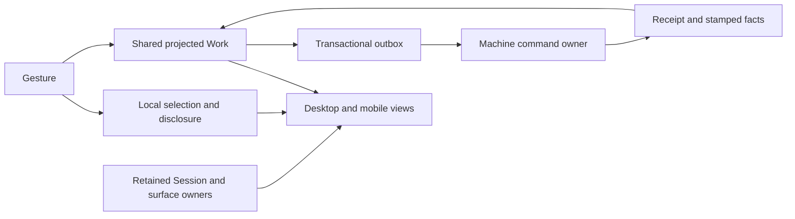

# LOO-906: immediate interactions across Desktop and mobile

Realigned 2026-11-14 after the receipt-cut checkpoint (`d4ecbd8a6b`), synced onto
origin/main `42b31bc791`; next step is implement. Supersedes the Desktop-only delivery
boundary. No shipping or merge decision is recorded. Placement remains this Task;
no Wave is selected.

## Direction

Build one shared client state and command-reconciliation architecture: every
surface renders local intent immediately, then reconciles against causally newer
Machine facts without inventing execution readiness.

Jack Heart, comment `b38d7ddf-eb30-4331-b9e9-bbf9244ab700`:
> “Let’s make sure this is an aggressive systematic rewrite that sets us up to avoid these kinds of issues across the whole system, not just these specific interactions I’m talking about, and mobile and desktop are being considered”

Jack Heart, comment `e008238d-ab6b-4cf2-b307-581d122d6d81`:
> “That could include having a whole second store or a list of pending changes that are applied as a diff to the known store, something like that”

Jack Heart, comment `30bf26ae-1815-4e74-920e-8c6ed1986d56`:
> “We should do at least as well as all of those systems”

Jack Heart, comment `d555fa61-e250-4e7d-9da8-cdbe51600a3a`, answering
`scratch/concept-review.html` question 1:
> “1b for the question (or show noting)”

This selects immediate next-Task navigation after completion, with an empty state
allowed when none remains. It supersedes the keep-conversation-open draft.

Jack Heart, comment `5d9cb5de-a753-4758-b6a5-d0cb96accc64`:
> “another thing that is too slow is the time it takes for a task to look highlighted (and the session to render) after i click it, evne if its cached / recetn”

Jack Heart, comment `33675e39-b299-4a18-9049-3750eca5a8b8`:
> “or for a wave to expand when i click on it”

Earlier direction, retained:
> “launching a new task should get to new session instantaneously”

Jack Heart:
> “this is meant for deskto”
> “it takes like >10 seconds and there are a lot of intermediate states”
> “another thing i will add is that completing a task should make it disappear immediately”
> “can we talk about what are the fundamental causes of so many intermediate states and non-immediate reactivity?”
> “is it about slow sql? insufficient reactive UI archtiecture?”

The reported LOO-904 screenshot described Reading workflow, Restoring workspace,
Not started/Start, and Conversation change unconfirmed. The screenshot was not
available here. No SQL or native latency distribution has been measured.

## What the current code establishes

Reactive rendering and synchronization are separate problems. Both clients already
use SwiftUI/Observation. Their command, cache and navigation owners disagree about
when an interaction has happened:

| Area | Current owners and sequencing | Replacement obligation |
|---|---|---|
| Desktop mutations | `WorkModel.performTaskAction`, `TaskRunDraft`, `confirmWorkUpdate`; Complete waits through command and observation | Immediate shared projection; acceptance survives refresh failure |
| Desktop removal | `abandoningTaskIDs` filters rows and separately advances selection | Same operation projection as Complete; navigation remains its own choice |
| Desktop creation | `StartingTask`, creation journal/recovery/presentation, exact Session attachment; branch reconciliation map | Shared operation destination and reconciliation, retain exact Session owner |
| Mobile creation | `MobileTaskDraft.submission/outcome/savedRequests` plus a separate `CreationSubmissions` journal; sheet owns/cancels async work, then opens a Task | One durable submitted-operation owner; draft stores editable text only |
| Read freshness | Desktop part sequence/floors and checkpoint waiters; mobile `RemoteTaskObservation` refresh/coalescing; saved Work and list files | One stamped read/reconciliation engine, platform-specific transport only |
| Task selection | Desktop `select` sets selection synchronously but continues through `openSelectedWorkspace`/warm conversation reconciliation; mobile pushes `NavigationLink` content and creates/closes a view-owned `SessionLink` | Small immediate navigation reducer; cached content/native occurrence retention independent of refresh |
| Wave navigation/disclosure | `WorkNavigator.waveRow` now selects synchronously; the delayed `pressedScope` path is deleted | Keep disclosure/route changes local before loading children |
| Shared commands | Typed `ServedWrite`/Rust `Write`; creations alone have durable request receipts | Stable operation IDs and outcomes for every UI command |
| Backend reads | SQLite domain revisions and pinned snapshots now reach revision-6 stamped subscriptions with exact query scope | Use shared causal reconciliation; do not compare unrelated checkpoints |

`task_complete` already saves a completion request, checks PR/execution conditions,
settles state, syncs planning and schedules retirement. Creation already performs
planning, primary Session preparation and Graph admission. These paths contain
potential waits; their durations do not establish which is slow. Server effects
continue after the connection drops, but ordinary request IDs are transport-local
and are not durable command identities.

## Established designs and dependency choices

Research checked on 2026-11-14:

- [Apollo optimistic mutations](https://www.apollographql.com/docs/react/performance/optimistic-ui)
  keep optimistic data separate from confirmed cache data and notify affected
  queries. Adopt operation layers and shared invalidation; rollback removes one
  operation, rather than restoring an entire old snapshot.
- [TanStack optimistic updates](https://tanstack.com/query/latest/docs/framework/react/guides/optimistic-updates)
  show both pending-variable projections and cache updates, cancel stale refetches,
  and invalidate after settling. Its [mutation guidance](https://tanstack.com/query/latest/docs/framework/react/guides/mutations)
  addresses persistent/offline mutations. Adopt stable identity, explicit retry
  policy and concurrency tests. Network uncertainty needs our domain receipts.
- [Apollo iOS](https://www.apollographql.com/docs/ios/caching/introduction)
  normalizes entities across query results and offers memory/SQLite caches.
  Direct adoption would require GraphQL schema/code generation and transport
  migration. That cost does not supply LF operation recovery or native ownership.
- [Apple Observation](https://developer.apple.com/documentation/observation.md)
  tracks observable model changes; [SwiftData](https://developer.apple.com/documentation/swiftdata/modelcontext)
  manages persistent models. Neither alone defines reconciliation with this Rust
  server. Replacing Observation would leave the synchronization problem intact.
- [Expo local-first guidance](https://docs.expo.dev/guides/local-first/)
  distinguishes local storage from synchronization and describes several sync
  systems. Those JavaScript/client-centric ecosystems are architectural references;
  replacing the native clients or Machine execution authority is a separate cost.
- [GRDB](https://github.com/groue/GRDB.swift) supplies SQLite transactions and
  database observation. [Sharing](https://github.com/pointfreeco/swift-sharing)
  shares observable persisted values; [TCA](https://github.com/pointfreeco/swift-composable-architecture)
  supplies reducers, effects and test stores. None removes the need for LF command
  semantics. A full TCA conversion adds navigation/effect migration; Sharing alone
  leaves our causal protocol. Proposed library choice: GRDB for transactional
  client persistence, existing Observation for UI, and a small shared typed
  reconciliation reducer. Verify supported toolchains and dependency build cost
  before adopting; no new dependency has been installed in this pass.

The comparison bar is behavioral: stable identity across surfaces, immediate shared
reads, overlapping-operation rebase, stale-response protection, operation-local
rollback, durable uncertain-outcome recovery and predictable navigation. The tests
below must demonstrate these properties; framework branding or a new placeholder
is not a substitute.

### Two storage architectures

| Candidate | Benefits | Costs and failure modes |
|---|---|---|
| Mutable client replica: local entities/queries become primary app state; bidirectional sync reconciles writes | All queries run locally; broad offline editing; strong normalization | Must reproduce derived Work status, membership and permissions or move their evaluator into a portable shared core; conflict policy for every field, replicated schema and execution-derived data; snapshot rollback can clobber overlapping writes |
| Confirmed cache plus ordered operation overlays, exposed through one client store | Keeps server derivation and domain execution; operation-local rollback/rebase; smaller recovery/migration cut | Requires complete query dependencies/membership rules and causal stamps; raw per-screen JSON patches would recreate the current fragmentation |

Next implement direction: the second, with a real shared client store containing
both cached facts and a transactional outbox. This is an architecture replacement,
not a window-local list of exceptions. It must normalize entity identity and
project every affected query, including Dashboard membership and counts. If the
membership cut cannot be made complete, the design must move the pure projection
core into shared portable code; silently leaving those surfaces stale is invalid.



## Proposed contracts

Shared implementation belongs in `swift/Loopflow`, used by both app targets.
One `ClientWorkStore` per connected Machine/account in each app process; all
Desktop windows share it. Windows and mobile routes own selection and drafts.
Devices share semantics, not an in-memory instance or credentials. A shared
`InteractionModel` implementation holds per-window/route selection, disclosure
and generation; purely local actions never enter the server outbox.

- `OperationID`: client UUID, durable across reconnect/restart. Separate from
  transport request IDs and Task/Session identities. New destinations initially
  refer to an operation; server receipts bind real entity IDs without fake DTOs.
- `PendingOperation`: immutable typed command, Machine, original scope, local
  sequence, resource lanes, dependencies, projection effect and delivery state.
  Saving, queued, sent/uncertain, accepted, committed and rejected describe real
  different facts; they are not separate screens. Execution/attachment readiness
  belongs to existing Session/Graph owners.
- `ReadingStamp`: Machine, store epoch, query/scope and schema identity, complete
  coverage, domain revision vector. Frames carry the stamp from the same pinned
  snapshot as their contents. External observations retain their own freshness;
  they cannot certify a SQLite commit. Epoch changes force reconciliation.
- `OperationReceipt`: ID, payload fingerprint, authoritative disposition/result,
  affected resources and commit fence. The domain writer records that fence and
  committed result in the transaction that changes displayed facts; reading the
  global counter after a slow command returns is insufficient. Multi-stage commands
  publish stage-specific commits, not a guessed final fence. A receipt may report
  accepted but still settling. Rejection is definitive only when its effect did not commit; partial
  external effects are retained as uncertain/recoverable, never called rolled back.
- `ProjectedWork`: confirmed records/query membership plus ordered local effects
  and pending/error annotations. It is presentation data, not a modified wire DTO.
  Disk stores the confirmed cache and outbox atomically; Keychain/credentials stay
  outside it and retained payloads keep existing device-protection policies.

Core API shape:

```swift
@MainActor func begin(_ command: WorkCommand, from origin: InteractionOrigin) -> OperationID
func receive(_ reading: StampedWorkReading)
func receive(_ receipt: OperationReceipt)
func projection(for query: WorkQuery) -> ProjectedWork
@MainActor func select(_ destination: WorkDestination) // local state, no I/O
@MainActor func setExpanded(_ wave: WaveID, _ expanded: Bool) // local disclosure
func recover(_ id: OperationID) async
```

`begin` publishes locally before its first await; persistence completes before
send. Save failure removes only that effect and retains editable words. The
outbox, receipt handling and projection update use one serialized reducer and one
transactional disk owner. Draft debounce remains independent. On restart, load
saved layers before displaying cached queries, then look up each sent operation on
its original Machine. Only definitely unsent or domain-authorized continuations
send; an unavailable lookup never means absence. Offline queueing is explicit and
limited to typed durable commands; controls requiring a live owner remain paused.

Generalize the current creation receipt owner rather than adding another server
ledger. Preserve all saved creation payloads, IDs and outcomes in one finished
additive migration. The physical table name may remain `creation_receipts` during
released-binary coexistence; there is one logical receipt store and no dual write.
Every UI command uses a typed operation envelope and durable lookup. CLI output
and domain execution remain their existing owners. Transport admission is a new
operation-envelope acknowledgment; it does not weaken the existing Task creation
receipt's Graph-admitted milestone. New envelope/stamp fields require a negotiated
protocol revision, shared DTO fixtures and coordinated app/helper deployment.

The server records admission before dispatch and returns its operation identity
without waiting for planning, Git or provider readiness. Reuse the existing
bounded effect execution; preserve jobs across client disconnection. A server
restart resumes only domain-proven continuations. A recorded dispatch whose effect
cannot be established becomes uncertain; there is no generic replay of arbitrary
writes. Creation's Continue/Inspect rules and completion's durable request become
domain recovery handlers under this one receipt owner. Operation observation
gets a change revision/notification; recovery is not a five-second UI poll.

## Ordering, reconciliation and query coverage

Project layers in local sequence order. Commands touching the same entity serialize
dispatch; multi-entity commands acquire a deterministic set of resource lanes.
Different resources can proceed concurrently. A dependent command waits for real
IDs; independent operations do not wait for a whole-repository refresh.

For Complete A followed by Reopen B: both intent changes appear immediately; A's
success or rejection removes/rebases only A, leaving B. Uncertain A blocks B's
conflicting dispatch until recovery establishes ordering. Once sent, commands are
immutable; Undo is a new command, not deletion of a possibly executed request.
Other devices' changes enter as newer authoritative facts and are rebased below
remaining local intent. Server revisions/preconditions resolve concurrent edits;
field conflicts retain drafts and show the current value.

A response cannot retire projection layers merely because it arrived last. For
each affected query, retain the effect until that query's complete stamped reading
dominates the receipt's commit fence. Unrelated parts, cached frames, query changes,
missing entities in partial pages and a fresh native surface cannot acknowledge it.
After all affected cached queries converge, drop the layer; retain failed or
uncertain durable requests until resolved. Closed queries are invalidated and
must reload beyond their fence before their cached base can be shown unoverlaid.

Keep the durable operation's lifetime separate from where its effect still
applies. Once a query incorporates a committed operation, stop applying that
operation to that query, even while another query remains behind its fence.
Retaining the operation for recovery must not subtract a completed Task twice
from a fresh count. Track incorporation per affected query; retire the durable
operation only after its remaining coverage obligations are discharged.

Normalized records also need provenance across queries. Accept confirmed database
facts only when the incoming stamp covers the domains those facts depend on and
does not regress their stored revisions within the same Machine/epoch/schema.
Generate those dependencies with the membership vocabulary; never order facts by
arrival, checkpoint ID or query hash. Merge independently stamped fact groups;
when freshness cannot be ordered, retain the known value as stale and request a
covering reading rather than choosing a winner. External observations keep their
own freshness. Missing membership in a complete filtered query removes that
membership, not the normalized entity or its retained workspace. A partial or
unavailable result establishes neither removal nor incorporation.

Changing epoch invalidates comparison with the old confirmed cache and fences.
Bind incoming frames to the active connection/store generation so a delayed old
frame cannot switch the cache back. Keep submitted operations, their original
identity and pending presentation while recovering receipts on the original
Machine. An old fence cannot acknowledge the replacement base, and epoch reset
is never permission to resend uncertain work.
Historical-backup restoration must establish a new epoch before serving cached
clients; the reset mechanism remains implementation work.

Normalize Task/Session/Wave identity across lists, detail pages, boards, searches
and counts. Cut `WorkViewPlan` membership over to a server-produced declarative
selection/group/sort plan over display facts, evaluated by the shared client
projection owner. Generate its vocabulary from Rust and enforce cross-language
fixtures; do not write a second ad hoc Task status resolver in Swift. An unloaded
page keeps explicit unknown membership plus a pending result, rather than a
fabricated row or count. Do not remove
an overlay merely because another client has changed a different domain revision.
Every `ServedWrite` and UI configuration mutation must declare affected entities,
queries and projection policy in an exhaustive registry: editable-value change,
membership change, or immediate pending execution with no predicted execution fact.

## Local navigation, disclosure and retained content

Publish selection/highlight and disclosure in a bounded synchronous reducer before
starting effects. Cached lookup uses stable identity indexes, not a scan/re-sort of
all Work or warm preparation before the next frame. Read/decode/cache persistence,
planning acquisition and child loading run outside that gesture path. Profile
main-actor body/layout work separately; Observation alone cannot make a blocked
main actor paint sooner.

Bind a destination immediately to its cached projection and retained workspace.
The existing Desktop `GhosttySurfacePool`/workspace registry remains the native
owner. On mobile, move `SessionLink`/terminal occurrence lifetime out of transient
`SessionView` into a bounded retained-workspace owner; preserve its buffer/viewport
on quick navigation, with memory-pressure eviction. Background policy and input
control stay explicit. Cached display never certifies a location or enables input;
unknown or changed ownership pauses input while validation proceeds. Reuse a live
validated native occurrence rather than reopening it on each route push.

A→B→A increments navigation generation at every gesture. Async readers can update
their resource's confirmed cache but cannot select, focus, expand a collapsed group
or replace a newer occurrence. Completion's next selection uses this same local
owner. Wave expand shows cached children immediately; if cold, only the expanded
section shows loading/error. Collapse is immediate and a late child answer only
warms the cache. Where mobile uses a picker instead of a tree, retain that interaction
rather than introducing a new tree solely for parity; any disclosure uses the same
local semantics.

## Representative timelines

**Launch, both platforms:** tap Start → same UI turn closes editor and selects the
operation's conversation destination, showing submitted words → persist exact
request → submit/admit → bind actual Task and Session IDs → attach that Session
in place → native readiness enables input. Task/list/Graph frames reconcile in
any order without replacing the destination with Task details, Start or restoration.
Leaving changes only navigation; the operation remains in the outbox. On restart,
recover its original Machine/ID. Edit is available before send failure; uncertain
send offers lookup; attachment failure offers Retry opening, never recreate.

**Complete, both platforms:** tap Complete → remove from working/available/busy
memberships and update affected counts immediately; details show pending completion
→ persist/send → accepted/committed result → fresh stamped reads replace the layer.
Definitive refusal restores membership from the latest base while retaining later
operations. Lost reply keeps pending confirmation and recovers the same ID; refresh
failure after commit never restores a working row. Completing the selected Task
moves immediately to the next visible Task in the current list order, or an empty
state when none remains. Completing an unselected Task leaves selection alone.
Navigation changes once, in the initial interaction; neither acknowledgment nor
failure recovery selects again. Mobile gains the same completion action and
semantics, replacing the selected route rather than stacking obsolete destinations.

**Cached/recent Task:** click A → highlight A and bind its last-known workspace in
that interaction → show retained native content without a new preparation/attachment
when usable → refresh in background → update facts without blanking content. Record
click-to-highlight, click-to-cached-content and click-to-input-ready independently.
Rapid A→B→A and late replies never revive B or rebuild A's retained surface.

**Wave disclosure:** click → arrow/expanded state changes in that interaction →
cached children display, or one local loading area appears → children populate
without a second navigation action. Collapse during loading remains collapsed.

**Other mutations:** claim/unassign/move/rename/reopen/abandon, Session bind/new/move,
Wave editing, settings, layout/file save and delivery/Graph actions all enter the
same owner. Value edits project values; membership edits project all known lists;
execution commands project accepted intent and progress only. File writes retain
base-revision conflicts. Provider/Graph/PR success and Machine transfer completion
are never predicted. Terminal bytes, replies and control takeover remain with
existing bounded input owners: no offline keystroke queue or automatic resend.

## Delete — do not maintain

- Removed: `WorkNavigator.waveRow`'s `pressedScope`/120 ms delayed selection.
  Production row actions now select synchronously. Remove view-owned
  mobile `SessionLink` teardown on ordinary Task switching; keep explicit Close,
  background policy and memory-pressure eviction under the retained owner.
- Desktop `createdTaskIDs` predecessor and this pass's request-specific
  `pendingTaskReconciliations`/checkpoint exception, `StartingTask` submission state,
  `TaskRunDraft.phase`, `abandoningTaskIDs`, mutation-specific refresh barriers and
  rename/bind replacement bookkeeping. Replace their consumers in the same cut.
- Mobile `MobileTaskOutcome`, submitted/outcome/savedRequests portions of
  `MobileTaskDraft`, sheet-owned mutation lifetime and result-owned Open Task gate.
  Keep unsent drafts, repository selection and device protection.
- `CreationSubmissions` as a creation-only parallel owner, `CreationRecovery`'s
  separate status poll and per-view retirement map. Generalize/migrate their exact
  saved requests and receipt semantics into the operation store, without loss.
- WorkCache/TaskFeed duplicate authoritative caches and Desktop/mobile duplicate
  freshness reconciliation. Keep UI-only workspace/layout/draft persistence where
  it represents retained local content, not server truth.
- Tests exclusively asserting old intermediate screens, local exception sets or
  second-submit recovery. Preserve success, duplicate prevention, failure,
  departure, ownership, layout and first-turn coverage on the shared path.

Reusable current branch work: immediate surface interaction, exact Session
attachment, original-request display, request UUIDs, recovery failure cases and
performance endpoints. Keep source edits; they are a checkpoint, not the final
architecture. Previous Desktop design and historical checks are recoverable at
`7030e08a:scratch/instant-task-session.md`.

## Forbidden outcomes

No per-screen exception sets, second mobile submission ledger, whole-snapshot
rollback, fake Task/Session DTOs or timer-based readiness. No SQL or network wait
before selection/disclosure, no retained surface replacement on a healthy revisit,
and no background completion that chooses navigation. A library or loading surface
alone does not complete the cut: query membership, overlap, uncertainty, migration
and both clients must use the same semantics.

## Delivery and acceptance

Indivisible cross-platform cut, with internal slices; no publish/merge authorization.
This scope exceeds the size-check signal because causal writes, both read paths
and their consumers must converge together.

1. **Architecture:** confirmed cache plus ordered overlays; validate query
   membership and persistence dependencies before cutting consumers over.
   Completion navigation is specified above.
2. Extend receipt/commit-stamp contracts and domain recovery; migrate saved data.
   Done: stamped subscription readings (revision 6). In progress: generalized
   admission/receipts and transactional stage fences in `client_operations.sql`;
   domain continuation and all-writer coverage remain.
3. Build shared transactional client store and projection reducer; cut both
   transports over, including query membership. Delete predecessor owners.
4. Move selection, disclosure, launch, completion and every mutation family through
   their shared interaction owners on both clients;
   retain native execution and input owners. Update product/API docs together.
5. Measure actual latency and remove demonstrated backend waits independently of
   presentation; run the full acceptance matrix and native demo.

Slices 3–4 have not started. Slice 5 now includes instrumentation and benchmark
coverage/preflight work before native demo. The Desktop launch checkpoint and synchronous Wave
selection are interim; slice 3 deletes the launch exception.

Headless acceptance uses deterministic held/reordered replies, not timing sleeps:
shared reducer tests cover overlapping success/failure, stale reads, partial pages,
query changes, epoch reset, reconnect and every save/send/crash boundary. Desktop
and iOS production-view tests prove immediate launch/removal before held network
responses. Selection/disclosure tests assert state before held reads; A→B→A,
expand→collapse and reordered loads preserve cached content and surface identity.
Two windows and two clients prove all projected surfaces agree. The
command registry has exhaustive policy coverage. Receipt fixtures include Rust,
Swift/macOS and iOS; upgrade tests preserve existing pending submissions.

Planned focused commands once those tests exist: `scripts/test_desktop.sh --filter
'ClientWorkStoreTests|WorkDestinationTests|NewTaskTests'`, `uv run python
scripts/test_ios.py -only-testing:LoopflowiOSTests/ClientWorkInteractionTests`, and
the new Rust operation-receipt/stamped-subscription module filters. Exact Rust
filters follow the named modules created by implementation. Gate owns wider suites
and documented commands; display diagnostics remain demo work.

## Latency and open review decisions

Trace gestures through event handling, observable state publication and the next
render commit; selection adds cached-content and input-ready endpoints, disclosure
adds arrow/children/data-ready endpoints. Separate retained hits, cold misses and
memory-pressure eviction. Trace one operation through gesture→local projection
→durable save→network admission
→domain commit→subscription apply→native readiness. Add separate backend spans for
SQLite lock wait/query, planning network, Git/worktree, Graph registration and
provider attach. Log IDs and durations, never authored text. Compare in-process
fixtures, Desktop local transport and mobile remote transport. Check changed SQL
with EXPLAIN on the 10,000-Task fixture; unrelated events must not reread every Task.

Proposed local-reaction target: P95 under 100 ms, at least 20 native launch and
completion, cached/recent selection and disclosure samples per applicable platform;
report highlight, cached content, input-ready and server-stage distributions
separately. Neither that target nor a SQL bottleneck has been measured here.

## Implement direction

Cache plus overlays is a headless engineering choice, not a recorded product
preference (see `questions.md`). Prove one membership vocabulary across Rust and
both clients before migration; check GRDB on both app toolchains before adopting
it. The transactional cache/outbox contract holds regardless of library.

Preserve the launch counterexamples in the shared tests: pre-admission cached
Task data, a fresh unrelated planning frame, unavailable or missing Task rows,
current no-Graph results, Graph removal after reconciliation, reconnect, departure
and return, and native readiness before a current Task result. Attachment failure
must remain visible beside receipt recovery, and Retry opening must reuse the
admitted Session without another create.

Desktop launch checkpoint as it stands: `createdTaskIDs` is gone.
`WorkNavigation.pendingTaskReconciliations` keys each admitted Task to its request
ID and the floor of a `.checkpoint(replay: ["task"])` sent after admission
(`WorkModel.submitTask`); reopening observation re-floors it. Only a matching
`.task` row at or beyond that floor clears it (`WorkModel.apply`); one-shot
transports clear it from `task show` (`reconcileCreatedTask`). After clearing,
the Task behaves ordinarily, including Graph loss. Focused tests cover
these counterexamples, as well as attachment failure with Inspect and Retry opening
reusing the Session. `docs/server.md` and `swift/README.md` describe this behavior.
This map is still a per-action exception. The shared store's operation fences
replace it; do not extend it to other actions.

Proposed usage text for the affected Desktop/mobile docs:
> Start opens your submitted request immediately. Leave and return while it
> prepares; Retry opening uses the same conversation. Complete removes the Task
> from the list and opens the next Task, or an empty view. A failed completion
> restores its row with an explanation without changing your later selection.
> Selecting a recent Task shows its retained content while refreshing. Expanding
> a Wave opens its children immediately; a cold section loads in place.

Keep this text marked proposed until each client uses the shared owner. Existing
creation-recovery instructions remain valid; no skill workflow change is needed.

Additional held-response counterexamples for the shared owner: a list at planning
revision 12 arrives before a detail response at revision 11 for the same Task;
the title must not regress. A refreshed count already includes Complete while
another affected list is held; apply the removal only to the lagging list. A Task
leaves a filtered list but remains open elsewhere; retain its entity/workspace.
After an epoch change, an old frame and a lost-write recovery reply arrive; neither
may restore the old base or trigger a second submission. These refine the existing
cache/overlay design and require no new product choice.

The launch checkpoint and its earlier 23-case result are recorded at
`9387f63e59ee91e8496e64b9304c73f152da589e:scratch/instant-task-session.md`.

## Current implementation cut

Stamped subscriptions (protocol revision 6) and synchronous Wave selection remain
intact. The single receipt owner moved from `store/sqlite/creation.rs` to
`operations.rs`; creation recovery is a projection of the same physical row.
`operation.submit` durably admits a typed command before its bounded worker runs;
`operation.get` reads/subscribes without dispatch. Duplicate admission retains
immutable content and dispatch state. A per-receipt revision orders held replies
within the active database epoch; second-resolution timestamps cannot. A sent command never takes the generic execution path again; a panic/restart leaves it for domain recovery.

Domain stages carry Machine/epoch/schema/revision fences and results inside the
writer's transaction. Current stages: Task filing, completion request/settlement,
reopen and Session input replacement. Command output stays separate, and a failed
command retains committed stages as uncertain. The Task's single migration is
extended in place, preserving creation IDs/fingerprints/results/launches. General
commands reuse the canonical result column, and uncertain failures retain a
creation's partial domain result; no parallel result column or ledger exists.
Historical rows get no invented fences. Receipt-only revisions wake receipt subscriptions
without invalidating Work; native and `--operation --subscribe` CLI consumers use
one receipt read owner, with revision interest outside the transport. New Rust tests specify transaction rollback, duplicate/restart,
held creation admission/disconnect, per-operation completion/reopen results,
10k-Task point-query plans and migration preservation. These Rust behavior tests still need execution; production library compilation and the Swift contract checks are separate results.

Admission counterexample found in review: `engine::operation::admit` calls
`require_repo_root` for Task creation, which runs `git rev-parse`, before the SQL
admission. This preserves existing canonical creation fingerprints but fails the
proposed no-Git-before-admission contract. The safe interim keeps identity checks;
removing this wait needs a single submitted-command identity with deferred domain
normalization and a lossless path for legacy fingerprints. A raw-directory hash
must not silently replace the existing canonical identity. Dependent client
cutover is not complete against this contract. No SQL-duration diagnosis follows
from this code-established wait; the admission span currently includes it.


### Revised admission identity contract (proposed)

Admission means the submitted envelope is saved, not that repository identity,
legacy compatibility or execution has been established. No repository discovery,
Git, planning, creation lock or provider call precedes the acknowledgment. Local
schema/ID checks and the receipt transaction remain necessary. Domain validation
and its wait are visible through receipt observation in the same destination;
there is no new screen or second submission.

Keep two meanings separate in the single receipt owner:

- **Submitted content:** a versioned deterministic encoding of the typed command,
  preserving authored values and path spelling. It excludes transport IDs and
  incidental JSON key order. Persist both content and its digest; a digest alone
  cannot recover the command. New operations bind this content at admission.
  Same ID/content returns the existing receipt without changing dispatch state;
  changed content is a conflict. Retrying uses the saved envelope, not rebuilt
  fields from a current form or a newly resolved directory.
- **Creation identity:** the existing canonical domain fingerprint, computed by
  the worker using the released normalization rules. Preserve it independently;
  never put a raw-envelope digest into the legacy fingerprint field. New creation
  rows need an explicitly unresolved domain identity until the worker establishes
  it. Direct CLI creation and served envelopes must use the same atomic domain
  claim, so a CLI attempt racing normalization cannot create a second Task.

Released creation rows have canonical identity but no submitted envelope. Preserve
all their IDs, results, launch data, milestones and recovery dispositions. For
first envelope adoption, durably reserve one candidate in that same row before
acknowledgment; this is pending validation, not a replacement command or permission
to execute. Existing creation lookup remains usable while validation is held.
The worker resolves its directory, compares the legacy fingerprint and atomically
binds the **first verified** envelope. A symlink/subdirectory spelling that resolves
to the old canonical payload can adopt it. A mismatch reports a candidate content
conflict and releases only that reservation; it must not reject, overwrite or
strand the previously successful creation. Unavailable normalization retains the
candidate for recovery, without classifying it as a mismatch. Concurrent identical
candidates share validation; a different candidate conflicts while reserved.
Candidate finalization/release must compare its saved identity so a held worker
cannot overwrite a newer reservation. After successful adoption, submitted content
is immutable; subsequent envelope retries use that saved spelling. Legacy CLI
recovery continues to compare canonical identity, including equivalent paths.

Keep candidate validation and command dispatch distinct. Validation can repeat
after restart because it has no domain effect. A new operation dispatches only
after validation and an atomic claim. An adopted released row always consults its
existing domain recovery disposition: Complete returns its saved result, Continue
uses only the domain-proven continuation, Inspect remains inspectable. It never
becomes generically queued. A crash after claim remains uncertain until domain
recovery proves what happened. No invented commit fence certifies historical
results; obtain current covering facts without replaying the creation.

Extend the one draft migration in place. Represent submitted and canonical identity
explicitly, including their absence; do not infer identity mode from a hash or
reuse `queued` to mean adoption of a completed creation. Expose admission versus
validation outcome in Rust/Swift fixtures and protocol docs before client cutover.
Keep the existing Graph-admitted creation milestone distinct from envelope receipt.

Required counterexamples before dependent work:

1. Hold Git before repository discovery completes: admission and receipt lookup
   return, disconnect does not cancel the saved submission, no effect dispatches.
2. Upgrade released complete/Continue/Inspect rows, adopt equivalent root,
   subdirectory and symlink spellings, and retain the original Session/result.
3. Wrong candidate then correct candidate: the old receipt is unchanged and the
   valid retry is possible; hold the wrong reply across reservation replacement.
4. Restart before/after validation, race direct CLI creation with an envelope,
   and duplicate submission after dispatch: at most one domain effect, saved
   identity survives, no uncertain command is replayed.
5. Reorder receipt validation replies: only the active epoch and newer receipt
   revision update the client; admission never enables input or retires overlays.

These are engineering consequences of immediate admission and lossless recovery,
not a new product choice. Order of remaining work: admission identity, domain
recovery and all-writer fences, transactional cache/outbox, query membership,
both-client migration with the launch exception deleted. The launch regression
cases above remain mandatory.

The new Swift mirror and exact-query fence comparison are shared with iOS; live
clients still use their existing creation/mutation owners. No client projection
cutover is claimed. Remaining: domain recovery continuations, definite-refusal
classification and terminal fences
for every mutation family (including remote/detached and external file/config
confirmation). Dispatched errors currently remain uncertain. SQLite fences cannot
certify filesystem/provider effects. Also remaining: transactional
confirmed cache/outbox and normalized query membership; both clients' interaction
and retained-occurrence migration; deletion of launch checkpoint exceptions and
other predecessors; epoch reset on historical restoration; full held/reordered/
crash and native acceptance. `complete` in a read stamp still means transport
coverage of that query, not complete external membership or native readiness.

Previous 50-Desktop/15-Rust/one-iOS read-contract checks are recoverable at
`950b83a138e2c3894f58ad260cad4bfd9d3fe839:scratch/instant-task-session.md`.
They do not cover the new receipt cut.

## Upstream since the last pass (origin/main `42b31bc791`)

- #1943 (LOO-905) added a third Desktop freshness owner: `WorkModel.taskPresentation`
  / `TaskPresentation` prefers current names over retained ones per source and keeps
  planning rows until the Task list answers. The shared normalized store absorbs it;
  its cases (fresh roadmap before list, empty list answer, failed refresh keeps
  names, one combined read-failure notice with Retry) join the shared tests.
- #1942 (LOO-910) forwards terminal visibility to Ghostty, so hidden retained
  surfaces pause rendering. A healthy revisit must unhide the retained surface,
  not reattach it; click-to-cached-content timing includes that resume.
- #1945 bounds the Desktop New session recovery test per attempt (3 s). Test-only.

## Benchmark implementation and observations (2026-11-14)

Exact feedback and host preferences are in `desktop-reactivity-feedback.md`.
The existing performance harness README now maps ADEMark A1–A12/B1–B4/C1–C6 and
LF workflow journeys to endpoints, fixtures, platforms, coverage and remaining
work. Sources read: https://ademark.dev/ and https://github.com/zqkra/ademark,
source HEAD `119a5f7b99247cffbe7f96bb2c36c03496cf3018`, retrieved 2026-11-14.
The site's C2–C6 reliability methods are written but not run; no borrowed result
is a Loopflow measurement. Web-reader access failed; a direct HTTP fetch succeeded.

`desktop_performance.py preflight` retains host CPU/load and rejects contamination
without stopping other work. Quiet-host native probes inspect display/capture/input
access without prompting. These probes do not yet establish thermal/swap or
whole-trial load. Shared `PerfClock.interaction` marks distinguish Desktop
selection publication/completion return and phone tap/workspace mount from pixels.
Rust CLI volume adds aggregate SQLite profile time without SQL text/values;
mutex/planning/provider attribution remains incomplete. The existing headless
projection measurement now includes 10,000 Tasks/Sessions, preserves each sample
with an atomic checkpoint outside the interval and refuses to overwrite an old
result. The rebuilt diagnostic ran; the quiet-host baseline remains missing. Native display/input benchmarks remain unmeasured.

Owned observations, preserved here because a fresh run cannot reproduce them:

- Current Mac, macOS 26.0.1, 16 logical CPUs, 2026-11-15 04:56:49 UTC:
  aggregate process CPU 634.6%; load 217.00/222.38/182.45. Rejected.
  Raw `/tmp/loo-906-host-20261114-current/preflight.json`.
- `mini-heart`, macOS 15.5, 8 logical CPUs, 04:59:16 UTC: CPU 336.3%;
  load 4.49/4.61/5.44. Rejected; three Python processes each used about a core.
  Desktop also requires macOS 26, so this mini cannot run the present app target.
  Console account was signed in; capture/input capability was not probed after
  load rejection. Raw `/tmp/loo-906-host-20261114-mini/preflight.json` on mini;
  local copy `/tmp/loo-906-host-20261114-mini.json`.
- Existing debug test binary SHA256
  `e0d99f8a4993a7cc19d923e2ece97fbe25c1e093c76bc9c4548649ca70df9b2a`:
  WorkProjection constructor only, 21 observations/population at 21:10 local.
  256 Tasks/Sessions: first 10.65 ms, warm n=20 median 32.57 ms/P95 63.70 ms.
  2,048: first 340.15 ms, warm n=20 median 287.11 ms/P95 523.89 ms.
  Raw and report `/tmp/loo-906-projection-existing-build-20261114/`.
  Invalid for regression comparison: host rejected, build source provenance was
  not recorded. No gesture, native paint, input or server endpoint was measured.
  These distributions do not establish a SQL bottleneck or the >10-second cause.

- Rebuilt current debug test binary SHA256
  `6547da6b33e05fb2914a44e6d54161ea8775360882ae9e5ba11de64664e2254d`,
  Swift/fixture/harness source digest
  `1b938dface06ba3093c792f27f87762e4e87d4a257b2ff31d60f3374befaaf45`
  unchanged before/after. At 22:12 local, constructor-only first / warm n=20
  median / P95: 256 Tasks/Sessions 4.10 / 3.72 / 4.57 ms; 2,048
  31.00 / 29.46 / 31.77 ms; 10,000 144.71 / 142.08 / 235.92 ms
  (maximum 296.58 ms). Raw samples, metadata and log:
  `/tmp/loo-906-projection-current-20261114/`. Preflight at 06:12:26 UTC
  measured CPU 1018.4%, rejected; raw
  `/tmp/loo-906-host-20261114-current-rebuilt/preflight.json`.
  Invalid as a regression baseline; no comparison against the earlier binary.
  This still measures neither native paint/input nor SQL/planning/provider time.
- The first projection invocation skipped because the network runner cleared its
  `LF_*` output variable. The corrected invocation places `env` inside that
  boundary; the convention is now in AGENTS.md and the harness docs.
- `measureWriteToVisible` still names removed `pm_items.body` in its old native
  fixture. That journey needs migration to current authoritative planning facts;
  it is not live coverage of the new store.

Checks:

- `uv run python scripts/check_migrations.py`: passed; one draft migration.
- `uv run pytest python/tests/test_desktop_performance.py -q -k 'host_load or preflight or sql_profile_time or native_runner or sandbox_paths_do_not_change'`: 5 passed; `ruff check` passed.
- `uv run python scripts/check_swift_multiplatform_boundaries.py`: passed.
- `cargo check -p loopflow --lib --jobs 2`: passed after the final shared receipt-stream change (1m31s); `cargo fmt --all` passed. The filtered Rust test build and subsequent test-target compile check were stopped after >15 and 24 minutes under host load, with no test result; gate owns `store::sqlite::operations::tests::`, the held service fixture and schema equality.
- `swift build --package-path swift --build-tests --jobs 2`: passed. `scripts/test_desktop.sh --skip-build --no-parallel --filter 'ServerProtocolTests|CreationSubmissionTests|WorkModelStreamTests.launchReconciliation|WorkDestinationTests.newTask|WorkDestinationTests.lateCreationReply|WorkDestinationTests.failedAutomatic|WorkNavigationTests.waveClickSelectsBeforeReturningFromTheGesture'`: 43 passed. `uv run python scripts/test_ios.py -only-testing:LoopflowiOSTests/ReadingStampTests`: 2 passed; app/test targets built and the disposable Simulator was removed.
- `uv run python /tmp/loo-906-receipt-sql-smoke.py`: passed against the finished migration and actual finish SQL, including recursive triggers, revision rollback and retention of a failed creation's canonical result.
- `uv run python scripts/check_architecture.py`: passed, 89/89 SQLite owners.

New receipt schema definitions were derived from their canonical Rust declarations
with the cached schemars library. Full `server::schema::tests::` equality against
the complete server generator still needs the Rust test build.

Gate owns wider store/transport/lifecycle, DTO integration, documented-command,
packaging and clippy checks. Implementation still owns a valid benchmark baseline
and near-term measurements; demo owns native usability judgment, not all timing.
