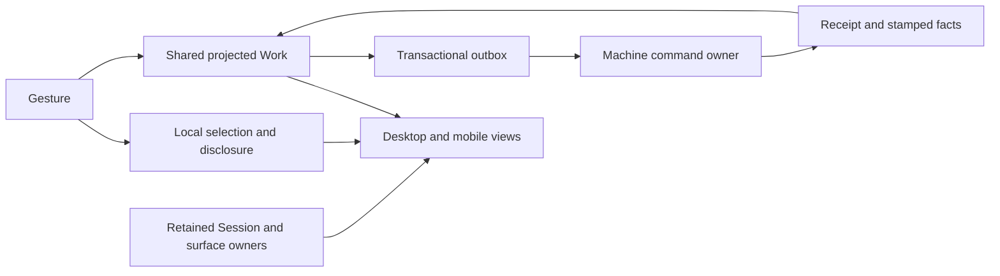

# LOO-906: immediate interactions across Desktop and mobile

Conversation/Machine-link cut committed at `a2a0a0fb33` on origin/main
`9cafc410ee`. Unreachable-Machine presentation and Desktop Session rename are
committed at `35e2835de1`. The next implementation needs the external-observation provenance correction
below before replacing query-local effect incorporation with field incorporation
and derived-query coverage, then migrating Move. Supersedes the
Desktop-only delivery boundary. No shipping or merge decision is recorded. Placement remains this Task;
no Wave is selected.

## Direction

Build one shared client state and command-reconciliation architecture: every
surface renders local intent immediately, then reconciles against causally newer
Machine facts without inventing execution readiness.

Jack Heart, comment `b38d7ddf-eb30-4331-b9e9-bbf9244ab700`:
> “Let’s make sure this is an aggressive systematic rewrite that sets us up to avoid these kinds of issues across the whole system, not just these specific interactions I’m talking about, and mobile and desktop are being considered”

Jack Heart, comment `e008238d-ab6b-4cf2-b307-581d122d6d81`:
> “That could include having a whole second store or a list of pending changes that are applied as a diff to the known store, something like that”

Jack Heart, comment `30bf26ae-1815-4e74-920e-8c6ed1986d56`:
> “We should do at least as well as all of those systems”

Jack Heart, comment `d555fa61-e250-4e7d-9da8-cdbe51600a3a`, answering
`scratch/concept-review.html` question 1:
> “1b for the question (or show noting)”

This selects immediate next-Task navigation after completion, with an empty state
allowed when none remains. It supersedes the keep-conversation-open draft.

Jack Heart, comment `5d9cb5de-a753-4758-b6a5-d0cb96accc64`:
> “another thing that is too slow is the time it takes for a task to look highlighted (and the session to render) after i click it, evne if its cached / recetn”

Jack Heart, comment `33675e39-b299-4a18-9049-3750eca5a8b8`:
> “or for a wave to expand when i click on it”

Earlier direction, retained:
> “launching a new task should get to new session instantaneously”

Jack Heart:
> “this is meant for deskto”
> “it takes like >10 seconds and there are a lot of intermediate states”
> “another thing i will add is that completing a task should make it disappear immediately”
> “can we talk about what are the fundamental causes of so many intermediate states and non-immediate reactivity?”
> “is it about slow sql? insufficient reactive UI archtiecture?”

The LOO-904 screenshot (not available here) was described as Reading workflow,
Restoring workspace, Not started/Start, and Conversation change unconfirmed.

## What the current code establishes

Start and Complete now use shared SwiftUI/Observation interaction and outbox
owners on both clients. Other mutations still disagree about when an interaction
happened. Desktop `TaskRunDraft`, plus mobile view-owned
`SessionLink`, remain replacement targets (see the delete list). Revision-6 subscriptions now provide exact-query snapshot stamps;
server operation admission covers all typed writes, while live client outbox
migration still specializes creation. Native Session/Graph owners retain readiness.
Predecessor map: `bb936ac371`; earlier Desktop design: `7030e08a`.

Completion already saves a domain request, checks execution/PR conditions, settles
state, syncs planning and schedules retirement. Creation already prepares its
primary Session and Graph. Those waits are not a measured SQL/latency diagnosis.

## Established designs and dependency choices

Research and replica comparisons: `8b42a874db`, `bb936ac371`. Apollo/TanStack
give operation-layer precedents, not LF domain recovery; SwiftData, Sharing and
TCA don't give causal sync; a mutable replica would duplicate server-derived
membership. Direction: confirmed cache plus ordered operation overlays, one
normalized owner, Observation for rendering. The outbox uses system SQLite3 on
both targets (GRDB not adopted); the confirmed cache belongs in that database.

The cache/overlay owner must project every affected query, including Dashboard
membership and counts. If declarative membership cannot cover them, move the pure
projection into a shared portable core before client migration.

## State, ordering and reconciliation contracts

Detailed contracts and counterexamples before the presentation cut remain at
`737b50adba26689bb27e67839d9ab9b90564bf50:scratch/instant-task-session.md`
under Proposed contracts through Opening another query. Live requirements:

- Shared Swift owns each Machine's confirmed cache, ordered immutable commands,
  receipt recovery and projected membership. Hosts own selection, drafts and
  native readiness. Windows share an owner; devices share semantics. Save before
  send; publish intent before disk or discovery. Never fabricate entity DTOs.
- Keep IDs, original Machine/scope, sequence, resource lanes and dependencies.
  Conflicting commands serialize; independent resources proceed concurrently.
  Dependent commands await actual IDs. Unknown delivery blocks conflicting sends
  until domain recovery establishes ordering. Undo after send is another command.
- Persist cache, effects and outbox in one SQLite transaction owner. Released
  files retain exact IDs, words, outcomes and unknown send history through import.
  Recover sent work by original ID on its original Machine. Missing/unavailable
  lookup or a replaced epoch never authorizes replay. Admission precedes Git,
  planning, provider and domain waits; worker recovery requires domain permission.
- Stamped readings cover the same pinned snapshot as their bodies: Machine,
  epoch, schema, query identity/completeness and domain revisions. Reject departed
  epochs and older revisions; checkpoint IDs and arrival order establish nothing.
  Historical restoration still needs an epoch-reset mechanism.
- Each semantic stage records its result and fence in the domain transaction.
  `task.completion_requested` confirms intent; only `task.completed` confirms
  removal. `task.filed` binds Task/Session without proving admission or input.
  Provider/filesystem/planning readiness cannot borrow a SQLite fence.
- In the current query-local implementation, apply an ordered effect independently
  until its complete reading covers the confirming stage's fence. The next cut
  replaces that criterion with the field/answer distinction below. A covering count cannot discharge
  a held list; a fresh query cannot subtract twice while another remains behind.
  Partial pages, unrelated domains, native mounts and command return don't
  establish incorporation. Query identity/plan changes invalidate prior coverage.
- Three independent obligations retain a command: domain recovery, remaining
  query coverage and an unseen creation result. Mount or Inspect acknowledges
  presentation only. Retirement transfers lagging effects into bounded retained
  bases, or invalidates closed bases under persisted scoped floors. Reopen, another
  window or another filter must reconcile pending effects before its first cached
  frame. Later queries require a covering base even after command retirement.
- Definite refusal removes only effects proved uncommitted. Partial success keeps
  committed facts and inspection for unresolved stages. Supersession belongs in
  existing typed stage resolutions, identifying the withdrawn request and its
  replacement fence. A covering replacement reading restores membership without
  navigation; a late settler cannot complete a withdrawn request. Never borrow a
  newer completion's outcome. No generic error or missing stage proves rollback.
- Normalize display facts with domain provenance across queries. Unknown or
  incomparable freshness remains labeled/stale rather than replacing known facts.
  Complete filtered absence removes membership, never entity/native lifetime.
  Declarative membership supplies scopes, paths, ordering, counts and dependencies;
  use a portable core if client projection cannot express all queries.
- Every mutation declares effect stages, dependencies and recovery policy in an
  exhaustive registry. Value changes project values; membership changes project
  every known list; execution projects intent only. Retain file-base conflicts,
  existing control ownership and no offline terminal-byte queue.

Acceptance retains held settlement, definite refusal, commit followed by failed
planning/output, reordered list/count and restart, supersession in either race
order, withdrawing old then completing new, unseen/seen creation with lagging
queries, Inspect without a Work reading, epoch replacement, new queries/windows
and changed filters after Complete, closed-query restart and eventual retirement.
Each checks one effect per query, unchanged later navigation, no replay or permanent
lane blockage. Missing correlation stays inspectable. Both clients use the same
reducer; two-client closed-query convergence remains open.

## Local navigation, disclosure and retained content

Publish selection/highlight and disclosure in a bounded synchronous reducer before
starting effects. Cached lookup uses stable identity indexes, not a scan/re-sort of
all Work or warm preparation before the next frame. Read/decode/cache persistence,
planning acquisition and child loading run outside that gesture path. Profile
main-actor body/layout work separately; Observation alone cannot make a blocked
main actor paint sooner.

Bind a destination immediately to its cached projection and retained workspace.
The existing Desktop `GhosttySurfacePool`/workspace registry remains the native
owner. On mobile, move `SessionLink`/terminal occurrence lifetime out of transient
`SessionView` into a bounded retained-workspace owner; preserve its buffer/viewport
on quick navigation, with memory-pressure eviction. Background policy and input
control stay explicit. Cached display never certifies a location or enables input;
unknown or changed ownership pauses input while validation proceeds. Reuse a live
validated native occurrence rather than reopening it on each route push.

A→B→A increments navigation generation at every gesture. Async readers can update
their resource's confirmed cache but cannot select, focus, expand a collapsed group
or replace a newer occurrence. Completion's next selection uses this same local
owner. Wave expand shows cached children immediately; if cold, only the expanded
section shows loading/error. Collapse is immediate and a late child answer only
warms the cache. Where mobile uses a picker instead of a tree, retain that interaction
rather than introducing a new tree solely for parity; any disclosure uses the same
local semantics.

## Representative timelines

**Launch, both platforms:** tap Start → same UI turn closes editor and selects the
operation's conversation destination, showing submitted words → persist exact
request → submit/admit → bind actual Task and Session IDs → attach that Session
in place → native readiness enables input. Task/list/Graph frames reconcile in
any order without replacing the destination with Task details, Start or restoration.
Leaving changes only navigation; the operation remains in the outbox. On restart,
recover its original Machine/ID. Edit is available before send failure; uncertain
send offers lookup; attachment failure offers Retry opening, never recreate.

**Complete, both platforms:** tap Complete → remove from working/available/busy
memberships and update affected counts immediately; details show pending completion
→ persist/send → accepted/committed result → fresh stamped reads replace the layer.
Definitive refusal restores membership from the latest base while retaining later
operations. Lost reply keeps pending confirmation and recovers the same ID; refresh
failure after commit never restores a working row. Completing the selected Task
moves immediately to the next visible Task in the current list order, or an empty
state when none remains. Completing an unselected Task leaves selection alone.
Navigation changes once, in the initial interaction; neither acknowledgment nor
failure recovery selects again. Mobile gains the same completion action and
semantics, replacing the selected route rather than stacking obsolete destinations.

**Cached/recent Task:** click A → highlight A and bind its last-known workspace in
that interaction → show retained native content without a new preparation/attachment
when usable → refresh in background → update facts without blanking content. Record
click-to-highlight, click-to-cached-content and click-to-input-ready independently.
Rapid A→B→A and late replies never revive B or rebuild A's retained surface.

**Wave disclosure:** click → arrow/expanded state changes in that interaction →
cached children display, or one local loading area appears → children populate
without a second navigation action. Collapse during loading remains collapsed.

**Other mutations:** claim/unassign/move/rename/reopen/abandon, Session bind/new/move,
Wave editing, settings, layout/file save and delivery/Graph actions all enter the
same owner. Value edits project values; membership edits project all known lists;
execution commands project accepted intent and progress only. File writes retain
base-revision conflicts. Provider/Graph/PR success and Machine transfer completion
are never predicted. Terminal bytes, replies and control takeover remain with
existing bounded input owners: no offline keystroke queue or automatic resend.

## Delete — do not maintain

Already removed: the list at `908e317e4f:scratch/instant-task-session.md`, plus
creation in `CreationRecovery`, its Task presentation map, host request filters
and the phone query-before-opening path. The pending-command cut also removes
`CreationOperation`, `WorkInteraction.Failure`, the failure collections,
`WorkModel.completionFailures`, Retry Complete rows, creation-owned reopening,
retired-source release APIs/index and the rest of `CreationRecovery`. `LegacyTaskDraft` reads released files
only; SQLite commits precede rewrites.

Still remove, with their consumers:

- Desktop `TaskRunDraft.phase`, other mutation refresh barriers
  (`performTaskAction`) and bind replacement bookkeeping (`replaceSession`,
  `supersedeSessions`).
- Query-local `WorkQueryEffect.covered`, `ClientWorkDatabase.effectsCover`,
  `ClientWorkQuery.makeProjection`'s state-only reducer, and dynamic prefiltering
  in Rust `Selection::compile_membership` / `compile_filter`, in one replacement
  cut. Keep explicit Work leaves, stable authored occurrence paths, descendant
  scopes, interleaved order, intersections, hidden/suppressed occurrences and
  unknown/partial reads covered on the surviving program. Existing tests of these
  behaviors remain requirements; only assertions exclusive to stamp-only
  incorporation disappear.
- View-owned mobile `SessionLink` teardown on ordinary Task switching; keep
  explicit Close, background policy and memory-pressure eviction.
- WorkCache/TaskFeed duplicate authoritative caches and duplicate freshness
  reconciliation. Keep UI-only workspace/layout/draft persistence.
- Tests exclusively asserting old intermediate screens, local exception sets or
  second-submit recovery; keep success, duplicate prevention, failure, departure,
  ownership, layout and first-turn coverage on the shared path.

## Forbidden outcomes

No per-screen exception sets, second mobile submission ledger, whole-snapshot
rollback, fake Task/Session DTOs or timer-based readiness. No SQL or network wait
before selection/disclosure, no retained surface replacement on a healthy revisit,
and no background completion that chooses navigation. A library or loading surface
alone does not complete the cut: query membership, overlap, uncertainty, migration
and both clients must use the same semantics.

## Delivery and acceptance

Indivisible cross-platform cut, with internal slices; no publish/merge authorization.
This scope exceeds the size-check signal because causal writes, both read paths
and their consumers must converge together.

1. **Architecture:** confirmed cache plus ordered overlays; validate query
   membership and persistence dependencies before cutting consumers over.
   Completion navigation is specified above.
2. Extend receipt/commit-stamp contracts and domain recovery; migrate saved data.
   Done: stamped subscription readings (revision 6), Git-free
   `operation.submit` admission, submitted/canonical identity, legacy envelope
   adoption, saved-command dispatch and both creation clients' outbox admission.
   Remaining: domain continuation and all-writer stage fences.
3. Build shared transactional client store and projection reducer; cut both
   transports over, including query membership. Delete predecessor owners.
4. Move selection, disclosure, launch, completion and every mutation family through
   their shared interaction owners on both clients;
   retain native execution and input owners. Update product/API docs together.
5. Measure actual latency and remove demonstrated backend waits independently of
   presentation; run the full acceptance matrix and native demo.

Slice status is under Current implementation cut; Complete starts slice 4.

Headless acceptance uses deterministic held/reordered replies, not timing sleeps:
shared reducer tests cover overlapping success/failure, stale reads, partial pages,
query changes, epoch reset, reconnect and every save/send/crash boundary. Desktop
and iOS production-view tests prove immediate launch/removal before held network
responses. Selection/disclosure tests assert state before held reads; A→B→A,
expand→collapse and reordered loads preserve cached content and surface identity.
Two windows and two clients prove all projected surfaces agree. The
command registry has exhaustive policy coverage. Receipt fixtures include Rust,
Swift/macOS and iOS; upgrade tests preserve existing pending submissions.

Focused commands: `ClientWorkStoreTests|OperationRecoveryPresentationTests` on
Desktop, `LoopflowiOSTests/ClientWorkStoreTests` on iOS, plus Rust operation
module filters. Gate owns wider suites; display diagnostics remain demo work.

## Latency and open review decisions

Trace gesture → state publication → render commit; selection adds cached-content
and input-ready endpoints, disclosure adds arrow/children/data-ready. Separate
retained hits, cold misses and eviction. Trace one operation through local
projection → save → admission → domain commit → subscription apply → native
readiness, with backend spans for SQLite lock/query, planning network, Git,
Graph registration and provider attach. Log IDs and durations, never authored
text. Compare in-process, Desktop local and mobile remote transports. EXPLAIN
changed SQL on the 10,000-Task fixture.

Proposed target: local reaction P95 under 100 ms, at least 20 native samples per
journey/platform, endpoints reported separately. Nothing here is measured yet.

## Implementation direction (2026-11-15)

### Synchronous intent and effect contracts

The detailed handoff, effect-stage and reordered-reading requirements remain in
`cfebc7f89a6c8c5301518a067f9cc3a2e977ee5a:scratch/instant-task-session.md`
(Implementation direction). Keep these acceptance requirements through subsequent
cuts: Complete publishes before Machine discovery or disk; save/receipt recovery
never navigates; settlement, supersession and per-query incorporation remain
independent. A held list retains its removal after a covering count and command
retirement, including restart, composed occurrences and unrelated domain writes.
Required domain correlation stays inspectable when unavailable. A newer Work
reading cannot replace an earlier command's original outcome. Attachment owns
input readiness and Retry opening for the same Session.

### Query destinations and leases

Built at `6e944e73b5a`; detailed checks and contracts remain in that commit's
`scratch/instant-task-session.md`. Current lease/cache behavior is summarized
under Current implementation cut. Two-client convergence on a closed query
remains unexercised.

### Prior conversation and pending-command cuts

Built: operation-owned Start destinations (`5ccc4563bd`), same submitted
conversation on both hosts (`72bb1d06d4`), shared pending-command presentation
(`e010cda519`). Details and retained acceptance:
`f2438fb1b49:scratch/instant-task-session.md` under the original headings. Current
contracts are summarized under Current implementation cut; unresolved product
choices remain below and in `questions.md`.

### Healthy changes and reconnect cut

Built at `c9b86d24f5`: one pending-command vocabulary and row on both hosts,
origin-only next selection for Complete/Abandon, durable abandonment decisions,
and receipt recovery on the original ID after reconnect or lost send. Detailed
acceptance and deleted predecessors:
`f2438fb1b49:scratch/instant-task-session.md` under this heading. Claim still has
only a label/stage; its writer and projection are unmigrated.

### Conversation and Machine-link cut · `a2a0a0fb33`

The shared row has list and conversation contexts, renders the request title only
in lists, and reads creation's progress words from the declaration. Both creation
conversations keep submitted words once beside **Starting conversation…**. Phone
Abandon uses Desktop's confirmation title, destructive action and explanation.

`MachineConnection` owns the control link, waiting fact, concurrent waiters and
one reconnect backoff for each Machine endpoint. Both hosts use it; receipt watches
no longer own backoff, and Desktop's `ServerLinks` and the phone's `opening` cache
are deleted. Canceling one watch releases only its connection wait; the last waiter
cancels opening. Receipt recovery still decides admission by the original ID after
the new stamped reading. The phone feed retains its subscription through failed
first opens and connection loss; a pending refresh checkpoint survives reconnect.
Protocol/identity failures terminate with attention rather than waiting.

Earlier check details: `f2438fb1b49:scratch/instant-task-session.md` under this heading.

### Unreachable-Machine and Session-name cuts · 2026-11-15

Committed at `35e2835de1`. Previous review findings and deleted
predecessors: `85564c1f20:scratch/instant-task-session.md`.

- The phone feed shows its Machine's waiting fact once above cold or saved
  Tasks. Waiting suppresses its cold spinner and empty-result overlay. Refresh
  returns immediately while waiting; a refresh already underway also ends on
  connection loss. Reconnect supplies a fresh reading. Refused/protocol/identity
  errors retain the error card and Try again.
- `ClientWorkStore` subscribes once to its endpoint's `MachineConnection`, reads
  waiting once per presentation and applies it to all that Machine's saved
  changes, even without live receipt watches. `ServerWatch.connections` and
  `isWaiting`, the watch map and per-watch forwarding tasks are deleted. Lists
  show one Machine line and held request titles; conversation rows retain the
  words. Attention and unsaved failures outrank waiting. Desktop Complete and
  Abandon no longer wait for a fresh Workflow reading; the actual unavailable-
  reading buttons enter the same two-window projection checks. `delivering` has no
  placeholder text; only creation/new Session and Complete declare visible
  progress. Both Task surfaces use Complete's declaration.
- Desktop Session rename publishes its value and closes the editor before save
  or transport. All windows use the same `WorkInteraction`; name facts and
  pending commands live in the existing SQLite owner. Lists, breadcrumbs, Work
  inspection and retained pane headings consume those names by Session identity.
  Stamped pages and Work frames order facts by the sessions revision across
  query identities. Unstamped data remains fallback inventory; raw merges never
  copy projected names back into the base.
- `session.renamed` records actual name/source or definite refusal in the
  domain transaction. The actual field value and fence join the normalized
  name owner atomically with its receipt, so retirement needs no invented
  exact-query stamp or membership reload. Saved renames serialize per Session
  through the earlier domain outcome; lost delivery recovers the original ID.
  A newer edit replaces an earlier name that never saved. Refusal changes no
  later navigation or other name.
- Deleted: `commitSessionRename`'s direct write/record replacement and its
  draft's submitting/error state, unused `RegistryQuery.renameSession`, and
  their exclusive held-write fixtures. Binding retains `replaceSession` and
  `supersedeSessions`. The phone has no rename UI and still shows Task titles;
  Wave/Dashboard rename and other mutation families remain unmigrated.

Earlier check details, including the original SQLite unlink warning and the
10k name-query SQL-only observations:
`f2438fb1b49:scratch/instant-task-session.md` under this heading. Those observations
were not a native latency baseline.

### Why Move cannot use the current reducer

2026-11-15 implementation findings; full account at
`5d0187746f:scratch/instant-task-session.md`. `compile_membership` filters Wave
descendants before emitting fixed `Members`/`State.members` leaves;
`MembershipFacts` carries states, not parent Wave; `ClientWorkQuery.makeProjection`
only changes states of facts already present. A cached destination that omitted
Task A cannot acquire it. Separately, `WorkQueryEffect.covered` decides by the
held query's own `ReadingStamp`, so Complete→Reopen seen through another query,
or Move A→B→C, would reapply the older effect. No partial dynamic-program code
remains. Acceptance before migrating callers: held source and destination Wave
readings with A absent from the destination; move offline; source removal,
destination insertion and counts in two windows and both clients; restart with
both queries closed; reordered older values rejected; refusal restores only its
membership without changing later navigation.

### Next implement direction: facts absorb effects; queries prove their answers

Headless concept review, 2026-11-15, against `5d0187746f`. Proposed, unbuilt.
The correction above becomes two contracts rather than one larger query stamp:

1. **Field incorporation.** Each confirmed value identifies its Machine, epoch,
   schema, entity, field and supporting domain revisions. A committed effect stops
   writing a field when a value for that same field covers its semantic stage's
   fence. A later value wins even when it differs from the command's intended
   value: Complete followed by Reopen must show Reopen. Missing or incomparable
   provenance cannot absorb an effect. Unknown delivery retains intent until the
   original receipt resolves it; an unrelated newer fact cannot settle delivery.
2. **Answer coverage.** A locally evaluated query records its program/definition
   revision, candidate coverage, and the field/content dependencies actually
   consumed. This is a client-derived answer, never a Machine `ReadingStamp`.
   Missing content may make the destination incomplete without reactivating an
   absorbed parent-Wave effect. A newer parent value cannot establish fresh
   lifecycle/activity, content, query definitions or candidate coverage.

Keep the original exact-query stamp and body immutable. Cross-query normalization
joins only values carrying comparable provenance, not whole DTOs by arrival time.
Do not manufacture a coherent server snapshot by taking vector maxima from
unrelated readings. Equal provenance with conflicting values is inconsistent;
retain the known value and require reconciliation rather than picking the last
arrival. Normalized facts, stage results, incorporation and saved command state
join transactionally in the existing SQLite owner. The name-field owner is a
precedent for ownership, not permission to use a sessions fence for Task fields.

**Dynamic membership.** Rust compiles authored scope and filter predicates, with
stable occurrence paths, instead of prefiltering their identities. Explicit Work
leaves remain fixed. Both clients evaluate the same finite typed program over
shared facts; canonical lifecycle/effect rules stay in one declaration, not a
second Swift derivation of Task state. Preserve descendant-Wave semantics,
interleaved/shared order, intersections, duplicate winners, hidden occurrences,
unknown activity and partial reads. If the finite program cannot express these,
use the portable core before changing consumers.

Headless engineering choice: start with a compact repository candidate manifest
(identity, parent relationships and membership predicates, not every Task's full
content) to support dynamic arrivals. Its completeness is scoped to its captured
revision. Individual fact replies cannot advance that universe or prove absence;
replacement manifests or complete deltas need deletion evidence too. Cache real
content separately by identity and provenance. For a known Task moved from A to B,
both programs can consume its projected parent and cached content even when B's
last result omitted it. A missing program, ancestor relationship or content stays
explicitly incomplete; never show a fabricated Task or an exact empty/count.
Index affected fields/scopes so a gesture does not scan/decode the repository on
the main actor. Measure the 10k manifest and fan-out when implementing.

**Move and recovery.** The gesture freezes original Machine, Task, destination
Wave identity (or No Wave), sequence and request ID, then publishes parent intent
to all affected queries/counts before disk. Keep native workspace, drafts and later
navigation. Save before send; serialize conflicting Task edits through the earlier
domain outcome. The domain still resolves the Wave's current Project and validates
membership; do not freeze a guessed Project or retarget another Machine. Record
the actual resulting parent/Project value, semantic disposition and fence with
`task.membership_changed` in its owning transaction, including definite refusal.
Commit followed by planning-sync failure retains the move. Recover an uncertain
send by original ID. No receipt stage or send history means no blind retry.

**Retirement and migration.** Query completeness and command delivery remain
separate obligations. Absorbed field effects cannot return after close/restart.
Retirement retains the necessary normalized facts and derived coverage, or marks
an evicted/old base unavailable under scoped reload floors. Do not retain full
commands forever merely because content is missing. Older query-local caches lack
this proof: invalidate their derived membership, retain exact commands/receipts
and recover their original IDs. Never relabel old cache data as new coverage.
Delete `WorkQueryEffect.covered`'s stamp-only decision and
`ClientWorkDatabase.effectsCover`'s arbitrary revision shortcut with their callers;
replace the current state-only reducer and prefiltered dynamic nodes together.
Preserve exact-query stamped refresh as an authoritative input.

Required counterexamples before caller migration:
- Held Working query → Complete commits → another query supplies Reopen's newer
  state → old query reevaluates: Task is visible; Complete never re-hides it.
- Move A→B commits → newer parent C arrives from another query: held A/B queries
  cannot reapply A→B. A stale B reply cannot replace C; an incomparable one cannot
  silently select a winner.
- Fresh parent, missing content or unknown activity: old move stays incorporated,
  but the dependent answer/count stays incomplete. A covering count cannot release
  a held list's independent coverage.
- Destination omitted the moved Task; two windows and both clients update source,
  destination and counts from real cached content before disk. Repeat with No Wave,
  descendant Waves, repeated authored occurrences and a changed saved definition.
- Close both queries, retire, restart offline: reconstruct the same projection or
  show unavailable under a persisted floor. Lost reply, refusal, newer local move,
  commit-then-sync-failure and epoch change neither replay nor steal selection.

Proposed usage text for both READMEs after acceptance:
> Move a Task to a Wave or No Wave. Cached lists and counts change immediately;
> its conversation and drafts stay open. While disconnected, the change waits for
> its original Machine and survives restart. A refusal restores only the refused
> change, leaving later edits and navigation alone. Incomplete cached destinations
> remain visibly incomplete until their missing data arrives.

No builtin skill needs a new interaction rule; its existing save/recover semantics
remain. Keep shipped README claims limited to built behavior until this cut passes.
The SQLite fixture teardown now awaits the owners and closes SQLite before
removing temporary directories; no sleep or retry. Checks are recorded below.
Native latency remains unmeasured and does not gate this pass.

### External-observation counterexample · 2026-11-15

Implementation stopped the dependent field/manifest/Move cut here. The proposed
contract gives each field supporting domain revisions, but that cannot order all
membership predicates. `work_in` in `store/sqlite/selections.rs` derives
`SelectionWork.states` and `activity_known` from `session_summaries_in`.
`sessions.rs` gates available/report values on `journal::agent_process_evidence`,
which observes OS process identity outside SQLite. A live provider can exit
without any SQLite commit. The same Machine/epoch/query/schema/revision vector
can therefore produce Busy, then not Busy. This is a legitimate change, not the
equal-provenance conflict described above. Task ordering also consumes this
activity (`TaskOrder::key`), so separating only the displayed activity badge is
insufficient.

`observe::Dependencies` already tracks private per-entry revisions and wakes
served reads for such changes; `ReadingStamp` intentionally carries none of
those dependencies. `Cache` entries can disappear and be recreated, so exporting
their bare counters would allow revision reuse. No normalization code or Move
caller was added on this incomplete clock model.

Design correction, proposed for review: keep SQLite-only parent/lifecycle facts
separate from observed activity. Activity and ordering dependencies need an
observer incarnation plus per-fact revision, captured with their values by the
existing observation owner. Include the identity of the observed process; a PID
alone is reusable. Declare exactly which predicates consume which inputs; a
planning fence can incorporate a parent/lifecycle effect without establishing
current activity, content, order or candidate coverage. A client-derived answer
retains those independent dependencies without changing the exact-query stamp.
A new observer incarnation cannot be ordered by arrival time or compared by its
reset counter. Establish its current source through a fresh Machine reading;
prior cached activity remains last-known/incomplete until then. Review must
settle source replacement, persistence and eviction before this becomes a wire
contract. Never promote observation evidence into native input readiness.

Add to acceptance: a live Task has a Busy answer; its provider exits and is
reaped, with every SQLite revision unchanged; another query supplies the new
activity. Both held answers update, including ordering and counts, while a
reordered old observation cannot restore Busy. Repeat after observer-cache and
server restart, with parent incorporation already complete. Missing activity
coverage must not reactivate the old Move or Complete.

The new focused Rust case
`process_exit_changes_selection_without_advancing_sqlite_provenance` exercises
that store boundary with a child process and no timing sleep. Its result and
fixture teardown checks are recorded below.

Fixture cut: `WorkInteraction.shutdown()` returns a joinable cancellation task,
including scheduled refreshes and retiring receipt observers. Shared XCTest
fixtures await it, then `ClientWorkStore.close()` releases connection observation
and SQLite, then directory teardown runs. The phone's direct query reader has the
same joinable close. Restart shutdown calls await the old recovery owner. Delete targets
for this cut were the immediate unlink defers and fire-and-forget teardown; saved
commands, normal query-close recovery and cancellation behavior remain.

Checks, 2026-11-15, inherited `LF_*` cleared:
- `scripts/test_desktop.sh --filter 'ClientWorkQueryTests/testHealthyCompletionWaitsAndReconnectsAfterRestartWithoutAnotherGesture|ClientWorkQueryTests/testDispatchedCompleteSurvivesReplacementEpochWithoutReplayAfterRestart|ClientWorkQueryTests/testRecentQueryReopensFromDiskWhileNoServerAnswerCanArrive' --jobs 4 -Xswiftc -gnone`: built, 3 passed.
- `scripts/test_ios.py` with `-only-testing:LoopflowiOSTests/ClientWorkQueryTests/` selecting `testUnreachableMachineShowsWaitingForColdAndSavedFeedsAndRefreshReturns`, `testPhoneCompleteButtonPublishesBothFeedsAndReplacesOnlyTheOriginRouteBeforeDisk`, `testPhoneAbandonPublishesBothFeedsAndReplacesOnlyTheOriginRouteBeforeDisk`, `testHealthyCompletionWaitsAndReconnectsAfterRestartWithoutAnotherGesture`, plus `MobileTaskCreationTests/testCreateButtonSelectsSubmittedWordsBeforeHeldSaveAndClosesEditor` and `ClientWorkStoreTests/testSubmittedWordsSurvivePhoneRestartWithoutSending`: 6 passed, no SQLite unlink warning; disposable Simulator removed.
- `cargo test -p loopflow --lib process_exit_changes_selection_without_advancing_sqlite_provenance`: passed after fixing the new fixture's Task/Wave association; debug linker reported oversized `__eh_frame`.
- `cargo test -p loopflow --test integration documented_commands::`: 4 passed.
- `check_swift_multiplatform_boundaries.py`, `git diff --check`, `cargo fmt --check`, `cargo clippy --all-targets -- -D warnings`: passed; gate owns broader suites and Desktop Xcode fallback.

### Open product choices

The disconnected-edit answer named Complete, rename and move. It does not settle
three choices numbered in `scratch/concept-review.html`: (1) queue destructive
Abandon offline or require a reachable Machine; (2) offer Cancel before first send
or no cancellation; (3) keep Task titles on the phone or show/rename Session names.
Nobody has answered them; built provisional behavior is in `scratch/questions.md`.
None blocks field incorporation or Move; (3) decides whether phone rename exists.

## Current implementation cut

Start, Complete and Abandon publish through shared `WorkInteraction` on both hosts. Creation
freezes ID/payload/scope/time before its synchronous selection callback, saves before
send and derives `PendingOperation` from the saved command and receipt stages.
Desktop keeps the operation selected through native readiness; iOS replaces its
editor with an operation route. Neither receipt nor recovery navigates after
leaving. Attachment Retry uses the recorded Session. Only a bound Session result can acknowledge presentation by resource. Native
readiness gates the pending creation mount, not ordinary Session recovery.
A mounted result acknowledges presentation without settling independent query/planning obligations. Unsaved
failure retains words for same-ID retry or deliberate editing.

Phone files import each original Machine/ID/command/source/outcome into SQLite,
transactionally per Machine and idempotently across source cleanup crashes.
Matching rows keep their send epoch and receipt; conflicts leave the source intact.
Imported missing send evidence remains inspectable, never unsent. Editor revisions
are associated with submitted commands in that transaction; surviving editor files
cannot submit again after save or retirement. Imported and editor-linked retired
commands leave compact source identities in the existing owner, outside indexed pending reads.
No second receipt ledger exists. Other-Machine imports/lookups open no transport.

Query leases retain their previous bounded semantics. Last-close suspends query
publication while command recovery continues; reopening reconciles before display,
including without a network event. Retirement cancels its receipt observer and
transfers lagging effects or scoped reload floors. The complete prior contracts and
query checks remain at `6e944e73b5a:scratch/instant-task-session.md`.

Remaining: external-observation provenance (design correction below), field incorporation and answer coverage, then disconnected Move; effect-policy duplication; cross-client closed-query convergence; exhaustive
effect/dependency declarations and cross-query provenance; other mutation recovery
and resource lanes; retained mobile `SessionLink`; projected inspection;
historical-restoration epoch reset; valid native benchmark baseline. One cross-platform PR; no shipping decision. SQLite
fences cannot certify filesystem/provider readiness.

### Admission identity and recovery contract

Built: the submitted envelope saves before discovery, Git, planning, lock or
provider calls; released rows adopt only the first verified envelope and keep their
domain recovery disposition. Contract: `465274b547:scratch/instant-task-session.md`;
server fixtures: `19612daf41:scratch/instant-task-session.md`.

Still open: reordered validation replies must update only the active epoch with a
newer receipt revision, never enabling input or retiring overlays, and full
cross-platform presentation acceptance.

## Upstream acceptance retained

Origin/main `9cafc410ee` supplies #1942–#1944 and #1947 (`selection_states`); the
shared projection and retained-occurrence migration keep their coverage. Map:
`639411f1b2:scratch/instant-task-session.md`.

## Benchmark implementation and observations (2026-11-14)

Exact feedback and host preferences are in `desktop-reactivity-feedback.md`; the
harness README maps ADEMark (https://github.com/zqkra/ademark at `119a5f7b99`,
retrieved 2026-11-14) and LF journeys to endpoints. No borrowed result is a
Loopflow measurement. `desktop_performance.py preflight` rejects contaminated
hosts; thermal/swap and whole-trial load are not yet checked. `PerfClock.interaction`
marks separate selection publication, completion return and phone mount from pixels.
Rust CLI volume reports aggregate SQLite time; mutex/planning/provider attribution
is incomplete. `measureWriteToVisible` still refers to removed `pm_items.body`.

Observed: both hosts failed load preflight on 2026-11-14 and again 2026-11-15T10:40:27Z
(CPU 371.0%, load 39.52); local again at 13:19:55Z (571.1% CPU, load 83.5), no
native trial began. The mini runs macOS 15.5 against Desktop's macOS 26 target. Debug 10k constructor warm P95 235.92 ms on a rejected host (diagnostic
only). 10k receipt lookup/admission P95 0.033 ms, all 20 receipt statements keyed
(nextest `7f2b652c-19e3-4026-8961-d4e3f4d84d37`). No gesture, native paint/input or
backend-stage baseline exists. Raw files and earlier detail: `8b42a874db`,
`bb936ac371` (`scratch/instant-task-session.md`).

Implementation owns a valid benchmark baseline; demo owns native usability.

Earlier checks: `57cb8a3a22:scratch/instant-task-session.md`; 10k client-query
observations: `6e944e73b5a:scratch/instant-task-session.md`. Healthy-change check details: `85564c1f20:scratch/instant-task-session.md`.

## Conversation review retained

The 2026-11-15 review, its numbered disconnected-edit option and proposed usage
remain at `f2438fb1b49:scratch/instant-task-session.md` under Conversation concept
review. Jack Heart's “1a” selects saved disconnected Complete/rename/Move on the
original Machine, retaining IDs across restart and uncertain delivery. Move,
other mutation families, mobile retained Session ownership and the native
acceptance journeys remain unbuilt or unmeasured as listed above. No later
receipt, save failure or refusal may choose navigation.
