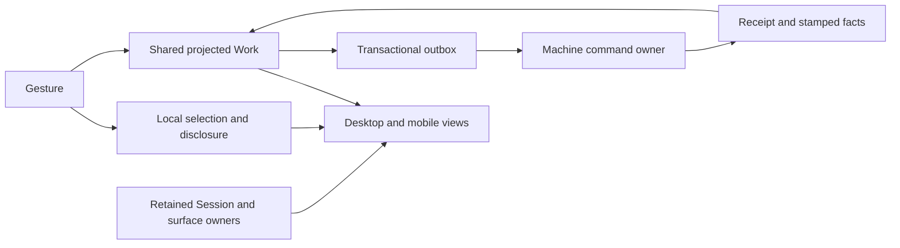

# LOO-906: immediate interactions across Desktop and mobile

Built on origin/main `9cafc410ee`: conversation/Machine link `a2a0a0fb33`,
unreachable Machine and Desktop rename `35e2835de1`, fixture teardown `5231746858`,
observation source `86f99e3315`, typed field support `f9a8da8ae9`. SQL-only
normalization is now persisted; receiving-link attribution precedes external
normalization, field-effect incorporation and derived-answer coverage, then dynamic
membership with disconnected Move. No shipping or merge decision; no Wave selected.

## Direction

Build one shared client state and command-reconciliation architecture: every
surface renders local intent immediately, then reconciles against causally newer
Machine facts without inventing execution readiness.

Jack Heart, comment `b38d7ddf-eb30-4331-b9e9-bbf9244ab700`:
> “Let’s make sure this is an aggressive systematic rewrite that sets us up to avoid these kinds of issues across the whole system, not just these specific interactions I’m talking about, and mobile and desktop are being considered”

Jack Heart, comment `e008238d-ab6b-4cf2-b307-581d122d6d81`:
> “That could include having a whole second store or a list of pending changes that are applied as a diff to the known store, something like that”

Jack Heart, comment `30bf26ae-1815-4e74-920e-8c6ed1986d56`:
> “We should do at least as well as all of those systems”

Jack Heart, comment `d555fa61-e250-4e7d-9da8-cdbe51600a3a`, answering
`scratch/concept-review.html` question 1:
> “1b for the question (or show noting)”

This selects immediate next-Task navigation after completion, with an empty state
allowed when none remains. It supersedes the keep-conversation-open draft.

Jack Heart, comment `5d9cb5de-a753-4758-b6a5-d0cb96accc64`:
> “another thing that is too slow is the time it takes for a task to look highlighted (and the session to render) after i click it, evne if its cached / recetn”

Jack Heart, comment `33675e39-b299-4a18-9049-3750eca5a8b8`:
> “or for a wave to expand when i click on it”

Earlier direction, retained:
> “launching a new task should get to new session instantaneously”

Jack Heart:
> “this is meant for deskto”
> “it takes like >10 seconds and there are a lot of intermediate states”
> “another thing i will add is that completing a task should make it disappear immediately”
> “can we talk about what are the fundamental causes of so many intermediate states and non-immediate reactivity?”
> “is it about slow sql? insufficient reactive UI archtiecture?”

The LOO-904 screenshot (not available here) was described as Reading workflow,
Restoring workspace, Not started/Start, and Conversation change unconfirmed.

## What the current code establishes

Start and Complete now use shared SwiftUI/Observation interaction and outbox
owners on both clients. Other mutations still disagree about when an interaction
happened. Desktop `TaskRunDraft`, plus mobile view-owned
`SessionLink`, remain replacement targets (see the delete list). Revision-6 subscriptions now provide exact-query snapshot stamps;
server operation admission covers all typed writes, while live client outbox
migration still specializes creation. Native Session/Graph owners retain readiness.
Predecessor map: `bb936ac371`; earlier Desktop design: `7030e08a`.

Completion already saves a domain request, checks execution/PR conditions, settles
state, syncs planning and schedules retirement. Creation already prepares its
primary Session and Graph. Those waits are not a measured SQL/latency diagnosis.

## Established designs and dependency choices

Research and replica comparisons: `8b42a874db`, `bb936ac371`. Apollo/TanStack
give operation-layer precedents, not LF domain recovery; SwiftData, Sharing and
TCA don't give causal sync; a mutable replica would duplicate server-derived
membership. Direction: confirmed cache plus ordered operation overlays, one
normalized owner, Observation for rendering. The outbox uses system SQLite3 on
both targets (GRDB not adopted); the confirmed cache belongs in that database.

The cache/overlay owner must project every affected query, including Dashboard
membership and counts. If declarative membership cannot cover them, move the pure
projection into a shared portable core before client migration.

## State, ordering and reconciliation contracts

Detailed contracts and counterexamples before the presentation cut remain at
`737b50adba26689bb27e67839d9ab9b90564bf50:scratch/instant-task-session.md`
under Proposed contracts through Opening another query. Live requirements:

- Shared Swift owns each Machine's confirmed cache, ordered immutable commands,
  receipt recovery and projected membership. Hosts own selection, drafts and
  native readiness. Windows share an owner; devices share semantics. Save before
  send; publish intent before disk or discovery. Never fabricate entity DTOs.
- Keep IDs, original Machine/scope, sequence, resource lanes and dependencies.
  Conflicting commands serialize; independent resources proceed concurrently.
  Dependent commands await actual IDs. Unknown delivery blocks conflicting sends
  until domain recovery establishes ordering. Undo after send is another command.
- Persist cache, effects and outbox in one SQLite transaction owner. Released
  files retain exact IDs, words, outcomes and unknown send history through import.
  Recover sent work by original ID on its original Machine. Missing/unavailable
  lookup or a replaced epoch never authorizes replay. Admission precedes Git,
  planning, provider and domain waits; worker recovery requires domain permission.
- Stamped readings cover the same pinned snapshot as their bodies: Machine,
  epoch, schema, query identity/completeness and domain revisions. Reject departed
  epochs and older revisions; checkpoint IDs and arrival order establish nothing.
  Historical restoration still needs an epoch-reset mechanism.
- Each semantic stage records its result and fence in the domain transaction.
  `task.completion_requested` confirms intent; only `task.completed` confirms
  removal. `task.filed` binds Task/Session without proving admission or input.
  Provider/filesystem/planning readiness cannot borrow a SQLite fence.
- In the current query-local implementation, apply an ordered effect independently
  until its complete reading covers the confirming stage's fence. The next cut
  replaces that criterion with the field/answer distinction below. A covering count cannot discharge
  a held list; a fresh query cannot subtract twice while another remains behind.
  Partial pages, unrelated domains, native mounts and command return don't
  establish incorporation. Query identity/plan changes invalidate prior coverage.
- Three independent obligations retain a command: domain recovery, remaining
  query coverage and an unseen creation result. Mount or Inspect acknowledges
  presentation only. Retirement transfers lagging effects into bounded retained
  bases, or invalidates closed bases under persisted scoped floors. Reopen, another
  window or another filter must reconcile pending effects before its first cached
  frame. Later queries require a covering base even after command retirement.
- Definite refusal removes only effects proved uncommitted. Partial success keeps
  committed facts and inspection for unresolved stages. Supersession belongs in
  existing typed stage resolutions, identifying the withdrawn request and its
  replacement fence. A covering replacement reading restores membership without
  navigation; a late settler cannot complete a withdrawn request. Never borrow a
  newer completion's outcome. No generic error or missing stage proves rollback.
- Normalize display facts with domain provenance across queries. Unknown or
  incomparable freshness remains labeled/stale rather than replacing known facts.
  Complete filtered absence removes membership, never entity/native lifetime.
  Declarative membership supplies scopes, paths, ordering, counts and dependencies;
  use a portable core if client projection cannot express all queries.
- Every mutation declares effect stages, dependencies and recovery policy in an
  exhaustive registry. Value changes project values; membership changes project
  every known list; execution projects intent only. Retain file-base conflicts,
  existing control ownership and no offline terminal-byte queue.

Acceptance retains held settlement, definite refusal, commit followed by failed
planning/output, reordered list/count and restart, supersession in either race
order, withdrawing old then completing new, unseen/seen creation with lagging
queries, Inspect without a Work reading, epoch replacement, new queries/windows
and changed filters after Complete, closed-query restart and eventual retirement.
Each checks one effect per query, unchanged later navigation, no replay or permanent
lane blockage. Missing correlation stays inspectable. Both clients use the same
reducer; two-client closed-query convergence remains open.

## Local navigation, disclosure and retained content

Publish selection/highlight and disclosure in a bounded synchronous reducer before
starting effects. Cached lookup uses stable identity indexes, not a scan/re-sort of
all Work or warm preparation before the next frame. Read/decode/cache persistence,
planning acquisition and child loading run outside that gesture path. Profile
main-actor body/layout work separately; Observation alone cannot make a blocked
main actor paint sooner.

Bind a destination immediately to its cached projection and retained workspace.
The existing Desktop `GhosttySurfacePool`/workspace registry remains the native
owner. On mobile, move `SessionLink`/terminal occurrence lifetime out of transient
`SessionView` into a bounded retained-workspace owner; preserve its buffer/viewport
on quick navigation, with memory-pressure eviction. Background policy and input
control stay explicit. Cached display never certifies a location or enables input;
unknown or changed ownership pauses input while validation proceeds. Reuse a live
validated native occurrence rather than reopening it on each route push.

A→B→A increments navigation generation at every gesture. Async readers can update
their resource's confirmed cache but cannot select, focus, expand a collapsed group
or replace a newer occurrence. Completion's next selection uses this same local
owner. Wave expand shows cached children immediately; if cold, only the expanded
section shows loading/error. Collapse is immediate and a late child answer only
warms the cache. Where mobile uses a picker instead of a tree, retain that interaction
rather than introducing a new tree solely for parity; any disclosure uses the same
local semantics.

## Representative timelines

**Launch, both platforms:** tap Start → same UI turn closes editor and selects the
operation's conversation destination, showing submitted words → persist exact
request → submit/admit → bind actual Task and Session IDs → attach that Session
in place → native readiness enables input. Task/list/Graph frames reconcile in
any order without replacing the destination with Task details, Start or restoration.
Leaving changes only navigation; the operation remains in the outbox. On restart,
recover its original Machine/ID. Edit is available before send failure; uncertain
send offers lookup; attachment failure offers Retry opening, never recreate.

**Complete, both platforms:** tap Complete → remove from working/available/busy
memberships and update affected counts immediately; details show pending completion
→ persist/send → accepted/committed result → fresh stamped reads replace the layer.
Definitive refusal restores membership from the latest base while retaining later
operations. Lost reply keeps pending confirmation and recovers the same ID; refresh
failure after commit never restores a working row. Completing the selected Task
moves immediately to the next visible Task in the current list order, or an empty
state when none remains. Completing an unselected Task leaves selection alone.
Navigation changes once, in the initial interaction; neither acknowledgment nor
failure recovery selects again. Mobile gains the same completion action and
semantics, replacing the selected route rather than stacking obsolete destinations.

**Cached/recent Task:** click A → highlight A and bind its last-known workspace in
that interaction → show retained native content without a new preparation/attachment
when usable → refresh in background → update facts without blanking content. Record
click-to-highlight, click-to-cached-content and click-to-input-ready independently.
Rapid A→B→A and late replies never revive B or rebuild A's retained surface.

**Wave disclosure:** click → arrow/expanded state changes in that interaction →
cached children display, or one local loading area appears → children populate
without a second navigation action. Collapse during loading remains collapsed.

**Other mutations:** claim/unassign/move/rename/reopen/abandon, Session bind/new/move,
Wave editing, settings, layout/file save and delivery/Graph actions all enter the
same owner. Value edits project values; membership edits project all known lists;
execution commands project accepted intent and progress only. File writes retain
base-revision conflicts. Provider/Graph/PR success and Machine transfer completion
are never predicted. Terminal bytes, replies and control takeover remain with
existing bounded input owners: no offline keystroke queue or automatic resend.

## Delete — do not maintain

Already removed in this cut: per-entry observation counters, uncaptured repeat
reads within an invocation, and reuse of pre-observation query bases. Required
behavior stays on the single cache, capture and client SQLite owners.

Already removed: the list at `908e317e4f:scratch/instant-task-session.md`, plus
creation in `CreationRecovery`, its Task presentation map, host request filters
and the phone query-before-opening path. The pending-command cut also removes
`CreationOperation`, `WorkInteraction.Failure`, the failure collections,
`WorkModel.completionFailures`, Retry Complete rows, creation-owned reopening,
retired-source release APIs/index and the rest of `CreationRecovery`. `LegacyTaskDraft` reads released files
only; SQLite commits precede rewrites.

Still remove, with their consumers:

- `ServerClient.subscribe`'s `RawJSON`→`Data` erasure and attribution-less
  `LineSubscription.lines` payload. Replace with receiving-link attribution
  through every raw/line/WorkFrame consumer and detached decoder. Keep exact
  bytes, queued baselines, resume/checkpoints, scope cancellation and guarded
  resource reads; CLI inventory without a negotiated link supplies no external
  revalidation. Keep attribution outside wire stamps.

- Desktop `TaskRunDraft.phase`, other mutation refresh barriers
  (`performTaskAction`) and bind replacement bookkeeping (`replaceSession`,
  `supersedeSessions`).
- Query-local `WorkQueryEffect.covered`, `ClientWorkDatabase.effectsCover`,
  `ClientWorkQuery.makeProjection`'s state-only reducer, `WorkMembershipPlan.Facts.states`'s
  transient union setter, and dynamic prefiltering
  in Rust `Selection::compile_membership` / `compile_filter`, in one replacement
  cut. Keep explicit Work leaves, stable authored occurrence paths, descendant
  scopes, interleaved order, intersections, hidden/suppressed occurrences and
  unknown/partial reads covered on the surviving program. Existing tests of these
  behaviors remain requirements; only assertions exclusive to stamp-only
  incorporation disappear.
- View-owned mobile `SessionLink` teardown on ordinary Task switching; keep
  explicit Close, background policy and memory-pressure eviction.
- WorkCache/TaskFeed duplicate authoritative caches and duplicate freshness
  reconciliation. Keep UI-only workspace/layout/draft persistence.
- Tests exclusively asserting old intermediate screens, local exception sets or
  second-submit recovery; keep success, duplicate prevention, failure, departure,
  ownership, layout and first-turn coverage on the shared path.

## Forbidden outcomes

No per-screen exception sets, second mobile submission ledger, whole-snapshot
rollback, fake Task/Session DTOs or timer-based readiness. No SQL or network wait
before selection/disclosure, no retained surface replacement on a healthy revisit,
and no background completion that chooses navigation. A library or loading surface
alone does not complete the cut: query membership, overlap, uncertainty, migration
and both clients must use the same semantics.

## Delivery and acceptance

Indivisible cross-platform cut, with internal slices; no publish/merge authorization.
This scope exceeds the size-check signal because causal writes, both read paths
and their consumers must converge together.

1. **Architecture:** confirmed cache plus ordered overlays; validate query
   membership and persistence dependencies before cutting consumers over.
   Completion navigation is specified above.
2. Extend receipt/commit-stamp contracts and domain recovery; migrate saved data.
   Done: stamped subscription readings (revision 6), Git-free
   `operation.submit` admission, submitted/canonical identity, legacy envelope
   adoption, saved-command dispatch and both creation clients' outbox admission.
   Remaining: domain continuation and all-writer stage fences.
3. Build shared transactional client store and projection reducer; cut both
   transports over, including query membership. Delete predecessor owners.
4. Move selection, disclosure, launch, completion and every mutation family through
   their shared interaction owners on both clients;
   retain native execution and input owners. Update product/API docs together.
5. Measure actual latency and remove demonstrated backend waits independently of
   presentation; run the full acceptance matrix and native demo.

Slice status is under Current implementation cut; Complete starts slice 4.

Headless acceptance uses deterministic held/reordered replies, not timing sleeps:
shared reducer tests cover overlapping success/failure, stale reads, partial pages,
query changes, epoch reset, reconnect and every save/send/crash boundary. Desktop
and iOS production-view tests prove immediate launch/removal before held network
responses. Selection/disclosure tests assert state before held reads; A→B→A,
expand→collapse and reordered loads preserve cached content and surface identity.
Two windows and two clients prove all projected surfaces agree. The
command registry has exhaustive policy coverage. Receipt fixtures include Rust,
Swift/macOS and iOS; upgrade tests preserve existing pending submissions.

Focused commands: `ClientWorkStoreTests|OperationRecoveryPresentationTests` on
Desktop, `LoopflowiOSTests/ClientWorkStoreTests` on iOS, plus Rust operation
module filters. Gate owns wider suites; display diagnostics remain demo work.

## Latency and open review decisions

Trace gesture → state publication → render commit; selection adds cached-content
and input-ready endpoints, disclosure adds arrow/children/data-ready. Separate
retained hits, cold misses and eviction. Trace one operation through local
projection → save → admission → domain commit → subscription apply → native
readiness, with backend spans for SQLite lock/query, planning network, Git,
Graph registration and provider attach. Log IDs and durations, never authored
text. Compare in-process, Desktop local and mobile remote transports. EXPLAIN
changed SQL on the 10,000-Task fixture.

Proposed target: local reaction P95 under 100 ms, at least 20 native samples per
journey/platform, endpoints reported separately. Nothing here is measured yet.

## Implementation direction (2026-11-15)

### Synchronous intent and effect contracts

The State, ordering and reconciliation contracts above retain the live requirements.
Earlier handoff and reordered-reading detail:
`cfebc7f89a6c8c5301518a067f9cc3a2e977ee5a:scratch/instant-task-session.md`
(Implementation direction).

### Query destinations and leases

Built at `6e944e73b5a` (details in that commit's plan); current behavior is under
Current implementation cut. Two-client closed-query convergence is unexercised.

Earlier cut ownership, deletions and checks:
`9fbc729a63b4eb6286159bcfa04090a68f6a9388:scratch/instant-task-session.md`.
Claim, Wave/Dashboard rename and other mutations remain unmigrated.

### Why Move cannot use the current reducer

Full account: `5d0187746f:scratch/instant-task-session.md`. `compile_membership`
prefilters Wave descendants into fixed leaves; `ClientWorkQuery.makeProjection`
only changes states of facts already present, so a destination that omitted Task
A cannot acquire it. `WorkQueryEffect.covered` decides by the held query's own
`ReadingStamp`, so Complete→Reopen seen elsewhere, or Move A→B→C, reapplies the
older effect. Acceptance: Required counterexamples below.

### Next implement direction: facts absorb effects; queries prove their answers

Headless concept review, 2026-11-15, against `5d0187746f`. Proposed, unbuilt.
The correction above becomes two contracts rather than one larger query stamp:

1. **Field incorporation.** Each confirmed value identifies its Machine, epoch,
   schema, entity, field and supporting domain revisions. A committed effect stops
   writing a field when a value for that same field covers its semantic stage's
   fence. A later value wins even when it differs from the command's intended
   value: Complete followed by Reopen must show Reopen. Missing or incomparable
   provenance cannot absorb an effect. Unknown delivery retains intent until the
   original receipt resolves it; an unrelated newer fact cannot settle delivery.
2. **Answer coverage.** A locally evaluated query records its program/definition
   revision, candidate coverage, and the field/content dependencies actually
   consumed. This is a client-derived answer, never a Machine `ReadingStamp`.
   Missing content may make the destination incomplete without reactivating an
   absorbed parent-Wave effect. A newer parent value cannot establish fresh
   lifecycle/activity, content, query definitions or candidate coverage.

Keep the original exact-query stamp and body immutable. Cross-query normalization
joins only values carrying comparable provenance, not whole DTOs by arrival time.
Do not manufacture a coherent server snapshot by taking vector maxima from
unrelated readings. Equal provenance with conflicting values is inconsistent;
retain the known value and require reconciliation rather than picking the last
arrival. Normalized facts, stage results, incorporation and saved command state
join transactionally in the existing SQLite owner. The name-field owner is a
precedent for ownership, not permission to use a sessions fence for Task fields.

**Dynamic membership.** Rust compiles authored scope and filter predicates, with
stable occurrence paths, instead of prefiltering their identities. Explicit Work
leaves remain fixed. Both clients evaluate the same finite typed program over
shared facts; canonical lifecycle/effect rules stay in one declaration, not a
second Swift derivation of Task state. Preserve descendant-Wave semantics,
interleaved/shared order, intersections, duplicate winners, hidden occurrences,
unknown activity and partial reads. If the finite program cannot express these,
use the portable core before changing consumers.

Headless engineering choice: start with a compact repository candidate manifest
(identity, parent relationships and membership predicates, not every Task's full
content) to support dynamic arrivals. Its completeness is scoped to its captured
revision. Individual fact replies cannot advance that universe or prove absence;
replacement manifests or complete deltas need deletion evidence too. Cache real
content separately by identity and provenance. For a known Task moved from A to B,
both programs can consume its projected parent and cached content even when B's
last result omitted it. A missing program, ancestor relationship or content stays
explicitly incomplete; never show a fabricated Task or an exact empty/count.
Index affected fields/scopes so a gesture does not scan/decode the repository on
the main actor. Measure the 10k manifest and fan-out when implementing.

**Move and recovery.** The gesture freezes original Machine, Task, destination
Wave identity (or No Wave), sequence and request ID, then publishes parent intent
to all affected queries/counts before disk. Keep native workspace, drafts and later
navigation. Save before send; serialize conflicting Task edits through the earlier
domain outcome. The domain still resolves the Wave's current Project and validates
membership; do not freeze a guessed Project or retarget another Machine. Record
the actual resulting parent/Project value, semantic disposition and fence with
`task.membership_changed` in its owning transaction, including definite refusal.
Commit followed by planning-sync failure retains the move. Recover an uncertain
send by original ID. No receipt stage or send history means no blind retry.

**Retirement and migration.** Query completeness and command delivery remain
separate obligations. Absorbed field effects cannot return after close/restart.
Retirement retains the necessary normalized facts and derived coverage, or marks
an evicted/old base unavailable under scoped reload floors. Do not retain full
commands forever merely because content is missing. Older query-local caches lack
this proof: invalidate their derived membership, retain exact commands/receipts
and recover their original IDs. Never relabel old cache data as new coverage.
Delete `WorkQueryEffect.covered`'s stamp-only decision and
`ClientWorkDatabase.effectsCover`'s arbitrary revision shortcut with their callers;
replace the current state-only reducer and prefiltered dynamic nodes together.
Preserve exact-query stamped refresh as an authoritative input.

Required counterexamples before caller migration:
- Held Working query → Complete commits → another query supplies Reopen's newer
  state → old query reevaluates: Task is visible; Complete never re-hides it.
- Move A→B commits → newer parent C arrives from another query: held A/B queries
  cannot reapply A→B. A stale B reply cannot replace C; an incomparable one cannot
  silently select a winner.
- Fresh parent, missing content or unknown activity: old move stays incorporated,
  but the dependent answer/count stays incomplete. A covering count cannot release
  a held list's independent coverage.
- Destination omitted the moved Task; two windows and both clients update source,
  destination and counts from real cached content before disk. Repeat with No Wave,
  descendant Waves, repeated authored occurrences and a changed saved definition.
- Close both queries, retire, restart offline: reconstruct the same projection or
  show unavailable under a persisted floor. Lost reply, refusal, newer local move,
  commit-then-sync-failure and epoch change neither replay nor steal selection.

Proposed usage text for both READMEs after acceptance:
> Move a Task to a Wave or No Wave. Cached lists and counts change immediately;
> its conversation and drafts stay open. While disconnected, the change waits for
> its original Machine and survives restart. A refusal restores only the refused
> change, leaving later edits and navigation alone. Incomplete cached destinations
> remain visibly incomplete until their missing data arrives.

No builtin skill needs a new interaction rule; its existing save/recover semantics
remain. Keep shipped README claims limited to built behavior until this cut passes.

### External-observation counterexample · 2026-11-15

`process_exit_changes_selection_without_advancing_sqlite_provenance` establishes
that activity and order can change without SQLite revisions. The Review direction
below resolves this with captured observations. Original investigation and teardown
checks: `0883b66cf08b145df0cd462a9c8dca06b0f3e15a:scratch/instant-task-session.md`
(External-observation counterexample).

### Review direction: one observation source, independent facts · 2026-11-15

Headless concept review against `5231746858`. This resolves the engineering gap
above, not the three independent product questions. Source/capture primitives and
wire transport are built in this cut; field declarations and normalized persisted
facts remain unbuilt. The experience stays the same: a Task whose provider exits stops looking Busy in every
cached view; missing activity does not undo an already incorporated Move. A
Machine restart keeps conversations and saved changes, while live status awaits
that Machine's new observations.

**Source ownership and replacement.** Give the existing `observe::Cache` one
opaque incarnation and one monotonic observation clock for its lifetime. The
server already holds that cache through `service::run`; expose its incarnation in
the negotiated welcome and carry it with captured observation evidence. Keep
`welcome.instance` (server lifetime), database epoch and observation incarnation
distinct: none orders the others. No new authority service or persistent observer
ledger. A replacement cache requires a new welcome before publishing its facts.
Bare reads without this owner may supply display inventory, never comparable
external provenance.

The shared Machine connection establishes the active observation source from its
current welcome, before delivering readings. Connection generations reject old
welcomes, reads and callbacks after reconnect; a delayed frame cannot elect its
own source. Windows share this decision through the existing Machine owner.
Disconnect preserves last-known content and pending intent, but dependent live
answers become stale. On reconnect, even to the same incarnation, current-source
readings revalidate their consumed inputs; welcome alone proves no field or
membership. With a new incarnation, keep the previous values as last-known and
invalidate their external coverage until replaced. Never compare incarnation IDs
lexically, compare counters across them, or switch back on a delayed reading.

**Capture and eviction.** Allocate from the cache-wide clock whenever a fact is
first installed or its answer changes, including failure/unknown transitions.
Entry eviction never resets that clock. Recreating a fact therefore produces a
newer token within the same incarnation without retaining unbounded tombstones.
Tokens compare only the same declared fact; an unrelated clock advance certifies
nothing about another input. Process evidence includes OS process identity, not
only PID. Export opaque dependency identities, not raw private paths, command
arguments or transcript contents.

Capture each consumed answer and token together, and reuse that captured answer
for repeated reads within the invocation and inherited workers. Before exporting
a derived field, validate its consumed dependency set against the observation
owner and record the owner's clock atomically with that validation, synchronized
with answer changes and entry replacement. Changed/evicted
dependencies make the field unavailable for normalization and schedule the normal
refresh; do not stamp a mixed computation as coherent or spin until it succeeds.
The validation clock can order changed dependency sets within one incarnation;
it never covers omitted dependencies. A later observation after validation makes
the captured answer older, not invalid history. Preserve the pinned SQLite
snapshot's revisions independently. Two captures with crossed SQLite/observation
freshness remain incomparable; neither arrival order nor component maxima can
create a replacement value.

**Field evidence and answer coverage.** Declare inputs per field/predicate:
parent and lifecycle consume their actual SQLite domains; activity consumes its
SQLite inputs plus process/turn/deadline observations as applicable; ordering
consumes the fields it actually sorts. A normalized derived value carries that
complete support, including captured dependency identities/tokens and validation
clock. A later comparable capture can replace it when the supporting set changes
(for example, a Session acquires another process); an individual process fact
alone cannot rewrite Task activity. Dynamic membership programs consume these
typed fields, never infer Task lifecycle a second time in Swift. Candidate
manifests declare observation coverage too if their eligibility depends on it;
an identity/parent-only universe must not prefilter Busy Tasks.

Persist normalized values, source identities, incorporation and derived-answer
dependencies in the existing client SQLite transaction owner. Persisted external
values are last-known after restart until the active source revalidates them;
do not persist the server's clock as a durable Machine revision. Parent/lifecycle
incorporation survives independently, so stale/missing activity cannot revive an
absorbed Complete or Move. Eviction retains sufficient facts/coverage or the
existing scoped reload floor. Missing content need not retain a full delivered
command. Old caches cannot be upgraded by assigning the current incarnation.

**Implement order and deletion.** First extend the observation owner and required
wire DTO/fixtures on Rust, Desktop and iOS; then add field incorporation and
derived-answer coverage; then dynamic membership and disconnected Move together
with their callers. Preserve the original exact-query stamp/body as an input.
Replace the query-local incorporation shortcuts and state-only reducer listed
above; do not add a second observer, outbox or readiness owner. No production
README or builtin skill claim changes until acceptance. The proposed Move usage
text above remains the documentation target; observation tokens stay out of the
product's interaction vocabulary.

Acceptance adds these deterministic cases to the retained Move counterexamples:

- Same SQLite revisions, process exits: held Busy membership, order and counts
  consume the newer derived activity; reordered old evidence cannot restore Busy.
- Evict/recreate the observed entry in the same cache: its token never repeats.
  Replace the cache/server: new welcome invalidates old external coverage; delayed
  old frames and welcomes cannot restore it, including across two windows.
- Change a dependency during capture or read it twice across a held change: no
  mixed field is normalized; refresh later supplies one complete dependency set.
- Replace a Task's process (including PID reuse): a newer complete capture may
  change the dependency set; a newer fact for only the old process cannot.
- Restart offline after parent incorporation, then reconnect with a new observer
  and unchanged database epoch: Move stays absorbed; activity/order/counts remain
  last-known or incomplete until covered. Saved request IDs and original-Machine
  recovery survive without resend or later navigation.

Source/capture cut details and passing filters: `86f99e3315:scratch/instant-task-session.md`.
Unresolved run `7bb50caf-46f5-485f-a8ff-d882ea6e5a98`: nextest marked
`server::schema::tests::bare_time_serializes_as_its_described_tuple` LEAK;
that case launches no children. Gate owns it; no retry was taken as a fix.

### Concept review: fields carry their own support · 2026-11-15

Review against `f9a8da8ae9`. Producer-declared parent, lifecycle and activity
support and strict cross-platform fixtures are built. Consume each field's full
SQLite/observation support and derivation identity, never split the invocation bag.
Missing/invalid support differs from validated empty observations. SQL-only fields
normalize independently; invalid activity stays last-known/unavailable. Keep the
existing capture owner and producer lifecycle rules on both clients.

Add the failure/recovery counterexample: a reading contains a newer committed
parent and activity whose dependency changes during capture. Incorporate the
parent once, retain the prior activity as last-known, and make only answers that
consume the missing activity incomplete. An unfiltered destination may still
show the real cached Task; Busy membership, activity-based ordering and their
counts cannot claim freshness. A later complete activity capture repairs those
answers without reapplying Move or changing selection. Reordered old fields,
restart and source replacement must retain the same separation on both hosts.

Next implement: persisted normalization and incorporation → derived-answer
coverage → dynamic membership and disconnected
Move with deletion of the old reducer. Keep the proposed Move usage above;
no new product vocabulary or builtin rule is needed.

**Ingestion precedes query replacement.** The next client API must accept a
reading as a source of independently supported fields, not only as a replacement
complete query. In the existing SQLite transaction owner: validate the connection's
Machine/epoch/schema and negotiated observation source; join each comparable typed
field; incorporate covered field effects; then evaluate whether the exact query
body can replace its prior base and derive affected answers. Rejecting an older,
incomplete or incomparable query as a whole must not discard a newer independently
supported parent or lifecycle field within it. Conversely, an accepted query body
does not validate unavailable activity. Preserve the original stamp/body unchanged.
Field support must match the containing resource's Machine/epoch/schema; captured
support also requires the current connection's source. A reading cannot elect a
source or restore a departed epoch. SQLite-only fields need no live observation
capture. Persisted external values still require reconnect revalidation.

Add the boundary counterexample: the held query has newer activity but an older
parent; another reading has a newer parent but older/unavailable activity, or is
incomplete because content is missing. Keep the newer parent and prior last-known
activity independently, absorb only the parent's committed effect, and retain
incompleteness for answers consuming the missing inputs. Neither query replaces
the other as a coherent Machine snapshot. Repeat reordered and after offline
restart on both hosts. Receipt delivery remains unresolved until its own recovery
answers; field incorporation never authorizes a resend or changes navigation.

Typed-field cut (`f9a8da8ae9`): activity conservatively declares the repository
Session read's consumed set; narrowing it keeps the contract. The transient union setter
(`WorkMembershipPlan.Facts.states`) clears support and repeats Rust's
`SelectionState::is_activity` split as a literal Swift set; both go with the
state-only reducer. Wire values alone do not complete normalization acceptance.

Prior typed-field checks and 10k query plans:
`0883b66cf08b145df0cd462a9c8dca06b0f3e15a:scratch/instant-task-session.md`
(Concept review: fields carry their own support). Native latency is unmeasured;
the nextest LEAK above remains gate work.

### Persisted normalization and receiving-link gap · 2026-11-15

Built in the client SQLite owner: independent parent/lifecycle/activity field
joins before exact-query replacement, retained last-known values, incomparable
support reconciliation, field fence comparison, and connection-local external
coverage. A newer SQL-only parent survives rejected/incomplete query bodies and
invalid activity. Facts and exact query writes commit or roll back together;
unsupported fields cannot acquire provenance from an older cache. No predecessor
membership reducer was extended or removed in this prerequisite.

**Dependent cut stopped at a transport counterexample.**
`ServerSubscription.disconnected` deliberately keeps queued readings across
reconnect. `RemoteTaskObservation` and Desktop's Dashboard decode them after
asynchronous suspension; `ServerClient.subscribe` strips `RawJSON` to `Data`.
A reading queued on generation A can reach SQLite after generation B welcomes
the same observation source. Sampling `MachineConnection.observationConnection`
at ingestion would falsely revalidate A as B. Source equality does not fix it.
Production ingestion therefore currently normalizes only SQL-only fields; it
never borrows the ambient connection to normalize captured activity. Existing
query rendering remains unchanged, and external normalized values are unbuilt
in live consumers. Direct owner tests supply an explicit receiving connection.

Revised prerequisite: carry receiving-link attribution beside raw bytes through
the existing subscription/line/WorkFrame transports and detached decoding, then
compare that attribution to the Machine owner's current generation inside the
client owner. Keep it outside encoded stamps and persisted Machine revisions.
Unattributed CLI/cache bodies cannot revalidate external values. Test buffered A
→ disconnect → same-source B welcome → consume A → consume B on both hosts;
only B can establish current external coverage. Keep SQL-only incorporation and
original request recovery independent. Then finish derived-answer dependencies,
field-targeted effects and dynamic membership/Move with the predecessor deletion
cut. No product judgment is missing; this changes the engineering order.

**Concept-review refinement: attribution belongs to the reading, not the
subscription.** Carry one local envelope containing unchanged bytes and the
receiving link's Machine, generation and negotiated observation source. Construct
it at `ServerSubscription.receive`, before yielding to a buffered stream. Preserve
it through `ServerClient.subscribe`, `LineSubscription`, `WorkFrame`, Dashboard
and phone detached decoding, and into `ClientWorkStore.receivePlans`. A watch
spans multiple links; neither its identity nor its current link can supply the
envelope after delivery. CLI/cache inputs have no negotiated attribution. This is
local transport metadata, not a wire DTO change or another persistent ledger.

At ingestion, compare the envelope to the existing Machine connection's active
link; passing the received generation to the database without this comparison
would merely bless an old link. Keep the received generation with any external
revalidation proof, so a disconnect during/after ingestion immediately makes that
proof last-known. Never stamp it with a freshly sampled generation. Commit and
rollback must also govern that proof; a failed query write cannot leave activity
revalidated in memory. Parent/lifecycle joins remain independently eligible under
their own Machine/epoch/schema and field support checks. Do not discard a queued
baseline solely to suppress external revalidation: preserve resume/checkpoint and
event ordering, exact-query inputs and scope cancellation.

Normal path: B's attributed capture establishes external coverage. Failure:
queue A, disconnect, welcome B with the same source, then finish decoding A;
A cannot establish B's coverage or revoke a newer B capture. Recovery: consume
B's complete capture and repair only dependent answers, without another Move,
send or navigation. Exercise both delivery orders, a disconnect held across
decoding/ingestion, and two windows sharing the Machine owner on both hosts.
Keep the existing independent-field, restart and source-replacement cases.

Checks: focused `ClientWorkQueryTests/testField*` via `scripts/test_desktop.sh --filter`
and `scripts/test_ios.py -only-testing`: 7 cases per host (including protocol upgrade);
`check_swift_multiplatform_boundaries.py` passes. 10k-row `EXPLAIN`: primary-key
lookup. Gate owns wider suites and the prior LEAK; native latency is unmeasured.

### Open product choices

Unanswered, numbered in `scratch/concept-review.html`: (1) queue Abandon offline
or require a reachable Machine; (2) Cancel before first send or none; (3) phone
shows Task titles or shows/renames Session names. Built provisional behavior is
in `questions.md`. None blocks this work; (3) decides whether phone rename exists.

## Current implementation cut

Start, Complete and Abandon publish through shared `WorkInteraction` on both hosts. Creation
freezes ID/payload/scope/time before its synchronous selection callback, saves before
send and derives `PendingOperation` from the saved command and receipt stages.
Desktop keeps the operation selected through native readiness; iOS replaces its
editor with an operation route. Neither receipt nor recovery navigates after
leaving. Attachment Retry uses the recorded Session. Only a bound Session result can acknowledge presentation by resource. Native
readiness gates the pending creation mount, not ordinary Session recovery.
A mounted result acknowledges presentation without settling independent query/planning obligations. Unsaved
failure retains words for same-ID retry or deliberate editing.

Phone files import each original Machine/ID/command/source/outcome into SQLite,
transactionally per Machine and idempotently across source cleanup crashes.
Matching rows keep their send epoch and receipt; conflicts leave the source intact.
Imported missing send evidence remains inspectable, never unsent. Editor revisions
are associated with submitted commands in that transaction; surviving editor files
cannot submit again after save or retirement. Imported and editor-linked retired
commands leave compact source identities in the existing owner, outside indexed pending reads.
No second receipt ledger exists. Other-Machine imports/lookups open no transport.

Query leases retain their previous bounded semantics. Last-close suspends query
publication while command recovery continues; reopening reconciles before display,
including without a network event. Retirement cancels its receipt observer and
transfers lagging effects or scoped reload floors. The complete prior contracts and
query checks remain at `6e944e73b5a:scratch/instant-task-session.md`.

Remaining: receiving-link attribution and live external normalization; field-effect incorporation and derived-answer coverage,
then disconnected Move; effect-policy duplication; cross-client closed-query convergence; exhaustive
effect/dependency declarations and cross-query provenance; other mutation recovery
and resource lanes; retained mobile `SessionLink`; projected inspection;
historical-restoration epoch reset; valid native benchmark baseline. One cross-platform PR; no shipping decision. SQLite
fences cannot certify filesystem/provider readiness.

### Admission identity and recovery contract

Built: the submitted envelope saves before discovery, Git, planning, lock or
provider calls; released rows adopt only the first verified envelope and keep their
domain recovery disposition. Contract: `465274b547:scratch/instant-task-session.md`;
server fixtures: `19612daf41:scratch/instant-task-session.md`.

Still open: reordered validation replies must update only the active epoch with a
newer receipt revision, never enabling input or retiring overlays, and full
cross-platform presentation acceptance.

## Upstream acceptance retained

Origin/main `9cafc410ee` supplies #1942–#1944 and #1947 (`selection_states`); the
shared projection and retained-occurrence migration keep their coverage. Map:
`639411f1b2:scratch/instant-task-session.md`.

## Benchmark implementation and observations (2026-11-14)

Exact feedback and host preferences are in `desktop-reactivity-feedback.md`; the
harness README maps ADEMark (https://github.com/zqkra/ademark at `119a5f7b99`,
retrieved 2026-11-14) and LF journeys to endpoints. No borrowed result is a
Loopflow measurement. `desktop_performance.py preflight` rejects contaminated
hosts; thermal/swap and whole-trial load are not yet checked. `PerfClock.interaction`
marks separate selection publication, completion return and phone mount from pixels.
Rust CLI volume reports aggregate SQLite time; mutex/planning/provider attribution
is incomplete. `measureWriteToVisible` still refers to removed `pm_items.body`.

Observed: both hosts failed load preflight on 2026-11-14 and again 2026-11-15T10:40:27Z
(CPU 371.0%, load 39.52); local again at 13:19:55Z (571.1% CPU, load 83.5), no
native trial began. The mini runs macOS 15.5 against Desktop's macOS 26 target. Debug 10k constructor warm P95 235.92 ms on a rejected host (diagnostic
only). 10k receipt lookup/admission P95 0.033 ms, all 20 receipt statements keyed
(nextest `7f2b652c-19e3-4026-8961-d4e3f4d84d37`). No gesture, native paint/input or
backend-stage baseline exists. Raw files and earlier detail: `8b42a874db`,
`bb936ac371` (`scratch/instant-task-session.md`).

Implementation owns the baseline; demo owns native usability.

Earlier checks: `57cb8a3a22`, `6e944e73b5a` (10k query), `85564c1f20`.

## Conversation review retained

The 2026-11-15 review and its numbered disconnected-edit option:
`f2438fb1b49:scratch/instant-task-session.md` (Conversation concept review).
Jack Heart's “1a” selects saved disconnected Complete/rename/Move on the original
Machine, keeping IDs across restart and uncertain delivery.
