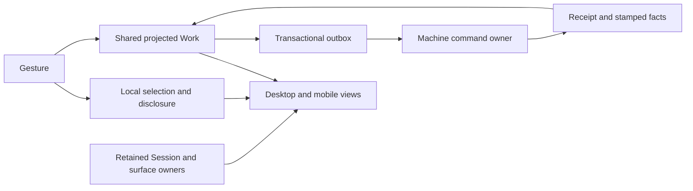

# LOO-906: immediate interactions across Desktop and mobile

Built on origin/main `9cafc410ee` (#1942–#1944, #1947; coverage map `639411f1b2`): conversation/Machine link `a2a0a0fb33`,
unreachable Machine and Desktop rename `35e2835de1`, fixture teardown `5231746858`,
observation source `86f99e3315`, typed field support `f9a8da8ae9`. SQL-only and attributed external
normalization, field-stage incorporation and derived membership answers now
share the client owner. Dynamic membership, disconnected Move and the projected
surface cut (boards, portfolio Roadmap/Now, trails, No Wave grouping, counts) use
that same owner. Wave detail/history joins those fields, and board/detail dated
Done ranges use one correlated lifecycle/completion-time fact; the remaining
responsibility inventory below keeps the full rewrite open. No shipping or merge decision; no Wave selected.

## Direction

Build one shared client state and command-reconciliation architecture: every
surface renders local intent immediately, then reconciles against causally newer
Machine facts without inventing execution readiness.

Jack Heart, comment `b38d7ddf-eb30-4331-b9e9-bbf9244ab700`:
> “Let’s make sure this is an aggressive systematic rewrite that sets us up to avoid these kinds of issues across the whole system, not just these specific interactions I’m talking about, and mobile and desktop are being considered”

Jack Heart, comment `e008238d-ab6b-4cf2-b307-581d122d6d81`:
> “That could include having a whole second store or a list of pending changes that are applied as a diff to the known store, something like that”

Jack Heart, comment `30bf26ae-1815-4e74-920e-8c6ed1986d56`:
> “We should do at least as well as all of those systems”

Jack Heart, comment `d555fa61-e250-4e7d-9da8-cdbe51600a3a`, answering
`scratch/concept-review.html` question 1:
> “1b for the question (or show noting)”

This selects immediate next-Task navigation after completion, with an empty state
allowed when none remains. It supersedes the keep-conversation-open draft.

Jack Heart, comment `5d9cb5de-a753-4758-b6a5-d0cb96accc64`:
> “another thing that is too slow is the time it takes for a task to look highlighted (and the session to render) after i click it, evne if its cached / recetn”

Jack Heart, comment `33675e39-b299-4a18-9049-3750eca5a8b8`:
> “or for a wave to expand when i click on it”

Earlier direction, retained:
> “launching a new task should get to new session instantaneously”

Jack Heart:
> “this is meant for deskto”
> “it takes like >10 seconds and there are a lot of intermediate states”

Other quotes: `desktop-reactivity-feedback.md`. The LOO-904 screenshot (not
here) showed Reading workflow, Restoring workspace, Not started/Start and
Conversation change unconfirmed.

## What the current code establishes

Shared interaction/outbox owners now serve both clients; the responsibility
inventory below names remaining consumers. Native Session/Graph owners retain
readiness. Completion and creation still have domain/planning/provider waits;
those waits are not a measured SQL/latency diagnosis. Predecessor map:
`bb936ac371`; earlier Desktop design: `7030e08a`.

## Established designs and dependency choices

Research and replica comparisons: `8b42a874db`, `bb936ac371`. Apollo/TanStack
give operation-layer precedents, not LF domain recovery; SwiftData, Sharing and
TCA don't give causal sync; a mutable replica would duplicate server-derived
membership. Direction: confirmed cache plus ordered operation overlays, one
normalized owner, Observation for rendering. The outbox uses system SQLite3 on
both targets (GRDB not adopted); the confirmed cache belongs in that database.

The cache/overlay owner must project every affected query, including Dashboard
membership and counts. If declarative membership cannot cover them, move the pure
projection into a shared portable core before client migration.

## State, ordering and reconciliation contracts

Detailed contracts and counterexamples before the presentation cut remain at
`737b50adba26689bb27e67839d9ab9b90564bf50:scratch/instant-task-session.md`
under Proposed contracts through Opening another query. Live requirements:

- Shared Swift owns each Machine's confirmed cache, ordered immutable commands,
  receipt recovery and projected membership. Hosts own selection, drafts and
  native readiness. Windows share an owner; devices share semantics. Save before
  send; publish intent before disk or discovery. Never fabricate entity DTOs.
- Keep IDs, original Machine/scope, sequence, resource lanes and dependencies.
  Conflicting commands serialize; independent resources proceed concurrently.
  Dependent commands await actual IDs. Unknown delivery blocks conflicting sends
  until domain recovery establishes ordering. Undo after send is another command.
- Persist cache, effects and outbox in one SQLite transaction owner. Released
  files retain exact IDs, words, outcomes and unknown send history through import.
  Recover sent work by original ID on its original Machine. Missing/unavailable
  lookup or a replaced epoch never authorizes replay. Admission precedes Git,
  planning, provider and domain waits; worker recovery requires domain permission.
- Stamped readings cover the same pinned snapshot as their bodies: Machine,
  epoch, schema, query identity/completeness and domain revisions. Reject departed
  epochs and older revisions; checkpoint IDs and arrival order establish nothing.
  Historical restoration still needs an epoch-reset mechanism.
- Each semantic stage records its result and fence in the domain transaction.
  `task.completion_requested` confirms intent; only `task.completed` confirms
  removal. `task.filed` binds Task/Session without proving admission or input.
  Provider/filesystem/planning readiness cannot borrow a SQLite fence.
- Field incorporation and derived answers decide visible membership for dynamic
  programs. Retirement acknowledges only each retained query's own invalidation;
  query stamps and unrelated effect revisions cannot substitute for field support.
  A covering count cannot discharge
  a held list; a fresh query cannot subtract twice while another remains behind.
  Partial pages, unrelated domains, native mounts and command return don't
  establish incorporation. Query identity/plan changes invalidate prior coverage.
- Three independent obligations retain a command: domain recovery, remaining
  query coverage and an unseen creation result. Mount or Inspect acknowledges
  presentation only. Retirement transfers lagging effects into bounded retained
  bases, or invalidates closed bases under persisted scoped floors. Reopen, another
  window or another filter must reconcile pending effects before its first cached
  frame. Later queries require a covering base even after command retirement.
- Definite refusal removes only effects proved uncommitted. Partial success keeps
  committed facts and inspection for unresolved stages. Supersession belongs in
  existing typed stage resolutions, identifying the withdrawn request and its
  replacement fence. A covering replacement reading restores membership without
  navigation; a late settler cannot complete a withdrawn request. Never borrow a
  newer completion's outcome. No generic error or missing stage proves rollback.
- Normalize display facts with domain provenance across queries. Unknown or
  incomparable freshness remains labeled/stale rather than replacing known facts.
  Complete filtered absence removes membership, never entity/native lifetime.
  Declarative membership supplies scopes, paths, ordering, counts and dependencies;
  use a portable core if client projection cannot express all queries.
- Every mutation declares effect stages, dependencies and recovery policy in an
  exhaustive registry. Value changes project values; membership changes project
  every known list; execution projects intent only. Retain file-base conflicts,
  existing control ownership and no offline terminal-byte queue.

Acceptance retains held settlement, definite refusal, commit followed by failed
planning/output, reordered list/count and restart, supersession in either race
order, withdrawing old then completing new, unseen/seen creation with lagging
queries, Inspect without a Work reading, epoch replacement, new queries/windows
and changed filters after Complete, closed-query restart and eventual retirement.
Each checks one effect per query, unchanged later navigation, no replay or permanent
lane blockage. Missing correlation stays inspectable. Both clients use the same
reducer; two-client closed-query convergence remains open.

## Local navigation, disclosure and retained content

Publish selection/highlight and disclosure in a bounded synchronous reducer before
starting effects. Cached lookup uses stable identity indexes, not a scan/re-sort of
all Work or warm preparation before the next frame. Read/decode/cache persistence,
planning acquisition and child loading run outside that gesture path. Profile
main-actor body/layout work separately; Observation alone cannot make a blocked
main actor paint sooner.

Bind a destination immediately to its cached projection and retained workspace.
The existing Desktop `GhosttySurfacePool`/workspace registry remains the native
owner. On mobile, move `SessionLink`/terminal occurrence lifetime out of transient
`SessionView` into a bounded retained-workspace owner; preserve its buffer/viewport
on quick navigation, with memory-pressure eviction. Background policy and input
control stay explicit. Cached display never certifies a location or enables input;
unknown or changed ownership pauses input while validation proceeds. Reuse a live
validated native occurrence rather than reopening it on each route push.

A→B→A increments navigation generation at every gesture. Async readers can update
their resource's confirmed cache but cannot select, focus, expand a collapsed group
or replace a newer occurrence. Completion's next selection uses this same local
owner. Wave expand shows cached children immediately; if cold, only the expanded
section shows loading/error. Collapse is immediate and a late child answer only
warms the cache. Where mobile uses a picker instead of a tree, retain that interaction
rather than introducing a new tree solely for parity; any disclosure uses the same
local semantics.

## Representative timelines

**Launch, both platforms:** tap Start → same UI turn closes editor and selects the
operation's conversation destination, showing submitted words → persist exact
request → submit/admit → bind actual Task and Session IDs → attach that Session
in place → native readiness enables input. Task/list/Graph frames reconcile in
any order without replacing the destination with Task details, Start or restoration.
Leaving changes only navigation; the operation remains in the outbox. On restart,
recover its original Machine/ID. Edit is available before send failure; uncertain
send offers lookup; attachment failure offers Retry opening, never recreate.

**Complete, both platforms:** tap Complete → remove from working/available/busy
memberships and update affected counts immediately; details show pending completion
→ persist/send → accepted/committed result → fresh stamped reads replace the layer.
Definitive refusal restores membership from the latest base while retaining later
operations. Lost reply keeps pending confirmation and recovers the same ID; refresh
failure after commit never restores a working row. Completing the selected Task
moves immediately to the next visible Task in the current list order, or an empty
state when none remains. Completing an unselected Task leaves selection alone.
Navigation changes once, in the initial interaction; neither acknowledgment nor
failure recovery selects again. Mobile gains the same completion action and
semantics, replacing the selected route rather than stacking obsolete destinations.

**Cached/recent Task:** click A → highlight A and bind its last-known workspace in
that interaction → show retained native content without a new preparation/attachment
when usable → refresh in background → update facts without blanking content. Record
click-to-highlight, click-to-cached-content and click-to-input-ready independently.
Rapid A→B→A and late replies never revive B or rebuild A's retained surface.

**Wave disclosure:** click → arrow/expanded state changes in that interaction →
cached children display, or one local loading area appears → children populate
without a second navigation action. Collapse during loading remains collapsed.

**Other mutations:** claim/unassign/move/rename/reopen/abandon, Session bind/new/move,
Wave editing, settings, layout/file save and delivery/Graph actions all enter the
same owner. Value edits project values; membership edits project all known lists;
execution commands project accepted intent and progress only. File writes retain
base-revision conflicts. Provider/Graph/PR success and Machine transfer completion
are never predicted. Terminal bytes, replies and control takeover remain with
existing bounded input owners: no offline keystroke queue or automatic resend.

## Delete — do not maintain

Already removed in this cut: per-entry observation counters, uncaptured repeat
reads within an invocation, and reuse of pre-observation query bases. Required
behavior stays on the single cache, capture and client SQLite owners.

Already removed: the list at `908e317e4f:scratch/instant-task-session.md`, plus
creation in `CreationRecovery`, its Task presentation map, host request filters
and the phone query-before-opening path. The pending-command cut also removes
`CreationOperation`, `WorkInteraction.Failure`, the failure collections,
`WorkModel.completionFailures`, Retry Complete rows, creation-owned reopening,
retired-source release APIs/index and the rest of `CreationRecovery`. `LegacyTaskDraft` reads released files
only; SQLite commits precede rewrites.

Removed in the dynamic cut: `WorkQueryEffect.covered`,
`ClientWorkDatabase.effectsCover`, `MembershipNode::State`, Swift's fixed state
node, Rust's prefiltered scope/filter compiler and `wave_descendants`. Required
explicit leaves, authored occurrence paths, descendant scopes, interleaved order,
intersections, hidden/suppressed occurrences and unknown/partial reads remain on
the typed program and its shared evaluator. Desktop Move no longer uses
`performTaskAction` or its post-write refresh barrier.

Removed in the dated-completion cut: `TaskHistoryFilter.includes`,
`WaveStandup.date`, and board/detail reads of page dates for membership/counts.
Their rolling-range, boundary and unresolved-execution behavior stays on the shared
lifecycle fact and retained history join.

Removed in the detail/history cut: `ClosedTaskHistory.merged`, detail's DTO
lifecycle filter, unconditional history resets, and inspector lookup limited to
`workMap.tasks`. Required page content/cursors, original Project IDs, ordering,
recovery and selected inspector now stay on the shared-field join; history pages
supply no field facts.

Removed in the domain-input cut: `TaskState::parse` and the bulk/single state-label
read path. Typed disposition/execution inputs preserve state, completion time and
pending identity; SQL projections share the structural predicates.

Still remove, with their consumers:

- Aggregate lifecycle membership authority in `MembershipFacts.lifecycle`,
  `WorkFieldLifecycle` and `ClientWorkQuery.apply`'s unconditional state-set
  mutation, when the reviewed Task-input replacement moves every consumer.
  Preserve correlated completion time, stage incorporation, dated history,
  stale-reading/refusal behavior and exact pending commands on the surviving
  evaluator; no flat Claim/Reopen effects that guess the destination section.
- Claim/unassign/Reopen uses of `WorkModel.performTaskAction`, header/hover
  async gesture wrappers and stale-planning guards, with shared synchronous
  actions and pending-request recovery replacing them in the same cut.
  `performTaskAction` itself remains until its delivery/Graph callers migrate.
- Desktop `TaskRunDraft.phase`, other mutation refresh barriers
  (`performTaskAction`) and bind replacement bookkeeping (`replaceSession`,
  `supersedeSessions`).
- View-owned mobile `SessionLink` teardown on ordinary Task switching; keep
  explicit Close, background policy and memory-pressure eviction.
- WorkCache/TaskFeed duplicate authoritative caches and duplicate freshness
  reconciliation. Keep UI-only workspace/layout/draft persistence.
- Tests exclusively asserting old intermediate screens, local exception sets or
  second-submit recovery; keep success, duplicate prevention, failure, departure,
  ownership, layout and first-turn coverage on the shared path.

## Forbidden outcomes

No per-screen exception sets, second mobile submission ledger, whole-snapshot
rollback, fake Task/Session DTOs or timer-based readiness. No SQL or network wait
before selection/disclosure, no retained surface replacement on a healthy revisit,
and no background completion that chooses navigation. A library or loading surface
alone does not complete the cut: query membership, overlap, uncertainty, migration
and both clients must use the same semantics.

## Delivery and acceptance

Indivisible cross-platform cut, with internal slices; no publish/merge authorization.
This scope exceeds the size-check signal because causal writes, both read paths
and their consumers must converge together.

1. **Architecture:** confirmed cache plus ordered overlays; validate query
   membership and persistence dependencies before cutting consumers over.
   Completion navigation is specified above.
2. Extend receipt/commit-stamp contracts and domain recovery; migrate saved data.
   Done: stamped subscription readings (revision 6), Git-free
   `operation.submit` admission, submitted/canonical identity, legacy envelope
   adoption, saved-command dispatch and both creation clients' outbox admission.
   Remaining: domain continuation and all-writer stage fences.
3. Build shared transactional client store and projection reducer; cut both
   transports over, including query membership. Delete predecessor owners.
4. Move selection, disclosure, launch, completion and every mutation family through
   their shared interaction owners on both clients;
   retain native execution and input owners. Update product/API docs together.
5. Measure actual latency and remove demonstrated backend waits independently of
   presentation; run the full acceptance matrix and native demo.

Headless acceptance uses deterministic held/reordered replies, not timing sleeps:
shared reducer tests cover overlapping success/failure, stale reads, partial pages,
query changes, epoch reset, reconnect and every save/send/crash boundary. Desktop
and iOS production-view tests prove immediate launch/removal before held network
responses. Selection/disclosure tests assert state before held reads; A→B→A,
expand→collapse and reordered loads preserve cached content and surface identity.
Two windows and two clients prove all projected surfaces agree. The
command registry has exhaustive policy coverage. Receipt fixtures include Rust,
Swift/macOS and iOS; upgrade tests preserve existing pending submissions.

Focused commands: `ClientWorkStoreTests|OperationRecoveryPresentationTests` on
Desktop, `LoopflowiOSTests/ClientWorkStoreTests` on iOS, plus Rust operation
module filters. Gate owns wider suites; display diagnostics remain demo work.

## Latency and open review decisions

Trace gesture → state publication → render commit; selection adds cached-content
and input-ready endpoints, disclosure adds arrow/children/data-ready. Separate
retained hits, cold misses and eviction. Trace one operation through local
projection → save → admission → domain commit → subscription apply → native
readiness, with backend spans for SQLite lock/query, planning network, Git,
Graph registration and provider attach. Log IDs and durations, never authored
text. Compare in-process, Desktop local and mobile remote transports. EXPLAIN
changed SQL on the 10,000-Task fixture.

Proposed target: local reaction P95 under 100 ms, ≥20 native samples per
journey/platform, endpoints separate. Unmeasured.

## Implementation direction (2026-11-15)

Earlier intent/lease/dynamic contracts: `cfebc7f89a6c:scratch/instant-task-session.md`
(Implementation direction), `6e944e73b5a`, `9fbc729a63`, `5c958398a6de`.
Wave/Dashboard rename and other mutations remain unmigrated.

### Facts absorb effects; queries prove their answers

Built: field incorporation, answer coverage, dynamic membership, Move/recovery and
query-specific retirement. The full contracts and required counterexamples are
at `aee0e10dc603:scratch/instant-task-session.md` (this heading's earlier title,
"Next implement direction: facts absorb effects…"); their tests are mapped under
Dynamic membership and disconnected Move below. Still binding: equal provenance
with conflicting values is inconsistent, never last-arrival; a client-derived
answer is never a Machine `ReadingStamp`; missing program, ancestry or content
stays incomplete, never an exact empty/count.

### Observation and independent ingestion contracts · 2026-11-15

Full source/capture and ingestion design, contrary cases and historical checks:
`0a7fcf3e703fe36bb11a5c93262a4fbf5c8c12b5:scratch/instant-task-session.md`
(Review direction through Independent ingestion and normalization). Live rules:

- The shared Machine link elects the observation incarnation before readings;
  generations reject departed welcomes, frames and callbacks. Database epoch,
  server lifetime and observer incarnation are distinct. Disconnect and restart
  keep values last-known; reconnect, even to the same incarnation, needs captures.
- One cache-wide clock never repeats tokens on eviction. Capture consumed inputs
  together, reuse them within an invocation/inherited worker, validate the complete
  dependency set atomically before export. Changed inputs make normalization
  unavailable and schedule refresh. External identity includes process identity,
  not PID alone; exported opaque tokens contain no private paths or words.
- Field support declares its real SQLite domains, derivation and external inputs.
  Compare complete supports; crossed vectors, equal conflicting values and changed
  derivations cannot elect a winner. New dependency sets require complete captures.
  An unrelated observation clock advance certifies nothing.
- Ingestion precedes exact-query replacement. Partial or incomparable bodies can
  contribute independently supported fields; complete bodies do not certify
  unavailable activity. Parent/lifecycle normalize without live activity. Only
  validated receiving-link attribution admits external facts. Local link generation
  remains transport metadata, never a wire revision or persistent observer ledger.
- Persist facts, incorporation and derived dependencies in the existing SQLite
  owner. Restart invalidates external coverage; missing content/activity cannot
  undo an incorporated parent/lifecycle stage. Old caches never acquire evidence
  by assigning the current source. Keep exact requests and original-ID recovery.
- Acceptance: same-SQL process exit changes Busy; eviction/recreation never repeats
  a token; new welcome cannot revive old external coverage; changing inputs during
  capture yields no mixed field; process replacement changes dependency sets; queued
  A → reconnect B cannot borrow B's link. Parent incorporation survives offline
  restart and new observer, without replay or later navigation.

Checks: `86f99e3315`, `0883b66cf0`, `2c6146e43f`. Gate owns nextest run
`7bb50caf-46f5-485f-a8ff-d882ea6e5a98`: `server::schema::tests::bare_time_serializes_as_its_described_tuple`
reported LEAK; it launches no children. No retry counted as a fix.

### Projected surface cut · 2026-11-15

Built. Concept reviews and counterexamples: `aee0e10dc603:scratch/instant-task-session.md`;
acceptance map and checks: `09ab7e7ab2:scratch/instant-task-session.md`. Removed:
`WorkProjection`'s `wave.tasks.items` grouping and `task.waveId` filter,
`standupTasks`' roadmap membership, the breadcrumb's Session-Wave precedence and
board counts from `RoadmapTask.section`. Boards use the shared ancestry evaluator
and lifecycle; missing content/ancestry has no exact count; unplaced parents never
acquire a No Wave label.

### Task action cut · 2026-11-15

Status: domain results/recovery built (`ede0429321`); execution-input reads are
in the working tree; the vertical client cut is next. Desktop Claim/unassign/Reopen still go through `WorkModel.performTaskAction`.

The current `MembershipFacts.lifecycle` is a derived result, not sufficient input
for these transitions:

- `task_selection_states` in `store/sqlite/selections.rs` maps every completed
  Task to Done and suppresses activity. Completed Tasks with a checkout versus
  none, or with different ownership/Graph positions, can therefore have identical
  membership facts but reopen into different lifecycle/sections. `reopen_task`
  clears completion and withdraws Auto-Ship, retaining Graph/checkout history.
  Inserting Working or Unstarted cannot represent both cases.
- A published unstarted Task has Open/Unstarted/Backlog whether owned or unowned.
  Its membership fact cannot determine the Claim/Unassign action. `RoadmapTask`
  still reads `runtime.owner` from separate DTO content; projecting a section
  alone would leave that control and the inspector stale after retirement.
- Claim/unassign outcomes, no-op recovery, definite refusals and exact planning
  delivery correlation are built. Prior domain details and checks:
  `1c35543dd8a70dfb1915d9fd02ba1b65bbf818dc:scratch/instant-task-session.md`
  (Task action cut).

Next implement direction: normalize the real inputs in the existing
field/outbox owner, then derive lifecycle/section once. Keep planning disposition
and its nullable completion time correlated; expose supported ownership (actual
owner, including known unowned), publication and the structural execution inputs
that terminal disposition currently masks. Execution inputs must account for
checkout, Graph position/running work and Auto-Ship approval independently, since
Reopen withdraws approval without moving the Graph. Running Graph work and the
Auto-Ship carrier are separate inputs: withdrawal releases the carrier even while
its Process is unfinished, but retained Graph work can still be Moving. A combined
running bit cannot predict that transition. Conditional Reopen clears carrier
and approval together; the already-open no-op retains both. External conversation activity
and native input readiness remain independently supported; reopening cannot
certify either. Missing inputs make affected answers incomplete rather than
inventing an exact destination. No second Task store or hypothetical future DTO.
Include the supported pending-completion identity: Reopen withdraws a pending
completion even before it becomes Done. Open disposition alone cannot distinguish
that transition from an already-open no-op.

This replaces the aggregate lifecycle authority rather than adding an ownership
exception map beside it. Claim projects requested ownership without inventing a
person/Machine owner DTO; confirmed owner labels come from the supported fact.
Unassign projects known unowned. Reopen of completed or completing work projects
open disposition with no completion time and withdrawn Auto-Ship approval; an
already-open no-op preserves approval. The surviving evaluator derives
its section from retained supported inputs. Each field absorbs only its own
semantic stage, so an unrelated execution revision cannot retire an ownership edit.

One vertical exit: domain transaction results/refusals and recovery; supported
inputs through both transports and persisted cache replacement; shared derivation
and resource lanes; Desktop header/hover/inspector plus phone Task actions; remove
their old refresh barriers in that same cut. Keep exact pending requests, IDs,
receipts and reload floors when replacing cached aggregate facts. Reuse the Task's
single unreleased migration if domain persistence needs adjustment.

Acceptance adds completed owned/unowned Tasks with and without checkout and at
held/running Graph positions; published unstarted owned/unowned Tasks; Claim →
unassign → Claim and Complete → Reopen → Complete. Both hosts must publish before
held disk/network, retain later selection/drafts/Session, survive offline restart,
recover the original ID after commit-before-reply, handle no-op success and definite
refusal, and converge under reordered/two-client readings without stale owner
controls.

Proposed usage for both app READMEs after the vertical exit:
> **Claim** requests ownership on this Machine; **Unassign** releases ownership
> while keeping checkout, PR and conversations. Controls and affected lists update
> immediately. **Reopen** withdraws completion without restarting the Workflow.
> For completed or completing work it also withdraws Auto-Ship approval; an
> already-open no-op keeps that approval. The destination follows retained facts;
> missing facts leave it incomplete. Saved changes wait for the original Machine
> through restart. Refusal removes only that change; an uncertain send checks the
> original request. Later navigation, drafts and conversations stay put.

No builtin skill instruction changes follow from this interaction design.

Counterexamples: Claim of an already-owned Task (stale cached owner) still needs
an actual ownership result and fence; transport return or planning refresh never
retires the projected owner. Unassign refusal after a newer local Claim removes
only the refused layer, never restoring an old owner snapshot.

Review refinement: Reopen is a conditional operation, not an unconditional
approval-clear patch. Evaluate it over the ordered projected inputs, including
an earlier local Complete. Known completed/pending completion clears approval;
known open with no pending completion preserves it. If that predicate is unknown,
publish the request immediately but leave its approval/destination answer
incomplete. Re-evaluate as supported inputs arrive, without navigation or input
readiness changes. A stale Done cache against an already-open approved Machine
must reconcile to the domain's no-op, never overwrite its approval.

The existing `task.reopened` result is a Task DTO and planning/graphs fence,
not a complete supported execution reading. Incorporate only values and domains
the result actually establishes; recover unknown inputs through stamped readings.
Likewise ownership receipts retain historical labels but cannot certify current
Machine labels. Add unknown-predicate → no-op and Complete → Reopen before send
to the vertical acceptance cases. Builtin skills and shipped app usage are
unchanged until this exit.

Domain input normalization now reads checkout, running Graph work, held position
and Auto-Ship approval independently of terminal disposition. Bulk Task reads,
single-Task state, selection completion dates and Reopen use that snapshot owner.
The old state-label decoder is removed; SQL-only consumers use the same structural
predicates. The client replacement must retain carrier-running separately from Graph-running,
not export their OR as the only running input. Carrier support depends on both
ship events and Process completion; withdrawal is not a Process-exit observation.
No wire or client cutover is claimed. Remaining vertical exit above
still includes producer support, normalized client persistence, shared derivation,
both hosts' actions and their barrier deletions.

Check: `cargo nextest run -p loopflow --lib -E 'test(store::sqlite::task_details::tests::) | test(completion_and_reopen_keep_their_exact_state_delivery_across_restart) | test(lifecycle_time_tracks_complete_reopen_complete_in_one_supported_snapshot)'` — 6 passed (`6043a7b9-8b6c-4b13-8bab-52b5722e0ae8`), including indexed 10k input reads. `cargo fmt` and `cargo clippy --all-targets -- -D warnings` passed. Gate owns wider suites/iOS and the recorded LEAK; native latency remains unmeasured.

### Open product choices

Unanswered, numbered in `scratch/concept-review.html`: (1) queue Abandon offline
or require a reachable Machine; (2) Cancel before first send or none; (3) phone
shows Task titles or shows/renames Session names. Built provisional behavior is
in `questions.md`. (1) determines whether destructive cleanup can be queued without
connectivity; (2) determines whether an unsent mistake can be withdrawn; (3)
determines whether phone conversations have editable Session identity. The input
normalization and client cut remain specified independently, but this headless
concept-review returns **Blocked** on these open product choices, as required by
the review step. No answer is inferred and no execution is restarted.

### Correlated lifecycle and completion time · 2026-11-15

Lifecycle now carries required nullable `completed_at` under the same support,
read in the producer's pinned snapshot (`work.lifecycle/2`). Reopen clears it;
Complete supplies a new Machine time. Both wire transports and the shared SQLite
field/derived-answer owner carry that value. Local intent clears time rather than
inventing it. Old lifecycle-only caches are replaceable; commands, receipts and
reload floors remain untouched. Unavailable/conflicting support retains confirmed
facts for reconciliation but cannot certify a dated answer. The derived answer
withdraws support rather than rewriting a last-known time into a known null.

Board and detail use `LifecycleFact.completed(inLast:now:)`, never page dates.
All ages uses lifecycle alone; missing/invalid time leaves dated totals incomplete.
Pages retain content, original Project association, cursors and range behavior;
unresolved execution remains reachable. Prior review/counterexamples:
`b70defa4a63a:scratch/instant-task-session.md` (completion time belongs to the fact).

Dated-history, time-wire and cache-replacement acceptance:
`1c35543dd8a70dfb1915d9fd02ba1b65bbf818dc:scratch/instant-task-session.md`
(Correlated lifecycle and completion time). Board and detail consume one fact.

Checks: focused Desktop, iOS, Rust lifecycle/schema/wire and documented-command
checks passed; formatting and platform-boundary checks passed. Exact commands,
results and log paths: `9987fcc9f1:scratch/instant-task-session.md` (Correlated
lifecycle and completion time). Gate owns wider suites/lint and the recorded
LEAK; native latency remains unmeasured.

### Persisted incorporation and derived answers

Field incorporation, query-specific coverage and bounded retirement are built in
the existing SQLite owner. A supported newer Reopen reading absorbs an earlier
Complete in either receipt/reading order, across query identities and restart.
That is reconciliation of a Machine reading, not projection of a local Reopen.
Missing activity, closure and retirement do not erase incorporation. Losing live
coverage retains last-known membership without promoting its original Machine
body. Detailed contracts and prior checks:
`9987fcc9f1:scratch/instant-task-session.md` (Persisted field incorporation and
Derived membership answers).

## Current implementation cut

Start, Complete, Abandon, Move and Session rename publish through shared
`WorkInteraction`; selection remains local, while save-before-send and original-ID
recovery belong to SQLite. Both clients import released creations by original
Machine; uncertain historical sends require inspection. Query leases, scoped
reload floors and compact retired source identities retain their prior contracts.
Detailed implementation, migration requirements and prior results:
`9987fcc9f1:scratch/instant-task-session.md` (Current implementation cut).

Boards, portfolio Roadmap/Now, trails, No Wave grouping, counts and Wave
detail/history join the query owner's parent/lifecycle fields; native acceptance
and full interaction cutover remain open.
Other remaining work: effect-policy duplication; exhaustive
effect/dependency declarations and cross-query provenance; other mutation recovery
and resource lanes; retained mobile `SessionLink`; projected inspection;
historical-restoration epoch reset; valid native benchmark baseline. One cross-platform PR; no shipping decision. SQLite
fences cannot certify filesystem/provider readiness.

### Dynamic membership and disconnected Move · 2026-11-15

Rust emits fixed explicit leaves plus `select` predicates for default scopes,
Wave descendants, kind and state, over an ordered repository manifest. An explicit
leaf-only program retains its small candidate set. Both hosts use the same
program and effect mutation. Prepared query indexes locate affected Tasks and
occurrence ranks; local changes evaluate those resources without recompiling or
sorting the manifest. Full preparation, field ingestion and persistence remain
on the store actor. Queries with unresolved membership currently use the full
reducer; that fallback, real supported-manifest payload/fan-out and prepared-cache
memory still need profiling. Missing ancestry is unavailable, never an exact empty result.

Move freezes its original Machine, canonical Task resource, destination Wave/No
Wave and request ID; publishes before disk; saves before send; and shares a
resource lane with conflicting Task edits. Both action menus call this owner.
Desktop's stale-planning Move guard and obsolete post-command barrier are gone.
The domain transaction records actual Wave and Project with its semantic result.
A newer C field absorbs older A→B in either receipt/reading order; missing content
or activity cannot revive it. Real content joins separately in the same database;
crossed/equal-conflicting content retains reconciliation requirements. Membership
states and native attachment diagnostics are not content identity conflicts.

Retirement transfers unresolved effects or acknowledges this specific invalidation
on an already-usable retained base, then saves scoped floors. It never treats an
unrelated effect revision as a replacement manifest. Old fixed programs are
invalidated without changing requests/receipts. Recovered commands keep original
IDs, destination and canonical resource lanes. No shipping decision.

Diagnostic, SwiftPM debug, 21 samples each (20 warm): 10k synthetic manifest
2,849,209 bytes; warm reducer P95 338.859291 ms before cleanup, 201.556583 ms
without repeated sorting, 8.638542 ms with prepared indexes. These are CPU/wall reducer
measurements on the active host, not native paint/input latency or a valid quiet-host
baseline. Raw samples: `scratch/dynamic-manifest-measurements.json`.

Acceptance map (`ClientWorkQueryTests`): A→B→C, two clients, stale readings,
offline restart (`testDynamicTwoClientsConverge…`); omitted destination,
retirement, restart (`testDynamicMoveIntoOmittedDestination…`); later navigation
offline (`testDynamicMovePublishesBothWindows…`); Complete→newer Reopen across
queries, retirement, restart (`testDerivedAnswerUsesIncorporatedReopen…`);
reconnect (`testDerivedCoveragePublishesDisconnect…`). The surface acceptance map remains at
`09ab7e7ab2:scratch/instant-task-session.md` (Projected surface validation).
Prior runs: `5c958398a6de`, `aee0e10dc603` (this file).

### Responsibility inventory · 2026-11-15

| Responsibility / consumers | Built / deleted path | Remaining / exit check |
| --- | --- | --- |
| Admission, creation, both hosts | Shared outbox and original-ID recovery; old creation owner removed | Reordered validation epochs and native first-input acceptance |
| Field capture and ingestion, both transports | Independent supported fields, receiving-link attribution | Historical restoration epoch reset; all-writer declaration audit |
| Dynamic queries and Move, both hosts | Shared field/effect evaluator; fixed membership removed | Real 10k payload/cache/fan-out profiling |
| Boards, portfolio, trails, No Wave | Query-owned parent/lifecycle; old planning membership removed | Native acceptance; surface commands at `09ab7e7ab2:scratch/instant-task-session.md` |
| Wave detail/history/inspector, dated Done | Shared projected join; correlated lifecycle/time; DTO membership merge and page-date filters removed | Native acceptance; unavailable dates stay incomplete |
| Complete/Abandon, both hosts | Synchronous shared projection/navigation and outbox | Three product questions above; other command families below |
| Other edits and command recovery | Session rename migrated | Claim/unassign/Reopen, Wave/Dashboard edits, bind/new/move, settings, file/layout and delivery/Graph actions: migrate real consumers and remove refresh barriers/duplicate policy |
| Native ownership, navigation | Desktop pool retained; shared synchronous selection | Retained mobile SessionLink, cached revisit/disclosure input and paint measurements |
| Query cache and inspection | SQLite normalized facts/derived answers | Remove remaining WorkCache/TaskFeed authority; projected inspection beyond this detail cut |
| Acceptance and latency | Deterministic shared/Desktop/phone checks per cut | Quiet-host native baseline; exhaustive policy/remaining consumer checks; gate owns broader suites, lint and recorded LEAK |

LOO-650 coordination (`f64be018-352a-4514-917f-181eb67f1bcc`): finite migration
table, vertical exits; Task report `50918d31-2e7a-4531-8a74-2d1921749a6a`.

### Detail and history cut · 2026-11-15

`WavePlanView` joins planning, repository and loaded-page content by canonical
repository/Task identity to the existing query owner's parent and lifecycle.
Move changes the open detail with its board/trail; old detail/pages cannot restore
membership. Complete follows the history filter, while unresolved execution stays
reachable. Reopen wins over old completed content in both clients after restart.
Historical Project IDs remain untouched. Missing fields/ancestry keep loaded rows
reachable as Updating; missing content or pages withhold exact counts.

Range changes retain pages and cursors. A canceled range's late reply can add
content but cannot change the current cursor, loading state or error. A failed
next page retains content/cursor and offers Retry. Selection, Session, drafts and
navigation never come from these replies. The inspector joins the same retained
content, including history-only Tasks and Tasks that left the list.

Unstamped pages carry display dates, not normalized field support. Dated filtering
now consumes the correlated lifecycle/time fact above; unavailable dates keep its
answer incomplete. All ages uses lifecycle. Pages never restore old lifecycle.

Prior detail/history acceptance and commands:
`b70defa4a63a:scratch/instant-task-session.md` (Detail and history cut).

### Admission identity and recovery contract

Built: the submitted envelope saves before discovery, Git, planning, lock or
provider calls; released rows adopt only the first verified envelope and keep their
domain recovery disposition. Contract: `465274b547:scratch/instant-task-session.md`;
server fixtures: `19612daf41:scratch/instant-task-session.md`.

Still open: reordered validation replies must update only the active epoch with a
newer receipt revision, never enabling input or retiring overlays, and full
cross-platform presentation acceptance.

## Benchmark implementation and observations (2026-11-14)

Exact feedback and host preferences are in `desktop-reactivity-feedback.md`; the
harness README maps ADEMark (https://github.com/zqkra/ademark at `119a5f7b99`,
retrieved 2026-11-14) and LF journeys to endpoints. No borrowed result is a
Loopflow measurement. `desktop_performance.py preflight` rejects contaminated
hosts; thermal/swap and whole-trial load are not yet checked. `PerfClock.interaction`
marks separate selection publication, completion return and phone mount from pixels.
Rust CLI volume reports aggregate SQLite time; mutex/planning/provider attribution
is incomplete. `measureWriteToVisible` still refers to removed `pm_items.body`.

Observed: both hosts failed load preflight on 2026-11-14 and again 2026-11-15T10:40:27Z
(CPU 371.0%, load 39.52); local again at 13:19:55Z (571.1% CPU, load 83.5), no
native trial began. The mini runs macOS 15.5 against Desktop's macOS 26 target. Debug 10k constructor warm P95 235.92 ms on a rejected host (diagnostic
only). 10k receipt lookup/admission P95 0.033 ms, all 20 receipt statements keyed
(nextest `7f2b652c-19e3-4026-8961-d4e3f4d84d37`). No gesture, native paint/input or
backend-stage baseline exists. Raw files and earlier detail: `8b42a874db`,
`bb936ac371` (`scratch/instant-task-session.md`).

Implementation owns the baseline; demo, native usability.

## Conversation review retained

The 2026-11-15 review and its numbered disconnected-edit option:
`f2438fb1b49:scratch/instant-task-session.md` (Conversation concept review).
Jack Heart's “1a” selects saved disconnected Complete/rename/Move on the original
Machine, keeping IDs across restart and uncertain delivery.
