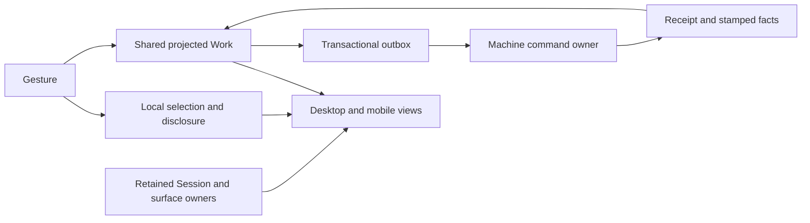

# LOO-906: immediate interactions across Desktop and mobile

Implementation updated 2026-11-15 after creation cut `72bb1d06d4` on origin/main `9cafc410ee`
(unchanged). Supersedes the Desktop-only delivery
boundary. No shipping or merge decision is recorded. Placement remains this Task;
no Wave is selected.

## Direction

Build one shared client state and command-reconciliation architecture: every
surface renders local intent immediately, then reconciles against causally newer
Machine facts without inventing execution readiness.

Jack Heart, comment `b38d7ddf-eb30-4331-b9e9-bbf9244ab700`:
> “Let’s make sure this is an aggressive systematic rewrite that sets us up to avoid these kinds of issues across the whole system, not just these specific interactions I’m talking about, and mobile and desktop are being considered”

Jack Heart, comment `e008238d-ab6b-4cf2-b307-581d122d6d81`:
> “That could include having a whole second store or a list of pending changes that are applied as a diff to the known store, something like that”

Jack Heart, comment `30bf26ae-1815-4e74-920e-8c6ed1986d56`:
> “We should do at least as well as all of those systems”

Jack Heart, comment `d555fa61-e250-4e7d-9da8-cdbe51600a3a`, answering
`scratch/concept-review.html` question 1:
> “1b for the question (or show noting)”

This selects immediate next-Task navigation after completion, with an empty state
allowed when none remains. It supersedes the keep-conversation-open draft.

Jack Heart, comment `5d9cb5de-a753-4758-b6a5-d0cb96accc64`:
> “another thing that is too slow is the time it takes for a task to look highlighted (and the session to render) after i click it, evne if its cached / recetn”

Jack Heart, comment `33675e39-b299-4a18-9049-3750eca5a8b8`:
> “or for a wave to expand when i click on it”

Earlier direction, retained:
> “launching a new task should get to new session instantaneously”

Jack Heart:
> “this is meant for deskto”
> “it takes like >10 seconds and there are a lot of intermediate states”
> “another thing i will add is that completing a task should make it disappear immediately”
> “can we talk about what are the fundamental causes of so many intermediate states and non-immediate reactivity?”
> “is it about slow sql? insufficient reactive UI archtiecture?”

The LOO-904 screenshot (not available here) was described as Reading workflow,
Restoring workspace, Not started/Start, and Conversation change unconfirmed.

## What the current code establishes

Start and Complete now use shared SwiftUI/Observation interaction and outbox
owners on both clients. Other mutations still disagree about when an interaction
happened. Desktop `TaskRunDraft` and `abandoningTaskIDs`, plus mobile view-owned
`SessionLink`, remain replacement targets (see the delete list). Revision-6 subscriptions now provide exact-query snapshot stamps;
server operation admission covers all typed writes, while live client outbox
migration still specializes creation. Native Session/Graph owners retain readiness.
Predecessor map: `bb936ac371`; earlier Desktop design: `7030e08a`.

Completion already saves a domain request, checks execution/PR conditions, settles
state, syncs planning and schedules retirement. Creation already prepares its
primary Session and Graph. Those waits are not a measured SQL/latency diagnosis.

## Established designs and dependency choices

Research and replica comparisons: `8b42a874db`, `bb936ac371`. Apollo/TanStack
give operation-layer precedents, not LF domain recovery; SwiftData, Sharing and
TCA don't give causal sync; a mutable replica would duplicate server-derived
membership. Direction: confirmed cache plus ordered operation overlays, one
normalized owner, Observation for rendering. The outbox uses system SQLite3 on
both targets (GRDB not adopted); the confirmed cache belongs in that database.

The cache/overlay owner must project every affected query, including Dashboard
membership and counts. If declarative membership cannot cover them, move the pure
projection into a shared portable core before client migration.

## State, ordering and reconciliation contracts

Detailed contracts and counterexamples before the presentation cut remain at
`737b50adba26689bb27e67839d9ab9b90564bf50:scratch/instant-task-session.md`
under Proposed contracts through Opening another query. Live requirements:

- Shared Swift owns each Machine's confirmed cache, ordered immutable commands,
  receipt recovery and projected membership. Hosts own selection, drafts and
  native readiness. Windows share an owner; devices share semantics. Save before
  send; publish intent before disk or discovery. Never fabricate entity DTOs.
- Keep IDs, original Machine/scope, sequence, resource lanes and dependencies.
  Conflicting commands serialize; independent resources proceed concurrently.
  Dependent commands await actual IDs. Unknown delivery blocks conflicting sends
  until domain recovery establishes ordering. Undo after send is another command.
- Persist cache, effects and outbox in one SQLite transaction owner. Released
  files retain exact IDs, words, outcomes and unknown send history through import.
  Recover sent work by original ID on its original Machine. Missing/unavailable
  lookup or a replaced epoch never authorizes replay. Admission precedes Git,
  planning, provider and domain waits; worker recovery requires domain permission.
- Stamped readings cover the same pinned snapshot as their bodies: Machine,
  epoch, schema, query identity/completeness and domain revisions. Reject departed
  epochs and older revisions; checkpoint IDs and arrival order establish nothing.
  Historical restoration still needs an epoch-reset mechanism.
- Each semantic stage records its result and fence in the domain transaction.
  `task.completion_requested` confirms intent; only `task.completed` confirms
  removal. `task.filed` binds Task/Session without proving admission or input.
  Provider/filesystem/planning readiness cannot borrow a SQLite fence.
- Apply an ordered effect independently to each affected query until its complete
  reading covers the confirming stage's fence. A covering count cannot discharge
  a held list; a fresh query cannot subtract twice while another remains behind.
  Partial pages, unrelated domains, native mounts and command return don't
  establish incorporation. Query identity/plan changes invalidate prior coverage.
- Three independent obligations retain a command: domain recovery, remaining
  query coverage and an unseen creation result. Mount or Inspect acknowledges
  presentation only. Retirement transfers lagging effects into bounded retained
  bases, or invalidates closed bases under persisted scoped floors. Reopen, another
  window or another filter must reconcile pending effects before its first cached
  frame. Later queries require a covering base even after command retirement.
- Definite refusal removes only effects proved uncommitted. Partial success keeps
  committed facts and inspection for unresolved stages. Supersession belongs in
  existing typed stage resolutions, identifying the withdrawn request and its
  replacement fence. A covering replacement reading restores membership without
  navigation; a late settler cannot complete a withdrawn request. Never borrow a
  newer completion's outcome. No generic error or missing stage proves rollback.
- Normalize display facts with domain provenance across queries. Unknown or
  incomparable freshness remains labeled/stale rather than replacing known facts.
  Complete filtered absence removes membership, never entity/native lifetime.
  Declarative membership supplies scopes, paths, ordering, counts and dependencies;
  use a portable core if client projection cannot express all queries.
- Every mutation declares effect stages, dependencies and recovery policy in an
  exhaustive registry. Value changes project values; membership changes project
  every known list; execution projects intent only. Retain file-base conflicts,
  existing control ownership and no offline terminal-byte queue.

Acceptance retains held settlement, definite refusal, commit followed by failed
planning/output, reordered list/count and restart, supersession in either race
order, withdrawing old then completing new, unseen/seen creation with lagging
queries, Inspect without a Work reading, epoch replacement, new queries/windows
and changed filters after Complete, closed-query restart and eventual retirement.
Each checks one effect per query, unchanged later navigation, no replay or permanent
lane blockage. Missing correlation stays inspectable. Both clients use the same
reducer; two-client closed-query convergence remains open.

## Local navigation, disclosure and retained content

Publish selection/highlight and disclosure in a bounded synchronous reducer before
starting effects. Cached lookup uses stable identity indexes, not a scan/re-sort of
all Work or warm preparation before the next frame. Read/decode/cache persistence,
planning acquisition and child loading run outside that gesture path. Profile
main-actor body/layout work separately; Observation alone cannot make a blocked
main actor paint sooner.

Bind a destination immediately to its cached projection and retained workspace.
The existing Desktop `GhosttySurfacePool`/workspace registry remains the native
owner. On mobile, move `SessionLink`/terminal occurrence lifetime out of transient
`SessionView` into a bounded retained-workspace owner; preserve its buffer/viewport
on quick navigation, with memory-pressure eviction. Background policy and input
control stay explicit. Cached display never certifies a location or enables input;
unknown or changed ownership pauses input while validation proceeds. Reuse a live
validated native occurrence rather than reopening it on each route push.

A→B→A increments navigation generation at every gesture. Async readers can update
their resource's confirmed cache but cannot select, focus, expand a collapsed group
or replace a newer occurrence. Completion's next selection uses this same local
owner. Wave expand shows cached children immediately; if cold, only the expanded
section shows loading/error. Collapse is immediate and a late child answer only
warms the cache. Where mobile uses a picker instead of a tree, retain that interaction
rather than introducing a new tree solely for parity; any disclosure uses the same
local semantics.

## Representative timelines

**Launch, both platforms:** tap Start → same UI turn closes editor and selects the
operation's conversation destination, showing submitted words → persist exact
request → submit/admit → bind actual Task and Session IDs → attach that Session
in place → native readiness enables input. Task/list/Graph frames reconcile in
any order without replacing the destination with Task details, Start or restoration.
Leaving changes only navigation; the operation remains in the outbox. On restart,
recover its original Machine/ID. Edit is available before send failure; uncertain
send offers lookup; attachment failure offers Retry opening, never recreate.

**Complete, both platforms:** tap Complete → remove from working/available/busy
memberships and update affected counts immediately; details show pending completion
→ persist/send → accepted/committed result → fresh stamped reads replace the layer.
Definitive refusal restores membership from the latest base while retaining later
operations. Lost reply keeps pending confirmation and recovers the same ID; refresh
failure after commit never restores a working row. Completing the selected Task
moves immediately to the next visible Task in the current list order, or an empty
state when none remains. Completing an unselected Task leaves selection alone.
Navigation changes once, in the initial interaction; neither acknowledgment nor
failure recovery selects again. Mobile gains the same completion action and
semantics, replacing the selected route rather than stacking obsolete destinations.

**Cached/recent Task:** click A → highlight A and bind its last-known workspace in
that interaction → show retained native content without a new preparation/attachment
when usable → refresh in background → update facts without blanking content. Record
click-to-highlight, click-to-cached-content and click-to-input-ready independently.
Rapid A→B→A and late replies never revive B or rebuild A's retained surface.

**Wave disclosure:** click → arrow/expanded state changes in that interaction →
cached children display, or one local loading area appears → children populate
without a second navigation action. Collapse during loading remains collapsed.

**Other mutations:** claim/unassign/move/rename/reopen/abandon, Session bind/new/move,
Wave editing, settings, layout/file save and delivery/Graph actions all enter the
same owner. Value edits project values; membership edits project all known lists;
execution commands project accepted intent and progress only. File writes retain
base-revision conflicts. Provider/Graph/PR success and Machine transfer completion
are never predicted. Terminal bytes, replies and control takeover remain with
existing bounded input owners: no offline keystroke queue or automatic resend.

## Delete — do not maintain

Already removed: the list at `908e317e4f:scratch/instant-task-session.md`, plus
creation in `CreationRecovery`, its Task presentation map, host request filters
and the phone query-before-opening path. The pending-command cut also removes
`CreationOperation`, `WorkInteraction.Failure`, the failure collections,
`WorkModel.completionFailures`, Retry Complete rows, creation-owned reopening,
retired-source release APIs/index and the rest of `CreationRecovery`. `LegacyTaskDraft` reads released files
only; SQLite commits precede rewrites.

Still remove, with their consumers:

- Desktop `TaskRunDraft.phase`, `abandoningTaskIDs`, other mutation refresh
  barriers and rename/bind replacement bookkeeping.
- View-owned mobile `SessionLink` teardown on ordinary Task switching; keep
  explicit Close, background policy and memory-pressure eviction.
- WorkCache/TaskFeed duplicate authoritative caches and duplicate freshness
  reconciliation. Keep UI-only workspace/layout/draft persistence.
- Tests exclusively asserting old intermediate screens, local exception sets or
  second-submit recovery; keep success, duplicate prevention, failure, departure,
  ownership, layout and first-turn coverage on the shared path.

## Forbidden outcomes

No per-screen exception sets, second mobile submission ledger, whole-snapshot
rollback, fake Task/Session DTOs or timer-based readiness. No SQL or network wait
before selection/disclosure, no retained surface replacement on a healthy revisit,
and no background completion that chooses navigation. A library or loading surface
alone does not complete the cut: query membership, overlap, uncertainty, migration
and both clients must use the same semantics.

## Delivery and acceptance

Indivisible cross-platform cut, with internal slices; no publish/merge authorization.
This scope exceeds the size-check signal because causal writes, both read paths
and their consumers must converge together.

1. **Architecture:** confirmed cache plus ordered overlays; validate query
   membership and persistence dependencies before cutting consumers over.
   Completion navigation is specified above.
2. Extend receipt/commit-stamp contracts and domain recovery; migrate saved data.
   Done: stamped subscription readings (revision 6), Git-free
   `operation.submit` admission, submitted/canonical identity, legacy envelope
   adoption, saved-command dispatch and both creation clients' outbox admission.
   Remaining: domain continuation and all-writer stage fences.
3. Build shared transactional client store and projection reducer; cut both
   transports over, including query membership. Delete predecessor owners.
4. Move selection, disclosure, launch, completion and every mutation family through
   their shared interaction owners on both clients;
   retain native execution and input owners. Update product/API docs together.
5. Measure actual latency and remove demonstrated backend waits independently of
   presentation; run the full acceptance matrix and native demo.

Slice status is under Current implementation cut; Complete starts slice 4.

Headless acceptance uses deterministic held/reordered replies, not timing sleeps:
shared reducer tests cover overlapping success/failure, stale reads, partial pages,
query changes, epoch reset, reconnect and every save/send/crash boundary. Desktop
and iOS production-view tests prove immediate launch/removal before held network
responses. Selection/disclosure tests assert state before held reads; A→B→A,
expand→collapse and reordered loads preserve cached content and surface identity.
Two windows and two clients prove all projected surfaces agree. The
command registry has exhaustive policy coverage. Receipt fixtures include Rust,
Swift/macOS and iOS; upgrade tests preserve existing pending submissions.

Focused commands: `ClientWorkStoreTests|OperationRecoveryPresentationTests` on
Desktop, `LoopflowiOSTests/ClientWorkStoreTests` on iOS, plus Rust operation
module filters. Gate owns wider suites; display diagnostics remain demo work.

## Latency and open review decisions

Trace gesture → state publication → render commit; selection adds cached-content
and input-ready endpoints, disclosure adds arrow/children/data-ready. Separate
retained hits, cold misses and eviction. Trace one operation through local
projection → save → admission → domain commit → subscription apply → native
readiness, with backend spans for SQLite lock/query, planning network, Git,
Graph registration and provider attach. Log IDs and durations, never authored
text. Compare in-process, Desktop local and mobile remote transports. EXPLAIN
changed SQL on the 10,000-Task fixture.

Proposed target: local reaction P95 under 100 ms, at least 20 native samples per
journey/platform, endpoints reported separately. Nothing here is measured yet.

## Implementation direction (2026-11-15)

### Synchronous intent and effect contracts

The detailed handoff, effect-stage and reordered-reading requirements remain in
`cfebc7f89a6c8c5301518a067f9cc3a2e977ee5a:scratch/instant-task-session.md`
(Implementation direction). Keep these acceptance requirements through subsequent
cuts: Complete publishes before Machine discovery or disk; save/receipt recovery
never navigates; settlement, supersession and per-query incorporation remain
independent. A held list retains its removal after a covering count and command
retirement, including restart, composed occurrences and unrelated domain writes.
Required domain correlation stays inspectable when unavailable. A newer Work
reading cannot replace an earlier command's original outcome. Attachment owns
input readiness and Retry opening for the same Session.

### Query destinations and leases

Built through `6e944e73b5a63bf4dfc28d091c21834e997e902d`; that commit's
`scratch/instant-task-session.md` retains the detailed contracts, exercised
counterexamples and check results. History holds original query identity, never
answers. Shared leases pin live queries; eight recent unleased answers are reusable.
Reopen reconciles disk/outbox before cached publication; generations reject earlier
replies. Retirement transfers lagging effects into retained bases or invalidates
closed bases under compact scoped floors. No close, eviction, acknowledgment or
native mount permits replay. Two-client convergence on the same closed query
remains unexercised.

### Start selects a conversation owned by the operation

Built at `5ccc4563bd`; direction and acceptance at
`6e944e73b5a:scratch/instant-task-session.md`, summarized under Current
implementation cut. The phone attachment now names **Reconnect**.

### A submitted conversation is one thing on both hosts

2026-11-15 creation presentation cut. The inspected predecessor map and complete
acceptance direction are at `908e317e4f3605766b6dc67c0a4be87ce32eb19f:scratch/instant-task-session.md`
under this heading. Shared `PendingOperation.presentation` now supplies status,
actions and inspection text. `PendingCommandActions` renders the same controls
in both conversations and Desktop's pending row, including after native readiness.
Both hosts list `WorkInteraction.listedOperations`;
ordinary Task and Session mounts acknowledge by resource. Inspect acknowledges
only when its receipt sheet mounts. A shown filed result hides normal Graph
preparation; a later admission failure restores its request row without navigation.
All command families now share the same failure presentation; the later cut
deletes `CreationRecovery` entirely.

The phone binds `SessionView` directly to the receipt's Session without a Work
query or fabricated Task DTO. Native attachment owns input and Retry opening;
command recovery remains visible alongside a recorded conversation. Desktop Start
requires a repository and keeps the editor words when none is resolved.

Retirement removes authored payloads and receipts. A compact identity in the same
SQLite owner retains request ID, draft ID, command digest and retirement time.
Source rewrites no longer release it. Opening
an older branch-format database compacts its retired payloads before file import.
An editor cleanup crash must still prevent duplicate creation.

Headless production-path acceptance: Start A, leave, A files, open its ordinary
row; no redundant request after restart. Held query never delays conversation
opening. Failed save offers same-ID retry and editable words, neither after save.
Attachment retry opens the recorded Session. Hold Graph admission after filing;
restart after uncertain send; retire before editor cleanup. Native display and
input latency remain demo/benchmark work, separate from these deterministic checks.

### A pending command is one thing, whatever its kind

2026-11-15 presentation cut, current worktree. The full inspected predecessor map
and counterexamples remain at `737b50adba:scratch/instant-task-session.md` under
Next implement direction. This is a headless engineering choice, not a recorded
product preference.

`PendingOperation` replaces `CreationOperation` and `WorkInteraction.Failure`.
The shared owner derives each pending command from its immutable payload, receipt
and recovery state. Both lists render the same actions: Try again before save,
Edit request for unsaved creation words, Check request for saved unknown outcomes,
Inspect for receipt attention. Attention messages are data; hosts word normal
progress without comparing copy. Failed unsaved completion withdraws only its
effect, retains the original ID/payload for retry and never navigates again.
Saved uncertain completion retains its removal through recovery.

`CreationRecovery`, its presentation map, per-kind failure collections and both
Retry Complete rows are deleted. Session commands and Task edits observe through
`WorkInteraction`, including shown-result acknowledgment by resource. Check request
retires the old observation lease before looking up the saved outcome.

Reopening belongs to native attachment: Desktop retains Retry opening from
`taskOpening`; the phone restores Reconnect. No command action names opening.
Desktop's new-Task sheet says Open a repository to start a Task when scope is
missing; `beginTask` no longer silently refuses because another launch is selected.

Retired imported/editor-linked commands retain compact IDs/digest/time permanently;
no authored words or receipts. `sourceReleased`, its index and all source-release
APIs/transactions are deleted. Start rotates the editor's in-memory draft revision
before asynchronous cleanup; a failed file rewrite cannot re-submit the original
revision. Existing branch-format retired payloads compact on open.

Disconnected delivery and Waiting for connection remain implementation work;
READMEs do not claim that behavior yet. The one presentation above is its owner.

## Current implementation cut

Start and Complete publish through shared `WorkInteraction` on both hosts. Creation
freezes ID/payload/scope/time before its synchronous selection callback, saves before
send and derives `PendingOperation` from the saved command and receipt stages.
Desktop keeps the operation selected through native readiness; iOS replaces its
editor with an operation route. Neither receipt nor recovery navigates after
leaving. Attachment Retry uses the recorded Session. Only a bound Session result can acknowledge presentation by resource. Native
readiness gates the pending creation mount, not ordinary Session recovery.
A mounted result acknowledges presentation without settling independent query/planning obligations. Unsaved
failure retains words for same-ID retry or deliberate editing.

Phone files import each original Machine/ID/command/source/outcome into SQLite,
transactionally per Machine and idempotently across source cleanup crashes.
Matching rows keep their send epoch and receipt; conflicts leave the source intact.
Imported missing send evidence remains inspectable, never unsent. Editor revisions
are associated with submitted commands in that transaction; surviving editor files
cannot submit again after save or retirement. Imported and editor-linked retired
commands leave compact source identities in the existing owner, outside indexed pending reads.
No second receipt ledger exists. Other-Machine imports/lookups open no transport.

Query leases retain their previous bounded semantics. Last-close suspends query
publication while command recovery continues; reopening reconciles before display,
including without a network event. Retirement cancels its receipt observer and
transfers lagging effects or scoped reload floors. The complete prior contracts and
query checks remain at `6e944e73b5a:scratch/instant-task-session.md`.

Remaining: disconnected Complete/rename/move delivery and
Waiting for connection under the recorded 1a direction, built on that one presentation; cross-client closed-query convergence; exhaustive
effect/dependency declarations and cross-query provenance; other mutation recovery
and resource lanes; retained mobile `SessionLink`; projected inspection;
historical-restoration epoch reset; valid native benchmark baseline. One cross-platform PR; no shipping decision. SQLite
fences cannot certify filesystem/provider readiness.

### Admission identity and recovery contract

Built: the submitted envelope saves before discovery, Git, planning, lock or
provider calls; released rows adopt only the first verified envelope and keep their
domain recovery disposition. Contract: `465274b547:scratch/instant-task-session.md`;
server fixtures: `19612daf41:scratch/instant-task-session.md`.

Still open: reordered validation replies must update only the active epoch with a
newer receipt revision, never enabling input or retiring overlays, and full
cross-platform presentation acceptance.

## Upstream acceptance retained

Origin/main `9cafc410ee` supplies #1942–#1944 and #1947 (`selection_states`); the
shared projection and retained-occurrence migration keep their coverage. Map:
`639411f1b2:scratch/instant-task-session.md`.

## Benchmark implementation and observations (2026-11-14)

Exact feedback and host preferences are in `desktop-reactivity-feedback.md`; the
harness README maps ADEMark (https://github.com/zqkra/ademark at `119a5f7b99`,
retrieved 2026-11-14) and LF journeys to endpoints. No borrowed result is a
Loopflow measurement. `desktop_performance.py preflight` rejects contaminated
hosts; thermal/swap and whole-trial load are not yet checked. `PerfClock.interaction`
marks separate selection publication, completion return and phone mount from pixels.
Rust CLI volume reports aggregate SQLite time; mutex/planning/provider attribution
is incomplete. `measureWriteToVisible` still refers to removed `pm_items.body`.

Observed: both hosts failed load preflight on 2026-11-14 and again 2026-11-15T10:40:27Z
(CPU 371.0%, load 39.52); local again at 13:19:55Z (571.1% CPU, load 83.5), no
native trial began. The mini runs macOS 15.5 against Desktop's macOS 26 target. Debug 10k constructor warm P95 235.92 ms on a rejected host (diagnostic
only). 10k receipt lookup/admission P95 0.033 ms, all 20 receipt statements keyed
(nextest `7f2b652c-19e3-4026-8961-d4e3f4d84d37`). No gesture, native paint/input or
backend-stage baseline exists. Raw files and earlier detail: `8b42a874db`,
`bb936ac371` (`scratch/instant-task-session.md`).

Implementation owns a valid benchmark baseline; demo owns native usability.

Earlier checks and the 10k client-query observations:
`737b50adba:scratch/instant-task-session.md` (Creation checks),
`6e944e73b5a:scratch/instant-task-session.md` and
`d9bf1c21ae:scratch/instant-task-session.md`. Pending-command checks
(2026-11-15; inherited `LF_*` cleared):
- `swift build --build-tests --package-path swift --jobs 4 -Xswiftc -gnone`: passed; gate owns wider suites and the Xcode fallback build.
- `scripts/test_desktop.sh --skip-build --filter 'ClientWorkQueryTests|OperationRecoveryPresentationTests|operationConversationUsesNativeReadiness'`: 51 checks passed. After the final candidate/attachment repair, its six recovery/native-readiness cases passed again. Covers mixed save failures, same-ID retry, no-repository copy, planning recovery, bound Session acknowledgment and unchanged later selection.
- `uv run python scripts/test_ios.py -only-testing:LoopflowiOSTests/MobileTaskCreationTests -only-testing:LoopflowiOSTests/ClientWorkQueryTests`: 46 checks passed on the final shared model, including editor revision rotation, retirement before file cleanup and the shared mixed-failure case. Eight SessionTerminal checks also passed earlier in the cut; disposable Simulators were removed.
- `uv run python scripts/check_swift_multiplatform_boundaries.py`, `git diff --check`: passed; gate owns archive/documented-command checks. Native latency remains unmeasured.

## Conversation concept review · 2026-11-15

The experience has three independent owners: local selection/disclosure, projected
Work plus pending commands, and retained native Session readiness. One stable
destination renders those facts; delivery milestones never become replacement
screens. Local selection and cached presentation must remain useful when no
Machine request can finish. Completion removes its displayed occurrence and moves
to the next Task (the earlier quoted 1b); rejection restores membership without
undoing a later selection. Successful domain changes survive later sync errors.

Current inspected code: shared `WorkInteraction.complete` and `createTask` publish
before save and invoke origin selection synchronously. `assignTask`, `moveTask`, `reopenTask` still use
`performTaskAction` and confirmation waits; Abandon retains a separate local set.
`OperationDeclaration` covers six kinds. These are unfinished cutover, not the
final shared contract. The review changed no production code or execution state.

Proposed usage, implementation still required:
> Select a recent Task to see its retained conversation immediately. Expand a
> Wave without waiting for the Machine. Complete removes the Task and opens the
> next one, or an empty view. Pending changes show where they were made. If a
> change is refused, its row/value returns with an explanation; your current
> selection stays where you put it.

Jack Heart replied “1a” to conversation concept-review question 1 on 2026-11-15.
The numbered option was: “Save routine edits while disconnected, show ‘Waiting
for connection,’ and send on reconnect.” Complete, rename and move save and project
locally on both clients, then deliver in order to their original Machine. Pending
changes survive app restart. Unknown delivery is recovered by original ID, never
blindly replayed. A definite refusal restores the affected value/membership without
changing later navigation. Native terminal input, control takeover and execution
readiness retain their existing live-owner rules. This settles disconnected routine
editing; implementation and recovery coverage remain required before shipped docs
claim the behavior.

Show next: Start, Complete, recent Task and Wave expansion on Desktop and mobile
with held responses, failed save, lost answer, reconnect and rapid navigation;
visible response measured separately from Session input readiness, on a quiet host.
