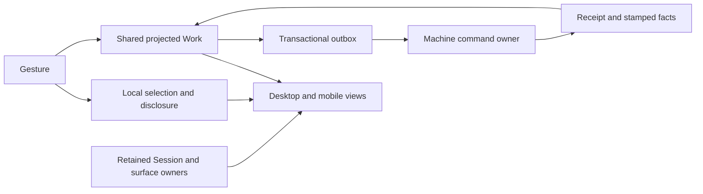

# LOO-906: immediate interactions across Desktop and mobile

Realigned 2026-11-15 at code `72bb1d06d4` on origin/main `9cafc410ee`
(unchanged). Supersedes the Desktop-only delivery
boundary. No shipping or merge decision is recorded. Placement remains this Task;
no Wave is selected.

## Direction

Build one shared client state and command-reconciliation architecture: every
surface renders local intent immediately, then reconciles against causally newer
Machine facts without inventing execution readiness.

Jack Heart, comment `b38d7ddf-eb30-4331-b9e9-bbf9244ab700`:
> “Let’s make sure this is an aggressive systematic rewrite that sets us up to avoid these kinds of issues across the whole system, not just these specific interactions I’m talking about, and mobile and desktop are being considered”

Jack Heart, comment `e008238d-ab6b-4cf2-b307-581d122d6d81`:
> “That could include having a whole second store or a list of pending changes that are applied as a diff to the known store, something like that”

Jack Heart, comment `30bf26ae-1815-4e74-920e-8c6ed1986d56`:
> “We should do at least as well as all of those systems”

Jack Heart, comment `d555fa61-e250-4e7d-9da8-cdbe51600a3a`, answering
`scratch/concept-review.html` question 1:
> “1b for the question (or show noting)”

This selects immediate next-Task navigation after completion, with an empty state
allowed when none remains. It supersedes the keep-conversation-open draft.

Jack Heart, comment `5d9cb5de-a753-4758-b6a5-d0cb96accc64`:
> “another thing that is too slow is the time it takes for a task to look highlighted (and the session to render) after i click it, evne if its cached / recetn”

Jack Heart, comment `33675e39-b299-4a18-9049-3750eca5a8b8`:
> “or for a wave to expand when i click on it”

Earlier direction, retained:
> “launching a new task should get to new session instantaneously”

Jack Heart:
> “this is meant for deskto”
> “it takes like >10 seconds and there are a lot of intermediate states”
> “another thing i will add is that completing a task should make it disappear immediately”
> “can we talk about what are the fundamental causes of so many intermediate states and non-immediate reactivity?”
> “is it about slow sql? insufficient reactive UI archtiecture?”

The LOO-904 screenshot (not available here) was described as Reading workflow,
Restoring workspace, Not started/Start, and Conversation change unconfirmed.

## What the current code establishes

Start and Complete now use shared SwiftUI/Observation interaction and outbox
owners on both clients. Other mutations still disagree about when an interaction
happened. Desktop `TaskRunDraft` and `abandoningTaskIDs`, plus mobile view-owned
`SessionLink`, remain replacement targets (see the delete list). Revision-6 subscriptions now provide exact-query snapshot stamps;
server operation admission covers all typed writes, while live client outbox
migration still specializes creation. Native Session/Graph owners retain readiness.
Predecessor map: `bb936ac371`; earlier Desktop design: `7030e08a`.

Completion already saves a domain request, checks execution/PR conditions, settles
state, syncs planning and schedules retirement. Creation already prepares its
primary Session and Graph. Those waits are not a measured SQL/latency diagnosis.

## Established designs and dependency choices

Research and replica comparisons: `8b42a874db`, `bb936ac371`. Apollo/TanStack
give operation-layer precedents, not LF domain recovery; SwiftData, Sharing and
TCA don't give causal sync; a mutable replica would duplicate server-derived
membership. Direction: confirmed cache plus ordered operation overlays, one
normalized owner, Observation for rendering. The outbox uses system SQLite3 on
both targets (GRDB not adopted); the confirmed cache belongs in that database.

The cache/overlay owner must project every affected query, including Dashboard
membership and counts. If declarative membership cannot cover them, move the pure
projection into a shared portable core before client migration.



## Proposed contracts

Shared implementation belongs in `swift/Loopflow`, used by both app targets.
One `ClientWorkStore` per connected Machine/account in each app process; all
Desktop windows share it. Windows and mobile routes own selection and drafts.
Devices share semantics, not an in-memory instance or credentials. A shared
`InteractionModel` implementation holds per-window/route selection, disclosure
and generation; purely local actions never enter the server outbox.

- `OperationID`: client UUID, durable across reconnect/restart. Separate from
  transport request IDs and Task/Session identities. New destinations initially
  refer to an operation; server receipts bind real entity IDs without fake DTOs.
- `PendingOperation`: immutable typed command, Machine, original scope, local
  sequence, resource lanes, dependencies, projection effect and delivery state.
  Saving, queued, sent/uncertain, accepted, committed and rejected describe real
  different facts; they are not separate screens. Execution/attachment readiness
  belongs to existing Session/Graph owners.
- `ReadingStamp`: Machine, store epoch, query/scope and schema identity, complete
  coverage, domain revision vector. Frames carry the stamp from the same pinned
  snapshot as their contents. External observations retain their own freshness;
  they cannot certify a SQLite commit. Epoch changes force reconciliation.
- `OperationReceipt`: ID, payload fingerprint, authoritative disposition/result,
  affected resources and commit fence. The domain writer records that fence and
  committed result in the transaction that changes displayed facts; reading the
  global counter after a slow command returns is insufficient. Multi-stage commands
  publish stage-specific commits, not a guessed final fence. A receipt may report
  accepted but still settling. Rejection is definitive only when its effect did not commit; partial
  external effects are retained as uncertain/recoverable, never called rolled back.
- `ProjectedWork`: confirmed records/query membership plus ordered local effects
  and pending/error annotations. It is presentation data, not a modified wire DTO.
  Disk stores the confirmed cache and outbox atomically; Keychain/credentials stay
  outside it and retained payloads keep existing device-protection policies.

Core API shape:

```swift
@MainActor func begin(_ command: WorkCommand, from origin: InteractionOrigin) -> OperationID
func receive(_ reading: StampedWorkReading)
func receive(_ receipt: OperationReceipt)
func projection(for query: WorkQuery) -> ProjectedWork
@MainActor func select(_ destination: WorkDestination) // local state, no I/O
@MainActor func setExpanded(_ wave: WaveID, _ expanded: Bool) // local disclosure
func recover(_ id: OperationID) async
```

`begin` publishes locally before its first await; persistence completes before
send. Save failure removes only that effect and retains editable words. The
outbox, receipt handling and projection update use one serialized reducer and one
transactional disk owner. Draft debounce remains independent. On restart, load
saved layers before displaying cached queries, then look up each sent operation on
its original Machine. Only definitely unsent or domain-authorized continuations
send; an unavailable lookup never means absence. Offline queueing is explicit and
limited to typed durable commands; controls requiring a live owner remain paused.

Generalize the current creation receipt owner rather than adding another server
ledger. Preserve all saved creation payloads, IDs and outcomes in one finished
additive migration. The physical table name may remain `creation_receipts` during
released-binary coexistence; there is one logical receipt store and no dual write.
Every UI command uses a typed operation envelope and durable lookup. CLI output
and domain execution remain their existing owners. Transport admission is a new
operation-envelope acknowledgment; it does not weaken the existing Task creation
receipt's Graph-admitted milestone. New envelope/stamp fields require a negotiated
protocol revision, shared DTO fixtures and coordinated app/helper deployment.

The server records admission before dispatch and returns its operation identity
without waiting for planning, Git or provider readiness. Reuse the existing
bounded effect execution; preserve jobs across client disconnection. A server
restart resumes only domain-proven continuations. A recorded dispatch whose effect
cannot be established becomes uncertain; there is no generic replay of arbitrary
writes. Creation's Continue/Inspect rules and completion's durable request become
domain recovery handlers under this one receipt owner. Operation observation
gets a change revision/notification; recovery is not a five-second UI poll.

## Ordering, reconciliation and query coverage

Project layers in local sequence order. Commands touching the same entity serialize
dispatch; multi-entity commands acquire a deterministic set of resource lanes.
Different resources can proceed concurrently. A dependent command waits for real
IDs; independent operations do not wait for a whole-repository refresh.

For Complete A followed by Reopen B: both intent changes appear immediately; A's
success or rejection removes/rebases only A, leaving B. Uncertain A blocks B's
conflicting dispatch until recovery establishes ordering. Once sent, commands are
immutable; Undo is a new command, not deletion of a possibly executed request.
Other devices' changes enter as newer authoritative facts and are rebased below
remaining local intent. Server revisions/preconditions resolve concurrent edits;
field conflicts retain drafts and show the current value.

A response cannot retire projection layers merely because it arrived last. For
each affected query, retain the effect until that query's complete stamped reading
dominates the receipt's commit fence. Unrelated parts, cached frames, query changes,
missing entities in partial pages and a fresh native surface cannot acknowledge it.
After all affected cached queries converge, drop the layer; retain failed or
uncertain durable requests until resolved. Closed queries are invalidated and
must reload beyond their fence before their cached base can be shown unoverlaid.

Keep the durable operation's lifetime separate from where its effect still
applies. Once a query incorporates a committed operation, stop applying that
operation to that query, even while another query remains behind its fence.
Retaining the operation for recovery must not subtract a completed Task twice
from a fresh count. Track incorporation per affected query; retire the durable
operation only after its remaining coverage obligations are discharged.

Normalized records also need provenance across queries. Accept confirmed database
facts only when the incoming stamp covers the domains those facts depend on and
does not regress their stored revisions within the same Machine/epoch/schema.
Generate those dependencies with the membership vocabulary; never order facts by
arrival, checkpoint ID or query hash. Merge independently stamped fact groups;
when freshness cannot be ordered, retain the known value as stale and request a
covering reading rather than choosing a winner. External observations keep their
own freshness. Missing membership in a complete filtered query removes that
membership, not the normalized entity or its retained workspace. A partial or
unavailable result establishes neither removal nor incorporation.

Changing epoch invalidates comparison with the old confirmed cache and fences.
Bind incoming frames to the active connection/store generation so a delayed old
frame cannot switch the cache back. Keep submitted operations, their original
identity and pending presentation while recovering receipts on the original
Machine. An old fence cannot acknowledge the replacement base, and epoch reset
is never permission to resend uncertain work.
Historical-backup restoration must establish a new epoch before serving cached
clients; the reset mechanism remains implementation work.

Normalize Task/Session/Wave identity across lists, detail pages, boards, searches
and counts. Cut `WorkViewPlan` membership over to a server-produced declarative
selection/group/sort plan over display facts, evaluated by the shared client
projection owner. Generate its vocabulary from Rust and enforce cross-language
fixtures; do not write a second ad hoc Task status resolver in Swift. An unloaded
page keeps explicit unknown membership plus a pending result, rather than a
fabricated row or count. Do not remove
an overlay merely because another client has changed a different domain revision.
Every `ServedWrite` and UI configuration mutation must declare affected entities,
queries and projection policy in an exhaustive registry: editable-value change,
membership change, or immediate pending execution with no predicted execution fact.

### Effect acknowledgment follows the domain stage

Next implement direction from concept-review: the operation is the durable request;
its projected effects have separate acknowledgment obligations. Delivery, domain
commit, query incorporation and native readiness are independent facts, not phases
of one screen. Keep the existing receipt owner and stage results; do not add a
second lifecycle ledger to make them appear linear.

The exhaustive command registry must map each projected effect to its confirming
semantic stage and fact domains, affected query dependencies, and recovery policy.
A stage fence can discharge only the effects that stage establishes. For Complete,
`task.completion_requested` confirms pending intent, not completed membership. Only
`task.completed` plus a covering reading can replace the optimistic removal with
confirmed membership. A read that covers the request stage while settlement is held
must not restore the row or retire its removal. For Start, `task.filed` can bind
Task/Session identity without proving Graph admission, attachment or input readiness.
An operation can therefore have incorporated effects and unresolved effects at once.

For each effect/query obligation, apply the overlay until a complete covering read
incorporates the confirming stage; then use the newer confirmed facts for that
query. Keep unresolved effects and their recovery annotations. Query incorporation
and cache replacement persist atomically with the outbox so restart cannot apply a
count delta twice or reveal a pending row between loading base and layers. No-op
success must provide a domain-established current result/fence or a covering
confirmation read; neither a missing stage nor `finished` alone acknowledges it.

A definite refusal removes only effects proved not to have committed. If one stage
committed and a later stage fails, retain its confirmed facts, reconcile those
queries and recover the remaining effect in place. Absence of commits is not proof
of refusal: a filesystem/provider effect can happen before receipt recording.
External facts need their own confirmation contract, never a fabricated SQLite
fence. Keep unavailable and uncertain outcomes inspectable with the saved command;
recovery never reselects a destination or generically resends a dispatched command.

Counterexamples required before both-client cutover:

- Complete saves its request, then settlement is held. A fresh list covers only
  the request fence: the row remains projected out. Settlement refusal restores it
  from the latest base only when the domain establishes no completion effect.
- Settlement commits, then planning sync or command output fails. The Task stays
  completed, even after restart, while the remaining failure stays visible.
- One count covers settlement while another list is held; restart between their
  replies. Each query incorporates the removal once, independently of delivery.
- A Task is filed while Graph admission or native attachment fails. Keep its exact
  Task/Session and submitted words; Retry opening never creates another Task.
- A successful no-op or external mutation returns without a new SQLite stage.
  Resolve its stated confirmation obligation; never retire all effects merely
  because command output succeeded.

### Superseding an intent must resolve its effect

Next implement direction: a domain request can end without producing its intended
effect. Record that resolution in the existing receipt owner, separately from
command delivery and from successful commits. In particular, withdrawing a saved
completion request must not leave its optimistic removal and resource lane pending
forever. This follows the existing newer-facts/rebase contract; it introduces no
new product choice or cancellation control.

Concrete recovery: Complete A hides its row and selects B. While settlement is
held, Reopen from another client or the CLI withdraws A's exact saved request.
The withdrawing domain transaction records supersession for that request's
subscribers, with its replacement-fact fence. A covering read restores A from
the latest base; B stays selected. A late settler cannot complete the withdrawn
request. If completion committed before Reopen, retain that original commit and
result instead; the newer covering facts show Reopen. Neither path repeats Complete
or borrows a later completion's result.

Extend the effect/stage registry and Rust/Swift receipt contract with typed domain
resolutions for committed, definitely refused and superseded effects, alongside
pending/uncertain recovery. Keep them in the one receipt owner. A generic error,
missing request, current Task status or `delivery=finished` is insufficient to
infer a resolution. Every writer that withdraws or replaces a domain request must
record it in the same transaction, including CLI and periodic writers. Historical
rows without that record stay inspectable unless domain recovery can establish
the exact outcome. Extend the single draft migration and cross-language fixtures.

Persist each effect's resolution and per-query incorporation with the confirmed
cache. Supersession does not immediately expose a stale base: keep the pending
projection until a covering replacement reading (or an authoritative replacement
fact in the same transaction) can rebase it. Release conflicting dispatch only
when domain recovery establishes the relevant prior writer can no longer mutate
that resource; retained query coverage alone must not hold the execution lane.
Outstanding external stages keep their own recovery and ordering obligations.
Refusal or supersession never erases an earlier commit or declares provider,
planning or cleanup work rolled back. A recovered Task result with a retained
error must still expose the unresolved stage's recovery action on both clients.

Before projection cutover, hold settlement across withdrawal, restart and reordered
receipt/list/count replies. Race settlement against Reopen in both transaction
orders, and withdraw an old request before completing a newer one. Assert eventual
row/count convergence, unchanged later selection, no duplicate dispatch and no
permanent lane blockage once that domain obligation resolves. These extend the existing success and uncertainty cases. Server withdrawal and
restart cases now record supersession; client projection and navigation checks
remain open.

### Seeing a result does not incorporate its effects

Next implement direction: replace presentation-driven deletion with a presentation
acknowledgment in the same durable operation record. A mounted Task/Session or
Inspect result can acknowledge that its saved result was shown. It cannot confirm
query membership, release a resource lane, establish native input readiness or
resolve domain uncertainty. No new receipt ledger or user-facing phase is needed.

Keep three independent retention obligations: unresolved domain recovery,
unincorporated effect/query coverage, and an unpresented creation result. Retire
the saved command only when all applicable obligations are discharged. Persist
the presentation acknowledgment alongside the operation; query incorporation,
cache replacement and resulting retirement remain one transaction. A closed query
can discharge coverage through persisted invalidation and its required reload
fence, never by silently treating its old cache as current. Queries already
incorporated stop applying the effect even while the operation remains retained.

For Start, show the exact admitted conversation immediately. Once its result is
shown, remove the redundant recovery prompt, while retaining the command and
remaining effects internally until covering facts arrive. Closing that window or
restarting cannot lose the pending list/count obligations. Conversely, converged
queries do not discard an unseen recoverable creation result. Attachment failure
still offers Retry opening for the same Session; viewing an Inspect receipt does
not settle that failure, hide its recovery action or authorize another creation.
An epoch change invalidates
old fact comparisons without undoing the local fact that a result was shown;
that acknowledgment cannot certify the replacement database.

Required counterexamples: mount a finished creation while another window's list
and count are held, then restart; inspect only receipt text without a stamped Work
reading; converge all queries before any result mounts; show a partially committed
creation whose attachment failed; replace the epoch between presentation and
incorporation. Each retains exactly its outstanding obligations, with no duplicate
count delta, replay, recovery prompt or navigation change. Cover both clients.

### Opening another query must preserve pending intent

Next implement direction: affected-query coverage is a dependency rule, not a
fixed list of the views open when `begin` runs. Opening another window, changing a
filter or returning to a cached query must evaluate the same ordered effects
before exposing its first cached frame. Derive applicability from the command's
resource/fact dependencies and the declarative query plan. Persist the plan's
identity/version with cached membership; a changed plan cannot reuse an old
incorporation acknowledgment. Unknown membership stays unknown as specified above.

Concrete interaction: Complete A hides it in Working, then open Dashboard while
its older cached count still includes A. Apply the same removal there. If that
count instead comes from a covering settlement reading, do not subtract again.
If Reopen superseded the request, retain the pending projection only until a
replacement reading covers that resolution. None of these reads changes selection.

Make operation retirement finite without requiring every possible future query
to be opened. In the cache/outbox transaction, either incorporate each affected
stored query or invalidate its base with its required confirmation fence. Opening
an invalidated query cannot expose that stale base as current. Queries created
later evaluate retained effects; after operation retirement they must use a base
that satisfies the persisted invalidation requirement or fetch a covering reading.
Keep such requirements with cache provenance, not an immortal saved command.
An epoch change still requires original-Machine recovery; invalidation is never
permission to replay uncertain work.

Before cutover, open a second window/query after Complete, close every affected
view, restart, then reopen from disk. Reorder a covering count and lagging list;
change filter/plan identity while replies are held. Assert one removal per query,
no stale row flash, no lost effect and eventual operation retirement without
opening every view. Cover Desktop and mobile through the same reducer.

## Local navigation, disclosure and retained content

Publish selection/highlight and disclosure in a bounded synchronous reducer before
starting effects. Cached lookup uses stable identity indexes, not a scan/re-sort of
all Work or warm preparation before the next frame. Read/decode/cache persistence,
planning acquisition and child loading run outside that gesture path. Profile
main-actor body/layout work separately; Observation alone cannot make a blocked
main actor paint sooner.

Bind a destination immediately to its cached projection and retained workspace.
The existing Desktop `GhosttySurfacePool`/workspace registry remains the native
owner. On mobile, move `SessionLink`/terminal occurrence lifetime out of transient
`SessionView` into a bounded retained-workspace owner; preserve its buffer/viewport
on quick navigation, with memory-pressure eviction. Background policy and input
control stay explicit. Cached display never certifies a location or enables input;
unknown or changed ownership pauses input while validation proceeds. Reuse a live
validated native occurrence rather than reopening it on each route push.

A→B→A increments navigation generation at every gesture. Async readers can update
their resource's confirmed cache but cannot select, focus, expand a collapsed group
or replace a newer occurrence. Completion's next selection uses this same local
owner. Wave expand shows cached children immediately; if cold, only the expanded
section shows loading/error. Collapse is immediate and a late child answer only
warms the cache. Where mobile uses a picker instead of a tree, retain that interaction
rather than introducing a new tree solely for parity; any disclosure uses the same
local semantics.

## Representative timelines

**Launch, both platforms:** tap Start → same UI turn closes editor and selects the
operation's conversation destination, showing submitted words → persist exact
request → submit/admit → bind actual Task and Session IDs → attach that Session
in place → native readiness enables input. Task/list/Graph frames reconcile in
any order without replacing the destination with Task details, Start or restoration.
Leaving changes only navigation; the operation remains in the outbox. On restart,
recover its original Machine/ID. Edit is available before send failure; uncertain
send offers lookup; attachment failure offers Retry opening, never recreate.

**Complete, both platforms:** tap Complete → remove from working/available/busy
memberships and update affected counts immediately; details show pending completion
→ persist/send → accepted/committed result → fresh stamped reads replace the layer.
Definitive refusal restores membership from the latest base while retaining later
operations. Lost reply keeps pending confirmation and recovers the same ID; refresh
failure after commit never restores a working row. Completing the selected Task
moves immediately to the next visible Task in the current list order, or an empty
state when none remains. Completing an unselected Task leaves selection alone.
Navigation changes once, in the initial interaction; neither acknowledgment nor
failure recovery selects again. Mobile gains the same completion action and
semantics, replacing the selected route rather than stacking obsolete destinations.

**Cached/recent Task:** click A → highlight A and bind its last-known workspace in
that interaction → show retained native content without a new preparation/attachment
when usable → refresh in background → update facts without blanking content. Record
click-to-highlight, click-to-cached-content and click-to-input-ready independently.
Rapid A→B→A and late replies never revive B or rebuild A's retained surface.

**Wave disclosure:** click → arrow/expanded state changes in that interaction →
cached children display, or one local loading area appears → children populate
without a second navigation action. Collapse during loading remains collapsed.

**Other mutations:** claim/unassign/move/rename/reopen/abandon, Session bind/new/move,
Wave editing, settings, layout/file save and delivery/Graph actions all enter the
same owner. Value edits project values; membership edits project all known lists;
execution commands project accepted intent and progress only. File writes retain
base-revision conflicts. Provider/Graph/PR success and Machine transfer completion
are never predicted. Terminal bytes, replies and control takeover remain with
existing bounded input owners: no offline keystroke queue or automatic resend.

## Delete — do not maintain

Already removed: the list at `908e317e4f:scratch/instant-task-session.md`, plus
creation in `CreationRecovery`, its Task presentation map, host request filters
and the phone query-before-opening path. `LegacyTaskDraft` reads released files
only; SQLite commits precede rewrites.

Still remove, with their consumers:

- `WorkInteraction.Failure`/`failures`, `failedCreations`, `failedDeliveries`,
  `WorkModel.completionFailures`, both "Retry Complete" rows, `CreationOperation.Action.open`,
  the retired-source release path and the rest of `CreationRecovery` (next direction).
- Desktop `TaskRunDraft.phase`, `abandoningTaskIDs`, other mutation refresh
  barriers and rename/bind replacement bookkeeping.
- View-owned mobile `SessionLink` teardown on ordinary Task switching; keep
  explicit Close, background policy and memory-pressure eviction.
- WorkCache/TaskFeed duplicate authoritative caches and duplicate freshness
  reconciliation. Keep UI-only workspace/layout/draft persistence.
- Tests exclusively asserting old intermediate screens, local exception sets or
  second-submit recovery; keep success, duplicate prevention, failure, departure,
  ownership, layout and first-turn coverage on the shared path.

## Forbidden outcomes

No per-screen exception sets, second mobile submission ledger, whole-snapshot
rollback, fake Task/Session DTOs or timer-based readiness. No SQL or network wait
before selection/disclosure, no retained surface replacement on a healthy revisit,
and no background completion that chooses navigation. A library or loading surface
alone does not complete the cut: query membership, overlap, uncertainty, migration
and both clients must use the same semantics.

## Delivery and acceptance

Indivisible cross-platform cut, with internal slices; no publish/merge authorization.
This scope exceeds the size-check signal because causal writes, both read paths
and their consumers must converge together.

1. **Architecture:** confirmed cache plus ordered overlays; validate query
   membership and persistence dependencies before cutting consumers over.
   Completion navigation is specified above.
2. Extend receipt/commit-stamp contracts and domain recovery; migrate saved data.
   Done: stamped subscription readings (revision 6), Git-free
   `operation.submit` admission, submitted/canonical identity, legacy envelope
   adoption, saved-command dispatch and both creation clients' outbox admission.
   Remaining: domain continuation and all-writer stage fences.
3. Build shared transactional client store and projection reducer; cut both
   transports over, including query membership. Delete predecessor owners.
4. Move selection, disclosure, launch, completion and every mutation family through
   their shared interaction owners on both clients;
   retain native execution and input owners. Update product/API docs together.
5. Measure actual latency and remove demonstrated backend waits independently of
   presentation; run the full acceptance matrix and native demo.

Slice status is under Current implementation cut; Complete starts slice 4.

Headless acceptance uses deterministic held/reordered replies, not timing sleeps:
shared reducer tests cover overlapping success/failure, stale reads, partial pages,
query changes, epoch reset, reconnect and every save/send/crash boundary. Desktop
and iOS production-view tests prove immediate launch/removal before held network
responses. Selection/disclosure tests assert state before held reads; A→B→A,
expand→collapse and reordered loads preserve cached content and surface identity.
Two windows and two clients prove all projected surfaces agree. The
command registry has exhaustive policy coverage. Receipt fixtures include Rust,
Swift/macOS and iOS; upgrade tests preserve existing pending submissions.

Focused commands: `ClientWorkStoreTests|OperationRecoveryPresentationTests` on
Desktop, `LoopflowiOSTests/ClientWorkStoreTests` on iOS, plus Rust operation
module filters. Gate owns wider suites; display diagnostics remain demo work.

## Latency and open review decisions

Trace gesture → state publication → render commit; selection adds cached-content
and input-ready endpoints, disclosure adds arrow/children/data-ready. Separate
retained hits, cold misses and eviction. Trace one operation through local
projection → save → admission → domain commit → subscription apply → native
readiness, with backend spans for SQLite lock/query, planning network, Git,
Graph registration and provider attach. Log IDs and durations, never authored
text. Compare in-process, Desktop local and mobile remote transports. EXPLAIN
changed SQL on the 10,000-Task fixture.

Proposed target: local reaction P95 under 100 ms, at least 20 native samples per
journey/platform, endpoints reported separately. Nothing here is measured yet.

## Implementation direction (2026-11-15)

### Synchronous intent and effect contracts

The detailed handoff, effect-stage and reordered-reading requirements remain in
`cfebc7f89a6c8c5301518a067f9cc3a2e977ee5a:scratch/instant-task-session.md`
(Implementation direction). Keep these acceptance requirements through subsequent
cuts: Complete publishes before Machine discovery or disk; save/receipt recovery
never navigates; settlement, supersession and per-query incorporation remain
independent. A held list retains its removal after a covering count and command
retirement, including restart, composed occurrences and unrelated domain writes.
Required domain correlation stays inspectable when unavailable. A newer Work
reading cannot replace an earlier command's original outcome. Attachment owns
input readiness and Retry opening for the same Session.

### Query destinations and leases

Built through `6e944e73b5a63bf4dfc28d091c21834e997e902d`; that commit's
`scratch/instant-task-session.md` retains the detailed contracts, exercised
counterexamples and check results. History holds original query identity, never
answers. Shared leases pin live queries; eight recent unleased answers are reusable.
Reopen reconciles disk/outbox before cached publication; generations reject earlier
replies. Retirement transfers lagging effects into retained bases or invalidates
closed bases under compact scoped floors. No close, eviction, acknowledgment or
native mount permits replay. Two-client convergence on the same closed query
remains unexercised.

### Start selects a conversation owned by the operation

Built at `5ccc4563bd`; direction and acceptance at
`6e944e73b5a:scratch/instant-task-session.md`, summarized under Current
implementation cut. `swift/LoopflowiOS/README.md:41` still names **Retry opening**; item 3 changes it.

### A submitted conversation is one thing on both hosts

2026-11-15 creation presentation cut. The inspected predecessor map and complete
acceptance direction are at `908e317e4f3605766b6dc67c0a4be87ce32eb19f:scratch/instant-task-session.md`
under this heading. Shared `CreationOperation.presentation` now supplies status,
actions and inspection text. `CreationRequestActions` renders the same controls
in both conversations and Desktop's pending row, including after native readiness.
Both hosts list `WorkInteraction.listedCreations`;
ordinary Task and Session mounts acknowledge by resource. Inspect acknowledges
only when its receipt sheet mounts. A shown filed result hides normal Graph
preparation; a later admission failure restores its request row without navigation.
Creation failures no longer appear
in the general failure list. `CreationRecovery` retains other command families,
not Task creation or its presentation map.

The phone binds `SessionView` directly to the receipt's Session without a Work
query or fabricated Task DTO. Native attachment owns input and Retry opening;
command recovery remains visible alongside a recorded conversation. Desktop Start
requires a repository and keeps the editor words when none is resolved.

Retirement removes authored payloads and receipts. A compact identity in the same
SQLite owner retains request ID, draft ID, command digest and retirement time.
As built, source rewrites release it; item 4 below deletes that release. Opening
an older branch-format database compacts its retired payloads before file import.
An editor cleanup crash must still prevent duplicate creation.

Headless production-path acceptance: Start A, leave, A files, open its ordinary
row; no redundant request after restart. Held query never delays conversation
opening. Failed save offers same-ID retry and editable words, neither after save.
Attachment retry opens the recorded Session. Hold Graph admission after filing;
restart after uncertain send; retire before editor cleanup. Native display and
input latency remain demo/benchmark work, separate from these deterministic checks.

### Next implement direction: a pending command is one thing, whatever its kind

Concept review of the creation presentation cut (2026-11-15, headless; no code
changed). The cut made a submitted conversation one thing across hosts. It left a
submitted *command* as two things across kinds, and added a lifecycle that can be
a record. Nothing below is a product choice; nobody has commented on it.

**1. One presentation for every pending command.** Creation renders
`CreationOperation.presentation()` (status, actions). Complete renders
`WorkInteraction.Failure` rows with their own "Retry Complete" button on both
hosts. `WorkInteraction` now holds three failure stores for the same fact:
`failures`, `failedCreations`, `failedDeliveries`. Disconnected Complete/rename/
move ("1a", "Waiting for connection") would be a fourth. Build that work as the
merge instead: one per-operation presentation derived from the saved command, its
receipt and delivery state; the kind supplies only its noun and whether authored
words exist. Vocabulary stays as built: **Try again** (never saved), **Edit
request** (never saved, has words), **Check request** (saved, outcome unknown),
**Inspect** (receipt needs attention), plus the status "Waiting for connection"
(saved, unsent, no action required). Delete `Failure`, `failedCreations`,
`failedDeliveries`, `WorkModel.completionFailures` and both "Retry Complete"
rows. Desktop `SessionPaneView` currently acknowledges a shown result twice
(`CreationPresentation(recovery: .shared…)` for `session.new` and the new
`.task(id: creationRequests)`); `CreationRecovery`'s remaining families move to
this owner in the same cut, then that file goes.

Counterexamples to hold: a Complete that failed to save keeps its row hidden
state consistent with its presentation (Try again re-sends the same ID; giving up
restores the row from the latest base); a saved Complete with a lost answer shows
Check request and never restores the row on its own; a creation and a Complete
failing together show two rows of the same shape, each with its own actions.

**2. Presentation is data.** The phone decides whether to show recovery controls
with `presentation().status != "Starting conversation…"`. Carry the attention
messages separately (empty when nothing is wrong); each host words normal
progress itself.

**3. Reopening belongs to the attachment owner.** `Action.open` appears only
when a host passes `openingError` (Desktop does; the phone never does and handles
it with `break`). Phone `SessionView` borrows `CreationOperation.Action.open.rawValue`
for its disconnected card, which renamed **Reconnect** to **Retry opening** on
every ordinary Session, not only created ones. Remove `.open` from the creation
actions; the Session attachment view on each host owns its reopen control and
`SessionView` names no creation type. Restore the phone's existing **Reconnect**;
Desktop keeps **Retry opening** from `taskOpening`. The single word for both is a
copy question in `questions.md`. READMEs follow the code.

**4. A retired source identity is a record, not a lifecycle.** The built cut
retains a compact identity (request ID, draft ID, digest, time) and then releases
it through `sourceReleased`, `releaseSources`, `retainCreationSource(before:)`,
the `operations_sources` index, two `MobileTaskCreationClient` methods and a
static that opens another Machine's database. Release coordinates two files by
wall-clock comparison (`retiredAt <= before`, `submittedAt <= before`) and runs a
write transaction after every debounced draft save. It reclaims roughly 200 bytes
per phone-created Task and holds no authored words. Keep the identity row and
delete the release path: `draftSubmitted` and the digest check in `save` already
give "a draft revision submits at most once". Check during the cut that Start
rotates the editor's in-memory draft ID even when the editor file rewrite fails,
so new words are never refused as "already submitted". This reverses "source
rewrites release that identity", which was a headless internal choice.

**5. Desktop Start with no repository says so.** `canStart` now disables Start
silently while the scope chip reads "repository". Show the reason in the sheet.
`beginTask`'s `startingTask == nil` guard cannot fire from the sheet (opening the
palette clears `startingTask`); drop it so no path refuses without a word.

Proposed usage text, once built (both READMEs):
> A change that hasn't finished shows as one row with what happened and what you
> can do: **Try again**, **Edit request**, **Check request** or **Inspect**.
> While disconnected it reads **Waiting for connection** and sends itself when the
> Machine returns.

## Current implementation cut

Start and Complete publish through shared `WorkInteraction` on both hosts. Creation
freezes ID/payload/scope/time before its synchronous selection callback, saves before
send and derives `CreationOperation` from the saved command and receipt stages.
Desktop keeps the operation selected through native readiness; iOS replaces its
editor with an operation route. Neither receipt nor recovery navigates after
leaving. Attachment Retry uses the recorded Session. A mounted result acknowledges
presentation without settling independent query/planning obligations. Unsaved
failure retains words for same-ID retry or deliberate editing.

Phone files import each original Machine/ID/command/source/outcome into SQLite,
transactionally per Machine and idempotently across source cleanup crashes.
Matching rows keep their send epoch and receipt; conflicts leave the source intact.
Imported missing send evidence remains inspectable, never unsent. Editor revisions
are associated with submitted commands in that transaction; surviving editor files
cannot submit again after save or retirement. Imported and editor-linked retired
commands leave compact source identities in the existing owner, outside indexed pending reads.
No second receipt ledger exists. Other-Machine imports/lookups open no transport.

Query leases retain their previous bounded semantics. Last-close suspends query
publication while command recovery continues; reopening reconciles before display,
including without a network event. Retirement cancels its receipt observer and
transfers lagging effects or scoped reload floors. The complete prior contracts and
query checks remain at `6e944e73b5a:scratch/instant-task-session.md`.

Remaining: the five items under "a pending command is one thing" (one presentation
for every pending command, attention messages as data, reopen owned by attachment
with the phone's Reconnect restored, keep retired identities without release,
Desktop no-repository reason); disconnected Complete/rename/move delivery and
Waiting for connection under the recorded 1a direction, built on that one presentation; cross-client closed-query convergence; exhaustive
effect/dependency declarations and cross-query provenance; other mutation recovery
and resource lanes; retained mobile `SessionLink`; projected inspection;
historical-restoration epoch reset; valid native benchmark baseline. One cross-platform PR; no shipping decision. SQLite
fences cannot certify filesystem/provider readiness.

### Admission identity and recovery contract

Built: the submitted envelope saves before discovery, Git, planning, lock or
provider calls; released rows adopt only the first verified envelope and keep their
domain recovery disposition. Contract: `465274b547:scratch/instant-task-session.md`;
server fixtures: `19612daf41:scratch/instant-task-session.md`.

Still open: reordered validation replies must update only the active epoch with a
newer receipt revision, never enabling input or retiring overlays, and full
cross-platform presentation acceptance.

## Upstream acceptance retained

Origin/main `9cafc410ee` supplies #1942–#1944 and #1947 (`selection_states`); the
shared projection and retained-occurrence migration keep their coverage. Map:
`639411f1b2:scratch/instant-task-session.md`.

## Benchmark implementation and observations (2026-11-14)

Exact feedback and host preferences are in `desktop-reactivity-feedback.md`; the
harness README maps ADEMark (https://github.com/zqkra/ademark at `119a5f7b99`,
retrieved 2026-11-14) and LF journeys to endpoints. No borrowed result is a
Loopflow measurement. `desktop_performance.py preflight` rejects contaminated
hosts; thermal/swap and whole-trial load are not yet checked. `PerfClock.interaction`
marks separate selection publication, completion return and phone mount from pixels.
Rust CLI volume reports aggregate SQLite time; mutex/planning/provider attribution
is incomplete. `measureWriteToVisible` still refers to removed `pm_items.body`.

Observed: both hosts failed load preflight on 2026-11-14 and again 2026-11-15T10:40:27Z
(CPU 371.0%, load 39.52); local again at 13:19:55Z (571.1% CPU, load 83.5), no
native trial began. The mini runs macOS 15.5 against Desktop's macOS 26 target. Debug 10k constructor warm P95 235.92 ms on a rejected host (diagnostic
only). 10k receipt lookup/admission P95 0.033 ms, all 20 receipt statements keyed
(nextest `7f2b652c-19e3-4026-8961-d4e3f4d84d37`). No gesture, native paint/input or
backend-stage baseline exists. Raw files and earlier detail: `8b42a874db`,
`bb936ac371` (`scratch/instant-task-session.md`).

Implementation owns a valid benchmark baseline; demo owns native usability.

Earlier checks: `6e944e73b5a:scratch/instant-task-session.md` and
`d9bf1c21ae:scratch/instant-task-session.md`. Creation checks
(2026-11-15; inherited `LF_*` cleared):
- `swift build --build-tests --package-path swift --jobs 4 -Xswiftc -gnone` and `scripts/test_desktop.sh --skip-build --filter 'ClientWorkQueryTests|operationConversationUsesNativeReadiness|OperationRecoveryPresentationTests|SessionControlsTests'`: build and 55 checks passed, including unsaved same-ID retry/edit, no repository, departure, uncertain restart, native attachment retry and recovery beside usable input; gate owns wider suites.
- `uv run python scripts/test_ios.py -only-testing:LoopflowiOSTests/MobileTaskCreationTests -only-testing:LoopflowiOSTests/ClientWorkQueryTests`: 45 checks passed, including direct receipt-to-Session opening, ordinary Task mount acknowledgment, same-ID retry, retirement before editor cleanup, and legacy import races; Simulator removed.
- `scripts/check_swift_multiplatform_boundaries.py`, `git diff --check`: passed. `EXPLAIN QUERY PLAN` on 10,000 synthetic client operations: source cleanup uses `operations_sources`; draft lookup uses `operations_draft` and `retired_operations_draft`. Gate owns archive/documented-command checks. Native latency remains unmeasured.

## Conversation concept review · 2026-11-15

The experience has three independent owners: local selection/disclosure, projected
Work plus pending commands, and retained native Session readiness. One stable
destination renders those facts; delivery milestones never become replacement
screens. Local selection and cached presentation must remain useful when no
Machine request can finish. Completion removes its displayed occurrence and moves
to the next Task (the earlier quoted 1b); rejection restores membership without
undoing a later selection. Successful domain changes survive later sync errors.

Current inspected code: shared `WorkInteraction.complete` and `createTask` publish
before save and invoke origin selection synchronously. `assignTask`, `moveTask`, `reopenTask` still use
`performTaskAction` and confirmation waits; Abandon retains a separate local set.
`OperationDeclaration` covers six kinds. These are unfinished cutover, not the
final shared contract. The review changed no production code or execution state.

Proposed usage, implementation still required:
> Select a recent Task to see its retained conversation immediately. Expand a
> Wave without waiting for the Machine. Complete removes the Task and opens the
> next one, or an empty view. Pending changes show where they were made. If a
> change is refused, its row/value returns with an explanation; your current
> selection stays where you put it.

Jack Heart replied “1a” to conversation concept-review question 1 on 2026-11-15.
The numbered option was: “Save routine edits while disconnected, show ‘Waiting
for connection,’ and send on reconnect.” Complete, rename and move save and project
locally on both clients, then deliver in order to their original Machine. Pending
changes survive app restart. Unknown delivery is recovered by original ID, never
blindly replayed. A definite refusal restores the affected value/membership without
changing later navigation. Native terminal input, control takeover and execution
readiness retain their existing live-owner rules. This settles disconnected routine
editing; implementation and recovery coverage remain required before shipped docs
claim the behavior.

Show next: Start, Complete, recent Task and Wave expansion on Desktop and mobile
with held responses, failed save, lost answer, reconnect and rapid navigation;
visible response measured separately from Session input readiness, on a quiet host.
