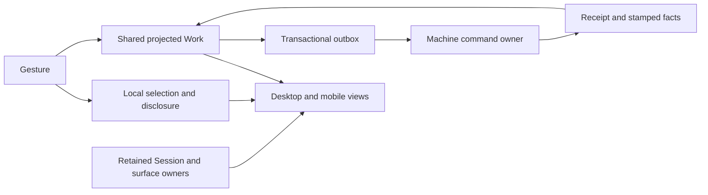

# LOO-906: immediate interactions across Desktop and mobile

Built on origin/main `9cafc410ee`: conversation/Machine link `a2a0a0fb33`,
unreachable Machine and Desktop rename `35e2835de1`, fixture teardown `5231746858`,
observation source `86f99e3315`, typed field support `f9a8da8ae9`. SQL-only and attributed external
normalization, field-stage incorporation and derived membership answers now
share the client owner. Dynamic membership and disconnected Move now use that
same owner; acceptance and remaining work are recorded below. No shipping or merge decision; no Wave selected.

## Direction

Build one shared client state and command-reconciliation architecture: every
surface renders local intent immediately, then reconciles against causally newer
Machine facts without inventing execution readiness.

Jack Heart, comment `b38d7ddf-eb30-4331-b9e9-bbf9244ab700`:
> “Let’s make sure this is an aggressive systematic rewrite that sets us up to avoid these kinds of issues across the whole system, not just these specific interactions I’m talking about, and mobile and desktop are being considered”

Jack Heart, comment `e008238d-ab6b-4cf2-b307-581d122d6d81`:
> “That could include having a whole second store or a list of pending changes that are applied as a diff to the known store, something like that”

Jack Heart, comment `30bf26ae-1815-4e74-920e-8c6ed1986d56`:
> “We should do at least as well as all of those systems”

Jack Heart, comment `d555fa61-e250-4e7d-9da8-cdbe51600a3a`, answering
`scratch/concept-review.html` question 1:
> “1b for the question (or show noting)”

This selects immediate next-Task navigation after completion, with an empty state
allowed when none remains. It supersedes the keep-conversation-open draft.

Jack Heart, comment `5d9cb5de-a753-4758-b6a5-d0cb96accc64`:
> “another thing that is too slow is the time it takes for a task to look highlighted (and the session to render) after i click it, evne if its cached / recetn”

Jack Heart, comment `33675e39-b299-4a18-9049-3750eca5a8b8`:
> “or for a wave to expand when i click on it”

Earlier direction, retained:
> “launching a new task should get to new session instantaneously”

Jack Heart:
> “this is meant for deskto”
> “it takes like >10 seconds and there are a lot of intermediate states”

Other quotes: `desktop-reactivity-feedback.md`.

The LOO-904 screenshot (not available here) was described as Reading workflow,
Restoring workspace, Not started/Start, and Conversation change unconfirmed.

## What the current code establishes

Start and Complete now use shared SwiftUI/Observation interaction and outbox
owners on both clients. Other mutations still disagree about when an interaction
happened. Desktop `TaskRunDraft`, plus mobile view-owned
`SessionLink`, remain replacement targets (see the delete list). Revision-6 subscriptions now provide exact-query snapshot stamps;
server operation admission covers all typed writes, while live client outbox
migration still specializes creation. Native Session/Graph owners retain readiness.
Predecessor map: `bb936ac371`; earlier Desktop design: `7030e08a`.

Completion already saves a domain request, checks execution/PR conditions, settles
state, syncs planning and schedules retirement. Creation already prepares its
primary Session and Graph. Those waits are not a measured SQL/latency diagnosis.

## Established designs and dependency choices

Research and replica comparisons: `8b42a874db`, `bb936ac371`. Apollo/TanStack
give operation-layer precedents, not LF domain recovery; SwiftData, Sharing and
TCA don't give causal sync; a mutable replica would duplicate server-derived
membership. Direction: confirmed cache plus ordered operation overlays, one
normalized owner, Observation for rendering. The outbox uses system SQLite3 on
both targets (GRDB not adopted); the confirmed cache belongs in that database.

The cache/overlay owner must project every affected query, including Dashboard
membership and counts. If declarative membership cannot cover them, move the pure
projection into a shared portable core before client migration.

## State, ordering and reconciliation contracts

Detailed contracts and counterexamples before the presentation cut remain at
`737b50adba26689bb27e67839d9ab9b90564bf50:scratch/instant-task-session.md`
under Proposed contracts through Opening another query. Live requirements:

- Shared Swift owns each Machine's confirmed cache, ordered immutable commands,
  receipt recovery and projected membership. Hosts own selection, drafts and
  native readiness. Windows share an owner; devices share semantics. Save before
  send; publish intent before disk or discovery. Never fabricate entity DTOs.
- Keep IDs, original Machine/scope, sequence, resource lanes and dependencies.
  Conflicting commands serialize; independent resources proceed concurrently.
  Dependent commands await actual IDs. Unknown delivery blocks conflicting sends
  until domain recovery establishes ordering. Undo after send is another command.
- Persist cache, effects and outbox in one SQLite transaction owner. Released
  files retain exact IDs, words, outcomes and unknown send history through import.
  Recover sent work by original ID on its original Machine. Missing/unavailable
  lookup or a replaced epoch never authorizes replay. Admission precedes Git,
  planning, provider and domain waits; worker recovery requires domain permission.
- Stamped readings cover the same pinned snapshot as their bodies: Machine,
  epoch, schema, query identity/completeness and domain revisions. Reject departed
  epochs and older revisions; checkpoint IDs and arrival order establish nothing.
  Historical restoration still needs an epoch-reset mechanism.
- Each semantic stage records its result and fence in the domain transaction.
  `task.completion_requested` confirms intent; only `task.completed` confirms
  removal. `task.filed` binds Task/Session without proving admission or input.
  Provider/filesystem/planning readiness cannot borrow a SQLite fence.
- Field incorporation and derived answers decide visible membership for dynamic
  programs. Retirement acknowledges only each retained query's own invalidation;
  query stamps and unrelated effect revisions cannot substitute for field support.
  A covering count cannot discharge
  a held list; a fresh query cannot subtract twice while another remains behind.
  Partial pages, unrelated domains, native mounts and command return don't
  establish incorporation. Query identity/plan changes invalidate prior coverage.
- Three independent obligations retain a command: domain recovery, remaining
  query coverage and an unseen creation result. Mount or Inspect acknowledges
  presentation only. Retirement transfers lagging effects into bounded retained
  bases, or invalidates closed bases under persisted scoped floors. Reopen, another
  window or another filter must reconcile pending effects before its first cached
  frame. Later queries require a covering base even after command retirement.
- Definite refusal removes only effects proved uncommitted. Partial success keeps
  committed facts and inspection for unresolved stages. Supersession belongs in
  existing typed stage resolutions, identifying the withdrawn request and its
  replacement fence. A covering replacement reading restores membership without
  navigation; a late settler cannot complete a withdrawn request. Never borrow a
  newer completion's outcome. No generic error or missing stage proves rollback.
- Normalize display facts with domain provenance across queries. Unknown or
  incomparable freshness remains labeled/stale rather than replacing known facts.
  Complete filtered absence removes membership, never entity/native lifetime.
  Declarative membership supplies scopes, paths, ordering, counts and dependencies;
  use a portable core if client projection cannot express all queries.
- Every mutation declares effect stages, dependencies and recovery policy in an
  exhaustive registry. Value changes project values; membership changes project
  every known list; execution projects intent only. Retain file-base conflicts,
  existing control ownership and no offline terminal-byte queue.

Acceptance retains held settlement, definite refusal, commit followed by failed
planning/output, reordered list/count and restart, supersession in either race
order, withdrawing old then completing new, unseen/seen creation with lagging
queries, Inspect without a Work reading, epoch replacement, new queries/windows
and changed filters after Complete, closed-query restart and eventual retirement.
Each checks one effect per query, unchanged later navigation, no replay or permanent
lane blockage. Missing correlation stays inspectable. Both clients use the same
reducer; two-client closed-query convergence remains open.

## Local navigation, disclosure and retained content

Publish selection/highlight and disclosure in a bounded synchronous reducer before
starting effects. Cached lookup uses stable identity indexes, not a scan/re-sort of
all Work or warm preparation before the next frame. Read/decode/cache persistence,
planning acquisition and child loading run outside that gesture path. Profile
main-actor body/layout work separately; Observation alone cannot make a blocked
main actor paint sooner.

Bind a destination immediately to its cached projection and retained workspace.
The existing Desktop `GhosttySurfacePool`/workspace registry remains the native
owner. On mobile, move `SessionLink`/terminal occurrence lifetime out of transient
`SessionView` into a bounded retained-workspace owner; preserve its buffer/viewport
on quick navigation, with memory-pressure eviction. Background policy and input
control stay explicit. Cached display never certifies a location or enables input;
unknown or changed ownership pauses input while validation proceeds. Reuse a live
validated native occurrence rather than reopening it on each route push.

A→B→A increments navigation generation at every gesture. Async readers can update
their resource's confirmed cache but cannot select, focus, expand a collapsed group
or replace a newer occurrence. Completion's next selection uses this same local
owner. Wave expand shows cached children immediately; if cold, only the expanded
section shows loading/error. Collapse is immediate and a late child answer only
warms the cache. Where mobile uses a picker instead of a tree, retain that interaction
rather than introducing a new tree solely for parity; any disclosure uses the same
local semantics.

## Representative timelines

**Launch, both platforms:** tap Start → same UI turn closes editor and selects the
operation's conversation destination, showing submitted words → persist exact
request → submit/admit → bind actual Task and Session IDs → attach that Session
in place → native readiness enables input. Task/list/Graph frames reconcile in
any order without replacing the destination with Task details, Start or restoration.
Leaving changes only navigation; the operation remains in the outbox. On restart,
recover its original Machine/ID. Edit is available before send failure; uncertain
send offers lookup; attachment failure offers Retry opening, never recreate.

**Complete, both platforms:** tap Complete → remove from working/available/busy
memberships and update affected counts immediately; details show pending completion
→ persist/send → accepted/committed result → fresh stamped reads replace the layer.
Definitive refusal restores membership from the latest base while retaining later
operations. Lost reply keeps pending confirmation and recovers the same ID; refresh
failure after commit never restores a working row. Completing the selected Task
moves immediately to the next visible Task in the current list order, or an empty
state when none remains. Completing an unselected Task leaves selection alone.
Navigation changes once, in the initial interaction; neither acknowledgment nor
failure recovery selects again. Mobile gains the same completion action and
semantics, replacing the selected route rather than stacking obsolete destinations.

**Cached/recent Task:** click A → highlight A and bind its last-known workspace in
that interaction → show retained native content without a new preparation/attachment
when usable → refresh in background → update facts without blanking content. Record
click-to-highlight, click-to-cached-content and click-to-input-ready independently.
Rapid A→B→A and late replies never revive B or rebuild A's retained surface.

**Wave disclosure:** click → arrow/expanded state changes in that interaction →
cached children display, or one local loading area appears → children populate
without a second navigation action. Collapse during loading remains collapsed.

**Other mutations:** claim/unassign/move/rename/reopen/abandon, Session bind/new/move,
Wave editing, settings, layout/file save and delivery/Graph actions all enter the
same owner. Value edits project values; membership edits project all known lists;
execution commands project accepted intent and progress only. File writes retain
base-revision conflicts. Provider/Graph/PR success and Machine transfer completion
are never predicted. Terminal bytes, replies and control takeover remain with
existing bounded input owners: no offline keystroke queue or automatic resend.

## Delete — do not maintain

Already removed in this cut: per-entry observation counters, uncaptured repeat
reads within an invocation, and reuse of pre-observation query bases. Required
behavior stays on the single cache, capture and client SQLite owners.

Already removed: the list at `908e317e4f:scratch/instant-task-session.md`, plus
creation in `CreationRecovery`, its Task presentation map, host request filters
and the phone query-before-opening path. The pending-command cut also removes
`CreationOperation`, `WorkInteraction.Failure`, the failure collections,
`WorkModel.completionFailures`, Retry Complete rows, creation-owned reopening,
retired-source release APIs/index and the rest of `CreationRecovery`. `LegacyTaskDraft` reads released files
only; SQLite commits precede rewrites.

Removed in the dynamic cut: `WorkQueryEffect.covered`,
`ClientWorkDatabase.effectsCover`, `MembershipNode::State`, Swift's fixed state
node, Rust's prefiltered scope/filter compiler and `wave_descendants`. Required
explicit leaves, authored occurrence paths, descendant scopes, interleaved order,
intersections, hidden/suppressed occurrences and unknown/partial reads remain on
the typed program and its shared evaluator. Desktop Move no longer uses
`performTaskAction` or its post-write refresh barrier.

Still remove, with their consumers:

- Desktop `TaskRunDraft.phase`, other mutation refresh barriers
  (`performTaskAction`) and bind replacement bookkeeping (`replaceSession`,
  `supersedeSessions`).
- View-owned mobile `SessionLink` teardown on ordinary Task switching; keep
  explicit Close, background policy and memory-pressure eviction.
- WorkCache/TaskFeed duplicate authoritative caches and duplicate freshness
  reconciliation. Keep UI-only workspace/layout/draft persistence.
- Tests exclusively asserting old intermediate screens, local exception sets or
  second-submit recovery; keep success, duplicate prevention, failure, departure,
  ownership, layout and first-turn coverage on the shared path.

## Forbidden outcomes

No per-screen exception sets, second mobile submission ledger, whole-snapshot
rollback, fake Task/Session DTOs or timer-based readiness. No SQL or network wait
before selection/disclosure, no retained surface replacement on a healthy revisit,
and no background completion that chooses navigation. A library or loading surface
alone does not complete the cut: query membership, overlap, uncertainty, migration
and both clients must use the same semantics.

## Delivery and acceptance

Indivisible cross-platform cut, with internal slices; no publish/merge authorization.
This scope exceeds the size-check signal because causal writes, both read paths
and their consumers must converge together.

1. **Architecture:** confirmed cache plus ordered overlays; validate query
   membership and persistence dependencies before cutting consumers over.
   Completion navigation is specified above.
2. Extend receipt/commit-stamp contracts and domain recovery; migrate saved data.
   Done: stamped subscription readings (revision 6), Git-free
   `operation.submit` admission, submitted/canonical identity, legacy envelope
   adoption, saved-command dispatch and both creation clients' outbox admission.
   Remaining: domain continuation and all-writer stage fences.
3. Build shared transactional client store and projection reducer; cut both
   transports over, including query membership. Delete predecessor owners.
4. Move selection, disclosure, launch, completion and every mutation family through
   their shared interaction owners on both clients;
   retain native execution and input owners. Update product/API docs together.
5. Measure actual latency and remove demonstrated backend waits independently of
   presentation; run the full acceptance matrix and native demo.

Slice status is under Current implementation cut; Complete starts slice 4.

Headless acceptance uses deterministic held/reordered replies, not timing sleeps:
shared reducer tests cover overlapping success/failure, stale reads, partial pages,
query changes, epoch reset, reconnect and every save/send/crash boundary. Desktop
and iOS production-view tests prove immediate launch/removal before held network
responses. Selection/disclosure tests assert state before held reads; A→B→A,
expand→collapse and reordered loads preserve cached content and surface identity.
Two windows and two clients prove all projected surfaces agree. The
command registry has exhaustive policy coverage. Receipt fixtures include Rust,
Swift/macOS and iOS; upgrade tests preserve existing pending submissions.

Focused commands: `ClientWorkStoreTests|OperationRecoveryPresentationTests` on
Desktop, `LoopflowiOSTests/ClientWorkStoreTests` on iOS, plus Rust operation
module filters. Gate owns wider suites; display diagnostics remain demo work.

## Latency and open review decisions

Trace gesture → state publication → render commit; selection adds cached-content
and input-ready endpoints, disclosure adds arrow/children/data-ready. Separate
retained hits, cold misses and eviction. Trace one operation through local
projection → save → admission → domain commit → subscription apply → native
readiness, with backend spans for SQLite lock/query, planning network, Git,
Graph registration and provider attach. Log IDs and durations, never authored
text. Compare in-process, Desktop local and mobile remote transports. EXPLAIN
changed SQL on the 10,000-Task fixture.

Proposed target: local reaction P95 under 100 ms, at least 20 native samples per
journey/platform, endpoints reported separately. Nothing here is measured yet.

## Implementation direction (2026-11-15)

### Synchronous intent and effect contracts

The State, ordering and reconciliation contracts above retain the live requirements.
Earlier handoff and reordered-reading detail:
`cfebc7f89a6c8c5301518a067f9cc3a2e977ee5a:scratch/instant-task-session.md`
(Implementation direction).

### Query destinations and leases

Built at `6e944e73b5a`; earlier ownership/checks at `9fbc729a63`. Claim,
Wave/Dashboard rename and other mutations remain unmigrated.

### Dynamic membership replacement

The fixed-candidate counterexample and prior design are retained at
`5c958398a6de:scratch/instant-task-session.md`. The dynamic predicate, field and
retirement contracts below remain the acceptance contract.

### Next implement direction: facts absorb effects; queries prove their answers

Headless concept review, 2026-11-15, against `5d0187746f`. Field incorporation
and derived answer coverage are built. The dynamic/Move replacement is now
implemented; the validation and outstanding surface migration are below.
The correction above becomes two contracts rather than one larger query stamp:

1. **Field incorporation.** Each confirmed value identifies its Machine, epoch,
   schema, entity, field and supporting domain revisions. A committed effect stops
   writing a field when a value for that same field covers its semantic stage's
   fence. A later value wins even when it differs from the command's intended
   value: Complete followed by Reopen must show Reopen. Missing or incomparable
   provenance cannot absorb an effect. Unknown delivery retains intent until the
   original receipt resolves it; an unrelated newer fact cannot settle delivery.
2. **Answer coverage.** A locally evaluated query records its program/definition
   revision, candidate coverage, and the field/content dependencies actually
   consumed. This is a client-derived answer, never a Machine `ReadingStamp`.
   Missing content may make the destination incomplete without reactivating an
   absorbed parent-Wave effect. A newer parent value cannot establish fresh
   lifecycle/activity, content, query definitions or candidate coverage.

Keep the original exact-query stamp and body immutable. Cross-query normalization
joins only values carrying comparable provenance, not whole DTOs by arrival time.
Do not manufacture a coherent server snapshot by taking vector maxima from
unrelated readings. Equal provenance with conflicting values is inconsistent;
retain the known value and require reconciliation rather than picking the last
arrival. Normalized facts, stage results, incorporation and saved command state
join transactionally in the existing SQLite owner. The name-field owner is a
precedent for ownership, not permission to use a sessions fence for Task fields.

**Dynamic membership.** Rust compiles authored scope and filter predicates, with
stable occurrence paths, instead of prefiltering their identities. Explicit Work
leaves remain fixed. Both clients evaluate the same finite typed program over
shared facts; canonical lifecycle/effect rules stay in one declaration, not a
second Swift derivation of Task state. Preserve descendant-Wave semantics,
interleaved/shared order, intersections, duplicate winners, hidden occurrences,
unknown activity and partial reads. If the finite program cannot express these,
use the portable core before changing consumers.

Headless engineering choice: start with a compact repository candidate manifest
(identity, parent relationships and membership predicates, not every Task's full
content) to support dynamic arrivals. Its completeness is scoped to its captured
revision. Individual fact replies cannot advance that universe or prove absence;
replacement manifests or complete deltas need deletion evidence too. Cache real
content separately by identity and provenance. For a known Task moved from A to B,
both programs can consume its projected parent and cached content even when B's
last result omitted it. A missing program, ancestor relationship or content stays
explicitly incomplete; never show a fabricated Task or an exact empty/count.
Index affected fields/scopes so a gesture does not scan/decode the repository on
the main actor. Measure the 10k manifest and fan-out when implementing.

**Move and recovery.** The gesture freezes original Machine, Task, destination
Wave identity (or No Wave), sequence and request ID, then publishes parent intent
to all affected queries/counts before disk. Keep native workspace, drafts and later
navigation. Save before send; serialize conflicting Task edits through the earlier
domain outcome. The domain still resolves the Wave's current Project and validates
membership; do not freeze a guessed Project or retarget another Machine. Record
the actual resulting parent/Project value, semantic disposition and fence with
`task.membership_changed` in its owning transaction, including definite refusal.
Commit followed by planning-sync failure retains the move. Recover an uncertain
send by original ID. No receipt stage or send history means no blind retry.

**Retirement and migration.** Query completeness and command delivery remain
separate obligations. Absorbed field effects cannot return after close/restart.
Retirement retains the necessary normalized facts and derived coverage, or marks
an evicted/old base unavailable under scoped reload floors. Do not retain full
commands forever merely because content is missing. Older query-local caches lack
this proof: invalidate their derived membership, retain exact commands/receipts
and recover their original IDs. Never relabel old cache data as new coverage.
Delete `WorkQueryEffect.covered`'s stamp-only decision and
`ClientWorkDatabase.effectsCover`'s arbitrary revision shortcut with their callers;
replace the current state-only reducer and prefiltered dynamic nodes together.
Preserve exact-query stamped refresh as an authoritative input.

Required counterexamples before caller migration:
- Held Working query → Complete commits → another query supplies Reopen's newer
  state → old query reevaluates: Task is visible; Complete never re-hides it.
- Move A→B commits → newer parent C arrives from another query: held A/B queries
  cannot reapply A→B. A stale B reply cannot replace C; an incomparable one cannot
  silently select a winner.
- Fresh parent, missing content or unknown activity: old move stays incorporated,
  but the dependent answer/count stays incomplete. A covering count cannot release
  a held list's independent coverage.
- Destination omitted the moved Task; two windows and both clients update source,
  destination and counts from real cached content before disk. Repeat with No Wave,
  descendant Waves, repeated authored occurrences and a changed saved definition.
- Close both queries, retire, restart offline: reconstruct the same projection or
  show unavailable under a persisted floor. Lost reply, refusal, newer local move,
  commit-then-sync-failure and epoch change neither replay nor steal selection.

Proposed usage text for both READMEs after acceptance:
> Move a Task to a Wave or No Wave. Cached lists and counts change immediately;
> its conversation and drafts stay open. While disconnected, the change waits for
> its original Machine and survives restart. A refusal restores only the refused
> change, leaving later edits and navigation alone. Incomplete cached destinations
> remain visibly incomplete until their missing data arrives.

No builtin skill changes; shipped READMEs claim only built behavior until acceptance.

### Observation and independent ingestion contracts · 2026-11-15

Full source/capture and ingestion design, contrary cases and historical checks:
`0a7fcf3e703fe36bb11a5c93262a4fbf5c8c12b5:scratch/instant-task-session.md`
(Review direction through Independent ingestion and normalization). Live rules:

- The shared Machine link elects the observation incarnation before readings;
  generations reject departed welcomes, frames and callbacks. Database epoch,
  server lifetime and observer incarnation are distinct. Disconnect and restart
  keep values last-known; reconnect, even to the same incarnation, needs captures.
- One cache-wide clock never repeats tokens on eviction. Capture consumed inputs
  together, reuse them within an invocation/inherited worker, validate the complete
  dependency set atomically before export. Changed inputs make normalization
  unavailable and schedule refresh. External identity includes process identity,
  not PID alone; exported opaque tokens contain no private paths or words.
- Field support declares its real SQLite domains, derivation and external inputs.
  Compare complete supports; crossed vectors, equal conflicting values and changed
  derivations cannot elect a winner. New dependency sets require complete captures.
  An unrelated observation clock advance certifies nothing.
- Ingestion precedes exact-query replacement. Partial or incomparable bodies can
  contribute independently supported fields; complete bodies do not certify
  unavailable activity. Parent/lifecycle normalize without live activity. Only
  validated receiving-link attribution admits external facts. Local link generation
  remains transport metadata, never a wire revision or persistent observer ledger.
- Persist facts, incorporation and derived dependencies in the existing SQLite
  owner. Restart invalidates external coverage; missing content/activity cannot
  undo an incorporated parent/lifecycle stage. Old caches never acquire evidence
  by assigning the current source. Keep exact requests and original-ID recovery.
- Acceptance: same-SQL process exit changes Busy; eviction/recreation never repeats
  a token; new welcome cannot revive old external coverage; changing inputs during
  capture yields no mixed field; process replacement changes dependency sets; queued
  A → reconnect B cannot borrow B's link. Parent incorporation survives offline
  restart and new observer, without replay or later navigation.

Source/normalization checks: `86f99e3315`, `0883b66cf0`, `2c6146e43f`.
Gate owns nextest run `7bb50caf-46f5-485f-a8ff-d882ea6e5a98`:
`server::schema::tests::bare_time_serializes_as_its_described_tuple` reported LEAK;
that case launches no children. No retry was taken as a fix.

### Projected surface cut · 2026-11-15

The 2026-11-15 concept reviews and their counterexamples remain at
`aee0e10dc603:scratch/instant-task-session.md` (moving changes membership;
one Task location across surfaces). Dynamic queries already move rows, but
boards, No Wave grouping, trails and counts still join old planning membership.

Removed in this cut: `WorkProjection`'s `wave.tasks.items` grouping and
`task.waveId` standalone filter; `standupTasks`' roadmap membership; the Task
breadcrumb's Session-Wave precedence; board counts from `RoadmapTask.section`.
Keep planning content, authored order, Session attribution, panes, drafts and
later navigation. The existing query owner exports projected fields and coverage;
boards use the shared ancestry evaluator and lifecycle states. No view-local Move
map or rewritten confirmed DTO. Missing content/ancestry has no exact count.

Acceptance: offline Move, refusal, superseded save/retry, descendants, changed
definitions, incomplete destinations, two-client Complete→Reopen, unresolved
destination membership, retirement/restart and retained native ownership. The
portfolio subscribes to the same per-repository manifests, with condition content
kept separate from projected terminal membership. Its checkpoint must cover
that subscription too. Unplaced parents never acquire a No Wave label.
The three product choices below remain open and do not block this cut.

### Open product choices

Unanswered, numbered in `scratch/concept-review.html`: (1) queue Abandon offline
or require a reachable Machine; (2) Cancel before first send or none; (3) phone
shows Task titles or shows/renames Session names. Built provisional behavior is
in `questions.md`. These do not prevent the engineering cut above, but remain
open product choices for this concept-review's Blocked outcome; (3) decides
whether phone rename exists. No answer is inferred in a headless run.

### Persisted field incorporation · 2026-11-15

The existing declaration targets Complete/Abandon/Reopen at lifecycle and Move at
parent. Bound accepted receipts and independently supported readings join stages
into the exact resource's field in the SQLite owner, in either arrival order.
Only known, nonconflicting support can establish incorporation; later conflicts,
missing activity, query closure and command retirement retain it. Same-revision
receipt content cannot advance incorporation beyond the saved receipt. Stage
fences compact comparable commits without keeping request IDs or command bodies;
retained query effects supply still-needed stages after retirement. Resource and
bound-receipt lookups use indexes, with stage fan-out grouped by resource.

Field incorporation now feeds the derived-answer path below. The dynamic cut removes stamp-only retirement and fixed candidates. Native
presentation and the remaining inventory surfaces still need acceptance.

### Derived membership answers · 2026-11-15

The existing query entry now persists one replaceable answer: authored selection,
saved definition revision, compiled root, original candidate/content snapshot,
consumed membership-field support and derived membership. Its Machine stamp/body
remain immutable. Shared field incorporation suppresses an absorbed Complete
before evaluating held Working queries, so a newer Reopen wins in either
receipt/reading order and after retirement/restart. Coverage does not settle
receipt recovery. The union setter and old `makeProjection` are removed; this
is the existing projection owner, not a second evaluator.

Both hosts publish rows and coverage together through their existing query
leases. Machine connection changes invalidate only dependent live membership,
without command traffic. Welcome alone revalidates nothing; current-link captures
do. Losing coverage retains the latest evaluated members, including a last-known
empty Busy answer, rather than restoring rows from its older Machine body.
Native attachment/location diagnostics do not mean missing content or invalidate
an exact count. Prepared renderings stay off the main actor for cached reads.

The dynamic cut below replaced fixed candidates and stamp-based retention.

## Current implementation cut

Start, Complete and Abandon publish through shared `WorkInteraction` on both hosts. Creation
freezes ID/payload/scope/time before its synchronous selection callback, saves before
send and derives `PendingOperation` from the saved command and receipt stages.
Desktop keeps the operation selected through native readiness; iOS replaces its
editor with an operation route. Neither receipt nor recovery navigates after
leaving. Attachment Retry uses the recorded Session. Only a bound Session result can acknowledge presentation by resource. Native
readiness gates the pending creation mount, not ordinary Session recovery.
A mounted result acknowledges presentation without settling independent query/planning obligations. Unsaved
failure retains words for same-ID retry or deliberate editing.

Phone files import each original Machine/ID/command/source/outcome into SQLite,
transactionally per Machine and idempotently across source cleanup crashes.
Matching rows keep their send epoch and receipt; conflicts leave the source intact.
Imported missing send evidence remains inspectable, never unsent. Editor revisions
are associated with submitted commands in that transaction; surviving editor files
cannot submit again after save or retirement. Imported and editor-linked retired
commands leave compact source identities in the existing owner, outside indexed pending reads.
No second receipt ledger exists. Other-Machine imports/lookups open no transport.

Query leases retain their previous bounded semantics. Last-close suspends query
publication while command recovery continues; reopening reconciles before display,
including without a network event. Retirement cancels its receipt observer and
transfers lagging effects or scoped reload floors. The complete prior contracts and
query checks remain at `6e944e73b5a:scratch/instant-task-session.md`.

The projected surface cut now joins boards, portfolio Roadmap/Now, Task trails,
No Wave grouping and counts to the query owner's parent/lifecycle fields. Initial
observation binds the receiving link's Machine before projecting; portfolio scope
subscribes to all repository manifests. Failed unsaved Moves cannot retry behind
a later Move. Focused checks are recorded below; native acceptance remains open.
Full interaction cutover is not claimed.
Other remaining work: effect-policy duplication; exhaustive
effect/dependency declarations and cross-query provenance; other mutation recovery
and resource lanes; retained mobile `SessionLink`; projected inspection;
historical-restoration epoch reset; valid native benchmark baseline. One cross-platform PR; no shipping decision. SQLite
fences cannot certify filesystem/provider readiness.

### Dynamic membership and disconnected Move · 2026-11-15

Rust emits fixed explicit leaves plus `select` predicates for default scopes,
Wave descendants, kind and state, over an ordered repository manifest. An explicit
leaf-only program retains its small candidate set. Both hosts use the same
program and effect mutation. Prepared query indexes locate affected Tasks and
occurrence ranks; local changes evaluate those resources without recompiling or
sorting the manifest. Full preparation, field ingestion and persistence remain
on the store actor. Queries with unresolved membership currently use the full
reducer; that fallback, real supported-manifest payload/fan-out and prepared-cache
memory still need profiling. Missing ancestry is unavailable, never an exact empty result.

Move freezes its original Machine, canonical Task resource, destination Wave/No
Wave and request ID; publishes before disk; saves before send; and shares a
resource lane with conflicting Task edits. Both action menus call this owner.
Desktop's stale-planning Move guard and obsolete post-command barrier are gone.
The domain transaction records actual Wave and Project with its semantic result.
A newer C field absorbs older A→B in either receipt/reading order; missing content
or activity cannot revive it. Real content joins separately in the same database;
crossed/equal-conflicting content retains reconciliation requirements. Membership
states and native attachment diagnostics are not content identity conflicts.

Retirement transfers unresolved effects or acknowledges this specific invalidation
on an already-usable retained base, then saves scoped floors. It never treats an
unrelated effect revision as a replacement manifest. Old fixed programs are
invalidated without changing requests/receipts. Recovered commands keep original
IDs, destination and canonical resource lanes. No shipping decision.

Diagnostic, SwiftPM debug, 21 samples each (20 warm): 10k synthetic manifest
2,849,209 bytes; warm reducer P95 338.859291 ms before cleanup, 201.556583 ms
without repeated sorting, 8.638542 ms with prepared indexes. The first manifest
was 2,848,480 bytes before ancestor fixtures were added. These are CPU/wall reducer
measurements on the active host, not native paint/input latency or a valid quiet-host
baseline. Raw samples: `scratch/dynamic-manifest-measurements.json`.

Acceptance map (`ClientWorkQueryTests`): A→B→C, two clients, stale readings,
offline restart (`testDynamicTwoClientsConverge…`); omitted destination,
retirement, restart (`testDynamicMoveIntoOmittedDestination…`); later navigation
offline (`testDynamicMovePublishesBothWindows…`); Complete→newer Reopen across
queries, retirement, restart (`testDerivedAnswerUsesIncorporatedReopen…`);
reconnect (`testDerivedCoveragePublishesDisconnect…`). The surface cut adds
two-client Complete→Reopen and unresolved-destination coverage below.
Prior runs: `5c958398a6de:scratch/instant-task-session.md`.

Prior dynamic/Move checks, including Desktop, iOS and Rust commands/results:
`aee0e10dc603:scratch/instant-task-session.md` (Dynamic membership and disconnected Move).
Logs: `/tmp/loo-906-dynamic-{build,final-tests,cli-workspace,ios,rust,domain,wire,docs}.log`.
Native usability/latency, broader suites and lint remain with implementation/demo
and gate as previously assigned.

### Projected surface validation · 2026-11-15

Shared fixtures now supply parent/lifecycle/activity independently of roadmap
membership. A dated Done count stays incomplete when projected completion precedes
its completion date; all-ages Done can count the known lifecycle immediately.
The real CLI fixture uses Manual portfolio selection before adding its repository;
adding a manual path alone left its default Folder reading empty.

- `swift build --build-tests --package-path swift --jobs 4`: passes.
- Desktop surface filter (`testProjectedInventory`, boards, trails, Now/Roadmap,
  scope/checkpoints and `standaloneMovesKeepWorkspace`): 25 pass; the real CLI
  case shares one owner across repository and portfolio windows and awaits both
  readers and its private server. Final breadcrumb/jump recheck: 2 pass. Logs:
  `/tmp/loo-906-surfaces-{tests,cli,trail}.log`.
- Desktop callers (`TaskConceptTests`, `waveRowCountsStartedTasks`, `inspectorShowsPlanning`): 9 pass; `/tmp/loo-906-surfaces-callers.log`.
- `uv run python scripts/test_ios.py` with seven explicit surface/Move selections:
  7 pass; `/tmp/loo-906-surfaces-ios.log`.
- `scripts/test_desktop.sh --skip-build --filter 'WaveStandupTests|WorkNavigationTests/projectedInventoryMovesBoardsAndTrail'`: 10 pass, including the additional unknown-date count case; `/tmp/loo-906-surfaces-dates.log`.
- `cargo test -p loopflow --test integration documented_commands::`: 4 pass; `/tmp/loo-906-surfaces-docs.log`.
- `uv run python scripts/check_swift_multiplatform_boundaries.py`: passes.

Remaining: native paint/input baseline, 10k inventory/count fan-out profiling,
planning Project detail/history tables (`WaveDetailPane.projectAndTasks`), and the
other interaction families above. Those tables merge separately paginated history;
changing their membership must retain that content on the same field owner.
The current board/trail cut does not claim full cross-platform acceptance.

### Next implement direction: current location through detail and history

Headless concept review of `aee0e10dc603` plus the uncommitted surface cut,
2026-11-15. Boards, portfolio Roadmap/Now, trails, No Wave grouping and phone
partial-result presentation now consume projected fields. The former review's
surface proposal is built; the three unanswered product questions remain open.

The remaining mismatch is the current Wave's detail Task table:
`WavePlanView.projectAndTasks` merges `workMap.tasks` with `ClosedTaskHistory`,
then `TaskHistoryFilter.includes` reads the resulting DTO's lifecycle. Move or
Complete can change the board while this table still lists the old membership.
Do not replace this merge with only the current manifest: loaded historical Tasks
and their pagination would disappear. Historical Project association is distinct
from a Task's current Wave; moving a Task must not rewrite historical records.

Proposed experience: Move changes every current-location list, including an open
Wave detail, in the same local interaction. Complete follows the existing history
visibility/range setting; a missing completion date leaves dated membership/counts
incomplete. Reopen restores current membership even when an older history page
arrives later. Keep the existing recovery visibility for unresolved execution;
known completion does not certify that native work or recovery has ended.

Use the existing query/SQLite owner for parent, lifecycle and coverage. Join real
detail and paged-history content by canonical identity with its actual provenance;
an unstamped history page cannot overwrite newer fields or establish completeness.
Keep its content reachable while the necessary field reading is unavailable.
Preserve loaded pages, range, cursor, authored order, selected inspector, Session,
panes, draft and later navigation. Count only what the captured scope/range covers;
partial pages never prove a complete historical total. Replace the old membership
and lifecycle decisions with this join, without another view-local overlay.

Show next: an open board and detail agree for offline A→B→No Wave, refusal and a
newer Move; retained old history pages cannot restore a removed row. Across two
clients, Complete→Reopen survives stale detail/page arrivals and restart. Include
unknown completion date, missing content/ancestry, a changed range during a held
page, and a failed next page: loaded content remains reachable, counts stay honest,
and no reply changes later navigation. Retain historical Project association and
unresolved-execution recovery tests. Profile 10k inventory/count fan-out separately;
native paint/input latency remains unmeasured. No builtin instruction changes.

Proposed usage addition after acceptance:
> A Task's current Wave lists agree with its board and trail. Completed-history
> pages stay loaded as you move or reopen Tasks. Missing data keeps the affected
> count incomplete; it does not close the conversation or discard loaded history.

Outcome for loop-or-next: Blocked on the three product questions under Open
product choices. The detail/history direction above follows the existing design
and can be implemented independently; no execution is started by this review.

### Admission identity and recovery contract

Built: the submitted envelope saves before discovery, Git, planning, lock or
provider calls; released rows adopt only the first verified envelope and keep their
domain recovery disposition. Contract: `465274b547:scratch/instant-task-session.md`;
server fixtures: `19612daf41:scratch/instant-task-session.md`.

Still open: reordered validation replies must update only the active epoch with a
newer receipt revision, never enabling input or retiring overlays, and full
cross-platform presentation acceptance.

## Upstream acceptance retained

Origin/main `9cafc410ee` supplies #1942–#1944 and #1947 (`selection_states`); the
shared projection and retained-occurrence migration keep their coverage. Map:
`639411f1b2:scratch/instant-task-session.md`.

## Benchmark implementation and observations (2026-11-14)

Exact feedback and host preferences are in `desktop-reactivity-feedback.md`; the
harness README maps ADEMark (https://github.com/zqkra/ademark at `119a5f7b99`,
retrieved 2026-11-14) and LF journeys to endpoints. No borrowed result is a
Loopflow measurement. `desktop_performance.py preflight` rejects contaminated
hosts; thermal/swap and whole-trial load are not yet checked. `PerfClock.interaction`
marks separate selection publication, completion return and phone mount from pixels.
Rust CLI volume reports aggregate SQLite time; mutex/planning/provider attribution
is incomplete. `measureWriteToVisible` still refers to removed `pm_items.body`.

Observed: both hosts failed load preflight on 2026-11-14 and again 2026-11-15T10:40:27Z
(CPU 371.0%, load 39.52); local again at 13:19:55Z (571.1% CPU, load 83.5), no
native trial began. The mini runs macOS 15.5 against Desktop's macOS 26 target. Debug 10k constructor warm P95 235.92 ms on a rejected host (diagnostic
only). 10k receipt lookup/admission P95 0.033 ms, all 20 receipt statements keyed
(nextest `7f2b652c-19e3-4026-8961-d4e3f4d84d37`). No gesture, native paint/input or
backend-stage baseline exists. Raw files and earlier detail: `8b42a874db`,
`bb936ac371` (`scratch/instant-task-session.md`).

Implementation owns the baseline; demo owns native usability.

## Conversation review retained

The 2026-11-15 review and its numbered disconnected-edit option:
`f2438fb1b49:scratch/instant-task-session.md` (Conversation concept review).
Jack Heart's “1a” selects saved disconnected Complete/rename/Move on the original
Machine, keeping IDs across restart and uncertain delivery.
