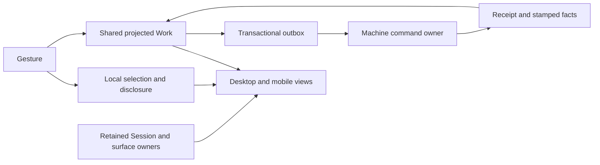

# LOO-906: immediate interactions across Desktop and mobile

Realigned 2026-11-15 at code `8a56fd337e` on origin/main `9cafc410ee`
(unchanged). Supersedes the Desktop-only delivery
boundary. No shipping or merge decision is recorded. Placement remains this Task;
no Wave is selected.

## Direction

Build one shared client state and command-reconciliation architecture: every
surface renders local intent immediately, then reconciles against causally newer
Machine facts without inventing execution readiness.

Jack Heart, comment `b38d7ddf-eb30-4331-b9e9-bbf9244ab700`:
> “Let’s make sure this is an aggressive systematic rewrite that sets us up to avoid these kinds of issues across the whole system, not just these specific interactions I’m talking about, and mobile and desktop are being considered”

Jack Heart, comment `e008238d-ab6b-4cf2-b307-581d122d6d81`:
> “That could include having a whole second store or a list of pending changes that are applied as a diff to the known store, something like that”

Jack Heart, comment `30bf26ae-1815-4e74-920e-8c6ed1986d56`:
> “We should do at least as well as all of those systems”

Jack Heart, comment `d555fa61-e250-4e7d-9da8-cdbe51600a3a`, answering
`scratch/concept-review.html` question 1:
> “1b for the question (or show noting)”

This selects immediate next-Task navigation after completion, with an empty state
allowed when none remains. It supersedes the keep-conversation-open draft.

Jack Heart, comment `5d9cb5de-a753-4758-b6a5-d0cb96accc64`:
> “another thing that is too slow is the time it takes for a task to look highlighted (and the session to render) after i click it, evne if its cached / recetn”

Jack Heart, comment `33675e39-b299-4a18-9049-3750eca5a8b8`:
> “or for a wave to expand when i click on it”

Earlier direction, retained:
> “launching a new task should get to new session instantaneously”

Jack Heart:
> “this is meant for deskto”
> “it takes like >10 seconds and there are a lot of intermediate states”
> “another thing i will add is that completing a task should make it disappear immediately”
> “can we talk about what are the fundamental causes of so many intermediate states and non-immediate reactivity?”
> “is it about slow sql? insufficient reactive UI archtiecture?”

The LOO-904 screenshot (not available here) was described as Reading workflow,
Restoring workspace, Not started/Start, and Conversation change unconfirmed.

## What the current code establishes

Both clients use SwiftUI/Observation; their command, cache and navigation owners
still disagree about when an interaction happened. Desktop `WorkModel`/
`TaskRunDraft`, launch checkpoints and `abandoningTaskIDs`, plus mobile
`MobileTaskDraft`/view-owned `SessionLink`, remain replacement targets (see the
delete list). Revision-6 subscriptions now provide exact-query snapshot stamps;
server operation admission covers all typed writes, while live client outbox
migration still specializes creation. Native Session/Graph owners retain readiness.
Predecessor map: `bb936ac371`; earlier Desktop design: `7030e08a`.

Completion already saves a domain request, checks execution/PR conditions, settles
state, syncs planning and schedules retirement. Creation already prepares its
primary Session and Graph. Those waits are not a measured SQL/latency diagnosis.

## Established designs and dependency choices

Research and replica comparisons: `8b42a874db`, `bb936ac371`. Apollo/TanStack
give operation-layer precedents, not LF domain recovery; SwiftData, Sharing and
TCA don't give causal sync; a mutable replica would duplicate server-derived
membership. Direction: confirmed cache plus ordered operation overlays, one
normalized owner, Observation for rendering. The outbox uses system SQLite3 on
both targets (GRDB not adopted); the confirmed cache belongs in that database.

The cache/overlay owner must project every affected query, including Dashboard
membership and counts. If declarative membership cannot cover them, move the pure
projection into a shared portable core before client migration.



## Proposed contracts

Shared implementation belongs in `swift/Loopflow`, used by both app targets.
One `ClientWorkStore` per connected Machine/account in each app process; all
Desktop windows share it. Windows and mobile routes own selection and drafts.
Devices share semantics, not an in-memory instance or credentials. A shared
`InteractionModel` implementation holds per-window/route selection, disclosure
and generation; purely local actions never enter the server outbox.

- `OperationID`: client UUID, durable across reconnect/restart. Separate from
  transport request IDs and Task/Session identities. New destinations initially
  refer to an operation; server receipts bind real entity IDs without fake DTOs.
- `PendingOperation`: immutable typed command, Machine, original scope, local
  sequence, resource lanes, dependencies, projection effect and delivery state.
  Saving, queued, sent/uncertain, accepted, committed and rejected describe real
  different facts; they are not separate screens. Execution/attachment readiness
  belongs to existing Session/Graph owners.
- `ReadingStamp`: Machine, store epoch, query/scope and schema identity, complete
  coverage, domain revision vector. Frames carry the stamp from the same pinned
  snapshot as their contents. External observations retain their own freshness;
  they cannot certify a SQLite commit. Epoch changes force reconciliation.
- `OperationReceipt`: ID, payload fingerprint, authoritative disposition/result,
  affected resources and commit fence. The domain writer records that fence and
  committed result in the transaction that changes displayed facts; reading the
  global counter after a slow command returns is insufficient. Multi-stage commands
  publish stage-specific commits, not a guessed final fence. A receipt may report
  accepted but still settling. Rejection is definitive only when its effect did not commit; partial
  external effects are retained as uncertain/recoverable, never called rolled back.
- `ProjectedWork`: confirmed records/query membership plus ordered local effects
  and pending/error annotations. It is presentation data, not a modified wire DTO.
  Disk stores the confirmed cache and outbox atomically; Keychain/credentials stay
  outside it and retained payloads keep existing device-protection policies.

Core API shape:

```swift
@MainActor func begin(_ command: WorkCommand, from origin: InteractionOrigin) -> OperationID
func receive(_ reading: StampedWorkReading)
func receive(_ receipt: OperationReceipt)
func projection(for query: WorkQuery) -> ProjectedWork
@MainActor func select(_ destination: WorkDestination) // local state, no I/O
@MainActor func setExpanded(_ wave: WaveID, _ expanded: Bool) // local disclosure
func recover(_ id: OperationID) async
```

`begin` publishes locally before its first await; persistence completes before
send. Save failure removes only that effect and retains editable words. The
outbox, receipt handling and projection update use one serialized reducer and one
transactional disk owner. Draft debounce remains independent. On restart, load
saved layers before displaying cached queries, then look up each sent operation on
its original Machine. Only definitely unsent or domain-authorized continuations
send; an unavailable lookup never means absence. Offline queueing is explicit and
limited to typed durable commands; controls requiring a live owner remain paused.

Generalize the current creation receipt owner rather than adding another server
ledger. Preserve all saved creation payloads, IDs and outcomes in one finished
additive migration. The physical table name may remain `creation_receipts` during
released-binary coexistence; there is one logical receipt store and no dual write.
Every UI command uses a typed operation envelope and durable lookup. CLI output
and domain execution remain their existing owners. Transport admission is a new
operation-envelope acknowledgment; it does not weaken the existing Task creation
receipt's Graph-admitted milestone. New envelope/stamp fields require a negotiated
protocol revision, shared DTO fixtures and coordinated app/helper deployment.

The server records admission before dispatch and returns its operation identity
without waiting for planning, Git or provider readiness. Reuse the existing
bounded effect execution; preserve jobs across client disconnection. A server
restart resumes only domain-proven continuations. A recorded dispatch whose effect
cannot be established becomes uncertain; there is no generic replay of arbitrary
writes. Creation's Continue/Inspect rules and completion's durable request become
domain recovery handlers under this one receipt owner. Operation observation
gets a change revision/notification; recovery is not a five-second UI poll.

## Ordering, reconciliation and query coverage

Project layers in local sequence order. Commands touching the same entity serialize
dispatch; multi-entity commands acquire a deterministic set of resource lanes.
Different resources can proceed concurrently. A dependent command waits for real
IDs; independent operations do not wait for a whole-repository refresh.

For Complete A followed by Reopen B: both intent changes appear immediately; A's
success or rejection removes/rebases only A, leaving B. Uncertain A blocks B's
conflicting dispatch until recovery establishes ordering. Once sent, commands are
immutable; Undo is a new command, not deletion of a possibly executed request.
Other devices' changes enter as newer authoritative facts and are rebased below
remaining local intent. Server revisions/preconditions resolve concurrent edits;
field conflicts retain drafts and show the current value.

A response cannot retire projection layers merely because it arrived last. For
each affected query, retain the effect until that query's complete stamped reading
dominates the receipt's commit fence. Unrelated parts, cached frames, query changes,
missing entities in partial pages and a fresh native surface cannot acknowledge it.
After all affected cached queries converge, drop the layer; retain failed or
uncertain durable requests until resolved. Closed queries are invalidated and
must reload beyond their fence before their cached base can be shown unoverlaid.

Keep the durable operation's lifetime separate from where its effect still
applies. Once a query incorporates a committed operation, stop applying that
operation to that query, even while another query remains behind its fence.
Retaining the operation for recovery must not subtract a completed Task twice
from a fresh count. Track incorporation per affected query; retire the durable
operation only after its remaining coverage obligations are discharged.

Normalized records also need provenance across queries. Accept confirmed database
facts only when the incoming stamp covers the domains those facts depend on and
does not regress their stored revisions within the same Machine/epoch/schema.
Generate those dependencies with the membership vocabulary; never order facts by
arrival, checkpoint ID or query hash. Merge independently stamped fact groups;
when freshness cannot be ordered, retain the known value as stale and request a
covering reading rather than choosing a winner. External observations keep their
own freshness. Missing membership in a complete filtered query removes that
membership, not the normalized entity or its retained workspace. A partial or
unavailable result establishes neither removal nor incorporation.

Changing epoch invalidates comparison with the old confirmed cache and fences.
Bind incoming frames to the active connection/store generation so a delayed old
frame cannot switch the cache back. Keep submitted operations, their original
identity and pending presentation while recovering receipts on the original
Machine. An old fence cannot acknowledge the replacement base, and epoch reset
is never permission to resend uncertain work.
Historical-backup restoration must establish a new epoch before serving cached
clients; the reset mechanism remains implementation work.

Normalize Task/Session/Wave identity across lists, detail pages, boards, searches
and counts. Cut `WorkViewPlan` membership over to a server-produced declarative
selection/group/sort plan over display facts, evaluated by the shared client
projection owner. Generate its vocabulary from Rust and enforce cross-language
fixtures; do not write a second ad hoc Task status resolver in Swift. An unloaded
page keeps explicit unknown membership plus a pending result, rather than a
fabricated row or count. Do not remove
an overlay merely because another client has changed a different domain revision.
Every `ServedWrite` and UI configuration mutation must declare affected entities,
queries and projection policy in an exhaustive registry: editable-value change,
membership change, or immediate pending execution with no predicted execution fact.

### Effect acknowledgment follows the domain stage

Next implement direction from concept-review: the operation is the durable request;
its projected effects have separate acknowledgment obligations. Delivery, domain
commit, query incorporation and native readiness are independent facts, not phases
of one screen. Keep the existing receipt owner and stage results; do not add a
second lifecycle ledger to make them appear linear.

The exhaustive command registry must map each projected effect to its confirming
semantic stage and fact domains, affected query dependencies, and recovery policy.
A stage fence can discharge only the effects that stage establishes. For Complete,
`task.completion_requested` confirms pending intent, not completed membership. Only
`task.completed` plus a covering reading can replace the optimistic removal with
confirmed membership. A read that covers the request stage while settlement is held
must not restore the row or retire its removal. For Start, `task.filed` can bind
Task/Session identity without proving Graph admission, attachment or input readiness.
An operation can therefore have incorporated effects and unresolved effects at once.

For each effect/query obligation, apply the overlay until a complete covering read
incorporates the confirming stage; then use the newer confirmed facts for that
query. Keep unresolved effects and their recovery annotations. Query incorporation
and cache replacement persist atomically with the outbox so restart cannot apply a
count delta twice or reveal a pending row between loading base and layers. No-op
success must provide a domain-established current result/fence or a covering
confirmation read; neither a missing stage nor `finished` alone acknowledges it.

A definite refusal removes only effects proved not to have committed. If one stage
committed and a later stage fails, retain its confirmed facts, reconcile those
queries and recover the remaining effect in place. Absence of commits is not proof
of refusal: a filesystem/provider effect can happen before receipt recording.
External facts need their own confirmation contract, never a fabricated SQLite
fence. Keep unavailable and uncertain outcomes inspectable with the saved command;
recovery never reselects a destination or generically resends a dispatched command.

Counterexamples required before both-client cutover:

- Complete saves its request, then settlement is held. A fresh list covers only
  the request fence: the row remains projected out. Settlement refusal restores it
  from the latest base only when the domain establishes no completion effect.
- Settlement commits, then planning sync or command output fails. The Task stays
  completed, even after restart, while the remaining failure stays visible.
- One count covers settlement while another list is held; restart between their
  replies. Each query incorporates the removal once, independently of delivery.
- A Task is filed while Graph admission or native attachment fails. Keep its exact
  Task/Session and submitted words; Retry opening never creates another Task.
- A successful no-op or external mutation returns without a new SQLite stage.
  Resolve its stated confirmation obligation; never retire all effects merely
  because command output succeeded.

### Superseding an intent must resolve its effect

Next implement direction: a domain request can end without producing its intended
effect. Record that resolution in the existing receipt owner, separately from
command delivery and from successful commits. In particular, withdrawing a saved
completion request must not leave its optimistic removal and resource lane pending
forever. This follows the existing newer-facts/rebase contract; it introduces no
new product choice or cancellation control.

Concrete recovery: Complete A hides its row and selects B. While settlement is
held, Reopen from another client or the CLI withdraws A's exact saved request.
The withdrawing domain transaction records supersession for that request's
subscribers, with its replacement-fact fence. A covering read restores A from
the latest base; B stays selected. A late settler cannot complete the withdrawn
request. If completion committed before Reopen, retain that original commit and
result instead; the newer covering facts show Reopen. Neither path repeats Complete
or borrows a later completion's result.

Extend the effect/stage registry and Rust/Swift receipt contract with typed domain
resolutions for committed, definitely refused and superseded effects, alongside
pending/uncertain recovery. Keep them in the one receipt owner. A generic error,
missing request, current Task status or `delivery=finished` is insufficient to
infer a resolution. Every writer that withdraws or replaces a domain request must
record it in the same transaction, including CLI and periodic writers. Historical
rows without that record stay inspectable unless domain recovery can establish
the exact outcome. Extend the single draft migration and cross-language fixtures.

Persist each effect's resolution and per-query incorporation with the confirmed
cache. Supersession does not immediately expose a stale base: keep the pending
projection until a covering replacement reading (or an authoritative replacement
fact in the same transaction) can rebase it. Release conflicting dispatch only
when domain recovery establishes the relevant prior writer can no longer mutate
that resource; retained query coverage alone must not hold the execution lane.
Outstanding external stages keep their own recovery and ordering obligations.
Refusal or supersession never erases an earlier commit or declares provider,
planning or cleanup work rolled back. A recovered Task result with a retained
error must still expose the unresolved stage's recovery action on both clients.

Before projection cutover, hold settlement across withdrawal, restart and reordered
receipt/list/count replies. Race settlement against Reopen in both transaction
orders, and withdraw an old request before completing a newer one. Assert eventual
row/count convergence, unchanged later selection, no duplicate dispatch and no
permanent lane blockage once that domain obligation resolves. These extend the existing success and uncertainty cases. Server withdrawal and
restart cases now record supersession; client projection and navigation checks
remain open.

### Seeing a result does not incorporate its effects

Next implement direction: replace presentation-driven deletion with a presentation
acknowledgment in the same durable operation record. A mounted Task/Session or
Inspect result can acknowledge that its saved result was shown. It cannot confirm
query membership, release a resource lane, establish native input readiness or
resolve domain uncertainty. No new receipt ledger or user-facing phase is needed.

Keep three independent retention obligations: unresolved domain recovery,
unincorporated effect/query coverage, and an unpresented creation result. Retire
the saved command only when all applicable obligations are discharged. Persist
the presentation acknowledgment alongside the operation; query incorporation,
cache replacement and resulting retirement remain one transaction. A closed query
can discharge coverage through persisted invalidation and its required reload
fence, never by silently treating its old cache as current. Queries already
incorporated stop applying the effect even while the operation remains retained.

For Start, show the exact admitted conversation immediately. Once its result is
shown, remove the redundant recovery prompt, while retaining the command and
remaining effects internally until covering facts arrive. Closing that window or
restarting cannot lose the pending list/count obligations. Conversely, converged
queries do not discard an unseen recoverable creation result. Attachment failure
still offers Retry opening for the same Session; viewing an Inspect receipt does
not settle that failure, hide its recovery action or authorize another creation.
An epoch change invalidates
old fact comparisons without undoing the local fact that a result was shown;
that acknowledgment cannot certify the replacement database.

Required counterexamples: mount a finished creation while another window's list
and count are held, then restart; inspect only receipt text without a stamped Work
reading; converge all queries before any result mounts; show a partially committed
creation whose attachment failed; replace the epoch between presentation and
incorporation. Each retains exactly its outstanding obligations, with no duplicate
count delta, replay, recovery prompt or navigation change. Cover both clients.

### Opening another query must preserve pending intent

Next implement direction: affected-query coverage is a dependency rule, not a
fixed list of the views open when `begin` runs. Opening another window, changing a
filter or returning to a cached query must evaluate the same ordered effects
before exposing its first cached frame. Derive applicability from the command's
resource/fact dependencies and the declarative query plan. Persist the plan's
identity/version with cached membership; a changed plan cannot reuse an old
incorporation acknowledgment. Unknown membership stays unknown as specified above.

Concrete interaction: Complete A hides it in Working, then open Dashboard while
its older cached count still includes A. Apply the same removal there. If that
count instead comes from a covering settlement reading, do not subtract again.
If Reopen superseded the request, retain the pending projection only until a
replacement reading covers that resolution. None of these reads changes selection.

Make operation retirement finite without requiring every possible future query
to be opened. In the cache/outbox transaction, either incorporate each affected
stored query or invalidate its base with its required confirmation fence. Opening
an invalidated query cannot expose that stale base as current. Queries created
later evaluate retained effects; after operation retirement they must use a base
that satisfies the persisted invalidation requirement or fetch a covering reading.
Keep such requirements with cache provenance, not an immortal saved command.
An epoch change still requires original-Machine recovery; invalidation is never
permission to replay uncertain work.

Before cutover, open a second window/query after Complete, close every affected
view, restart, then reopen from disk. Reorder a covering count and lagging list;
change filter/plan identity while replies are held. Assert one removal per query,
no stale row flash, no lost effect and eventual operation retirement without
opening every view. Cover Desktop and mobile through the same reducer.

## Local navigation, disclosure and retained content

Publish selection/highlight and disclosure in a bounded synchronous reducer before
starting effects. Cached lookup uses stable identity indexes, not a scan/re-sort of
all Work or warm preparation before the next frame. Read/decode/cache persistence,
planning acquisition and child loading run outside that gesture path. Profile
main-actor body/layout work separately; Observation alone cannot make a blocked
main actor paint sooner.

Bind a destination immediately to its cached projection and retained workspace.
The existing Desktop `GhosttySurfacePool`/workspace registry remains the native
owner. On mobile, move `SessionLink`/terminal occurrence lifetime out of transient
`SessionView` into a bounded retained-workspace owner; preserve its buffer/viewport
on quick navigation, with memory-pressure eviction. Background policy and input
control stay explicit. Cached display never certifies a location or enables input;
unknown or changed ownership pauses input while validation proceeds. Reuse a live
validated native occurrence rather than reopening it on each route push.

A→B→A increments navigation generation at every gesture. Async readers can update
their resource's confirmed cache but cannot select, focus, expand a collapsed group
or replace a newer occurrence. Completion's next selection uses this same local
owner. Wave expand shows cached children immediately; if cold, only the expanded
section shows loading/error. Collapse is immediate and a late child answer only
warms the cache. Where mobile uses a picker instead of a tree, retain that interaction
rather than introducing a new tree solely for parity; any disclosure uses the same
local semantics.

## Representative timelines

**Launch, both platforms:** tap Start → same UI turn closes editor and selects the
operation's conversation destination, showing submitted words → persist exact
request → submit/admit → bind actual Task and Session IDs → attach that Session
in place → native readiness enables input. Task/list/Graph frames reconcile in
any order without replacing the destination with Task details, Start or restoration.
Leaving changes only navigation; the operation remains in the outbox. On restart,
recover its original Machine/ID. Edit is available before send failure; uncertain
send offers lookup; attachment failure offers Retry opening, never recreate.

**Complete, both platforms:** tap Complete → remove from working/available/busy
memberships and update affected counts immediately; details show pending completion
→ persist/send → accepted/committed result → fresh stamped reads replace the layer.
Definitive refusal restores membership from the latest base while retaining later
operations. Lost reply keeps pending confirmation and recovers the same ID; refresh
failure after commit never restores a working row. Completing the selected Task
moves immediately to the next visible Task in the current list order, or an empty
state when none remains. Completing an unselected Task leaves selection alone.
Navigation changes once, in the initial interaction; neither acknowledgment nor
failure recovery selects again. Mobile gains the same completion action and
semantics, replacing the selected route rather than stacking obsolete destinations.

**Cached/recent Task:** click A → highlight A and bind its last-known workspace in
that interaction → show retained native content without a new preparation/attachment
when usable → refresh in background → update facts without blanking content. Record
click-to-highlight, click-to-cached-content and click-to-input-ready independently.
Rapid A→B→A and late replies never revive B or rebuild A's retained surface.

**Wave disclosure:** click → arrow/expanded state changes in that interaction →
cached children display, or one local loading area appears → children populate
without a second navigation action. Collapse during loading remains collapsed.

**Other mutations:** claim/unassign/move/rename/reopen/abandon, Session bind/new/move,
Wave editing, settings, layout/file save and delivery/Graph actions all enter the
same owner. Value edits project values; membership edits project all known lists;
execution commands project accepted intent and progress only. File writes retain
base-revision conflicts. Provider/Graph/PR success and Machine transfer completion
are never predicted. Terminal bytes, replies and control takeover remain with
existing bounded input owners: no offline keystroke queue or automatic resend.

## Delete — do not maintain

- Removed in this cut: `Selection::expand`'s snapshot-only interpreter. Rust now
  compiles the finite membership program and evaluates that same program. Keep
  selection identity, scope/name resolution, unavailable evidence and server order.
- Removed: Desktop Complete's checkpoint/action path and async button wrappers;
  phone stream-owned displayed rows and unbound Task navigation links. Shared
  intent, leases and outbox publications replace them; keep generic command
  confirmation and creation recovery coverage.
- Removed in this cut: Desktop Dashboard's temporary mutation of
  `resolution.members` to obtain visible rows. Projected membership, arrangement,
  attention and counts are derived together; retained confirmed DTOs stay immutable.

- Removed: `WorkModel.sidebarTaskRows`' roadmap-membership fallback. Sidebar
  membership now comes only from the confirmed Work plan; retained entity facts
  still supply details. Desktop restores stamped plans through the shared owner.
- Removed: presentation-driven `ClientWorkStore.presented` deletion and its
  exclusive race fixture. Mounted results now persist acknowledgment; observation
  and inspection continue until domain resolution and persisted cache invalidation
  permit retirement.
- Removed: `ClientWorkStore.recover`'s separate receipt reducer. Recovery and
  continued observation now share `receive`.
- Removed in this cut: newest-only delivery selection/acknowledgment in
  `task_state_delivery`/`observe_task_state`; exact attempted-delivery recovery
  replaces it. Current-decision acquisition and its adoption coverage remain.
- Already removed: Git discovery in `operation::admit`, `check_creation`, and
  `WorkNavigator.waveRow`'s delayed selection. Remove view-owned mobile
  `SessionLink` teardown on ordinary Task switching; keep explicit Close,
  background policy and memory-pressure eviction under the retained owner.
- Desktop `createdTaskIDs` predecessor and this pass's request-specific
  `pendingTaskReconciliations`/checkpoint exception, `StartingTask` submission state,
  `TaskRunDraft.phase`, `abandoningTaskIDs`, mutation-specific refresh barriers and
  rename/bind replacement bookkeeping. Replace their consumers in the same cut.
- Mobile `MobileTaskOutcome`, submitted/outcome/savedRequests portions of
  `MobileTaskDraft`, sheet-owned mutation lifetime and result-owned Open Task gate.
  Keep unsent drafts, repository selection and device protection.
- Removed: creation-only `CreationSubmissions` and `CreationRecovery`'s status
  poll. The shared SQLite outbox replaces the sender and saved-command owner.
  Remaining: per-view presentation map. Generalize/migrate their exact
  saved requests and receipt semantics into the operation store, without loss.
- WorkCache/TaskFeed duplicate authoritative caches and Desktop/mobile duplicate
  freshness reconciliation. Keep UI-only workspace/layout/draft persistence where
  it represents retained local content, not server truth.
- Tests exclusively asserting old intermediate screens, local exception sets or
  second-submit recovery. Preserve success, duplicate prevention, failure,
  departure, ownership, layout and first-turn coverage on the shared path.

## Forbidden outcomes

No per-screen exception sets, second mobile submission ledger, whole-snapshot
rollback, fake Task/Session DTOs or timer-based readiness. No SQL or network wait
before selection/disclosure, no retained surface replacement on a healthy revisit,
and no background completion that chooses navigation. A library or loading surface
alone does not complete the cut: query membership, overlap, uncertainty, migration
and both clients must use the same semantics.

## Delivery and acceptance

Indivisible cross-platform cut, with internal slices; no publish/merge authorization.
This scope exceeds the size-check signal because causal writes, both read paths
and their consumers must converge together.

1. **Architecture:** confirmed cache plus ordered overlays; validate query
   membership and persistence dependencies before cutting consumers over.
   Completion navigation is specified above.
2. Extend receipt/commit-stamp contracts and domain recovery; migrate saved data.
   Done: stamped subscription readings (revision 6), Git-free
   `operation.submit` admission, submitted/canonical identity, legacy envelope
   adoption, saved-command dispatch and both creation clients' outbox admission.
   Remaining: domain continuation and all-writer stage fences.
3. Build shared transactional client store and projection reducer; cut both
   transports over, including query membership. Delete predecessor owners.
4. Move selection, disclosure, launch, completion and every mutation family through
   their shared interaction owners on both clients;
   retain native execution and input owners. Update product/API docs together.
5. Measure actual latency and remove demonstrated backend waits independently of
   presentation; run the full acceptance matrix and native demo.

Slice status is under Current implementation cut; Complete starts slice 4.

Headless acceptance uses deterministic held/reordered replies, not timing sleeps:
shared reducer tests cover overlapping success/failure, stale reads, partial pages,
query changes, epoch reset, reconnect and every save/send/crash boundary. Desktop
and iOS production-view tests prove immediate launch/removal before held network
responses. Selection/disclosure tests assert state before held reads; A→B→A,
expand→collapse and reordered loads preserve cached content and surface identity.
Two windows and two clients prove all projected surfaces agree. The
command registry has exhaustive policy coverage. Receipt fixtures include Rust,
Swift/macOS and iOS; upgrade tests preserve existing pending submissions.

Focused commands: `ClientWorkStoreTests|OperationRecoveryPresentationTests` on
Desktop, `LoopflowiOSTests/ClientWorkStoreTests` on iOS, plus Rust operation
module filters. Gate owns wider suites; display diagnostics remain demo work.

## Latency and open review decisions

Trace gestures through event handling, observable state publication and the next
render commit; selection adds cached-content and input-ready endpoints, disclosure
adds arrow/children/data-ready endpoints. Separate retained hits, cold misses and
memory-pressure eviction. Trace one operation through gesture→local projection
→durable save→network admission
→domain commit→subscription apply→native readiness. Add separate backend spans for
SQLite lock wait/query, planning network, Git/worktree, Graph registration and
provider attach. Log IDs and durations, never authored text. Compare in-process
fixtures, Desktop local transport and mobile remote transport. Check changed SQL
with EXPLAIN on the 10,000-Task fixture; unrelated events must not reread every Task.

Proposed target: local reaction P95 under 100 ms, at least 20 native samples per
journey/platform, endpoints reported separately. Nothing here is measured yet.

## Implementation direction (2026-11-15)

### One intent through the synchronous-to-durable handoff

The portable membership program and durable ordered query effects now exist.
The next design change makes their local publication and durable adoption one
intent, rather than adding a second optimistic implementation at each gesture.
No product choice is open: immediate next/empty navigation was specified above.

Use one shared main-actor presentation owner per connected Machine/account,
consumed by every window/feed, with per-window/route interaction state. The store
actor continues to own disk, receipts and confirmed query preparation. A gesture
creates its immutable operation ID, original Machine/repository, command and local
ordering token from already known connection context. It publishes that effect
through the same membership evaluator and changes only its originating selection
before its first await. If the Machine is disconnected, preserve that original
destination; discovery must never silently retarget an existing intent.

Complete uses the origin's currently displayed occurrence order: remove A's
affected occurrences, then choose the next remaining distinct visible Task, or
empty. An explicit retained A destination remains reachable. Another window's
selection stays unchanged even though its membership updates. A later manual
selection always wins. Readiness remains the native owner's fact.

The handoff must neither expose the unoverlaid base nor apply two layers. Memory
and disk identify the effect by the same operation ID. Persist command/effect
ordering atomically before send; serialize saves in gesture order without holding
the main actor through I/O. Adoption replaces the transient representation by ID
only when the published store update includes its durable layer or its established
resolution. An older prepared query arriving during save must be rebased beneath
all newer local intents. Do not wait for a network frame to repaint other mounted
queries: save, receipt, retirement and cache changes all feed the same publication
path. Reuse the existing store change stream rather than adding a polling owner.

Save failure withdraws only the unsaved operation's effect, preserves its command
and error for retry, and never changes selection again. Later local effects retain
their order. A process exit before durable save can lose that unsaved intent; it
must not have sent a command. Restart restores saved effects before the first
cached presentation. This is the existing save-before-send contract, not an offline
execution promise. Recovery/epoch replacement must not promote an old prepared
publication over newer local intent or replay a dispatched request.

Expose query open/close leases through this owner, distinct from stored query
identity: two windows can mount the same query. Closing one cannot invalidate the
other's usable projection. The last close may release presentation preparation;
durable query obligations remain incorporated, transferred or invalidated under
the existing transaction contract. Returning to a filter applies current effects
before showing its cached frame. Keep confirmed DTOs for inspection and make the
displayed projection available separately so inspection can explain a removed row.

Next implement acceptance: hold the store actor/disk and all network replies;
Complete A must publish B/count 1 and origin selection B synchronously on both
hosts. Mount a second feed without a new server reply; it shows the same effect
without taking selection. Deliver an older prepared base between gesture and
durable adoption; A never flashes and the count never subtracts twice. Repeat with
save failure followed by another operation, two same-query windows with one closed,
rapid manual navigation, restart after save, and replacement epochs. Then rerun
the existing real-body receipt/list/count permutations through these production
action paths. Native paint/input timing still requires a valid benchmark host.

Full review wording: `a127084469:scratch/instant-task-session.md`. The
contracts below remain acceptance requirements through the cutover.

- A reload floor prevents reuse of an obsolete confirmed base; it is not the
  displayed result of Complete. Keep a lagging active base usable only beneath
  its ordered effects until replacement. An active query keeps its effect until
  a covering base arrives; retirement cannot delete the only removal layer and
  blank the active list. Closed queries may instead be invalidated, allowing
  retirement without reopening them. Persist these obligations in the existing
  cache/outbox owner; do not relabel a projection as confirmed.
  Replace the broad per-Machine floor with declared query/domain dependencies
  during cutover, so an unrelated command cannot blank a usable query.
- Membership includes occurrences, arrangement and counts, not only Task IDs.
  Evaluate the Rust-produced selection/group/sort plan over projected display
  facts, then derive visible/suppressed occurrences and totals consistently.
  Never filter `resolution.members` while leaving `projection.visible`, attention
  or totals on the old snapshot. A Task composed into two source paths must not
  be counted twice by a guessed delta. Explicit Task destinations and retained
  conversations remain reachable when Working membership disappears. If the
  plan lacks facts for an exact total, retain unknown membership rather than
  inventing one. Extend shared DTO fixtures for the portable plan vocabulary.
- Local Complete publishes removal and next/empty navigation together before
  awaiting the store actor, Machine discovery or disk. Persist that same intent
  before send; save failure withdraws only its layer and retains a recoverable
  error. Neither that failure nor any receipt selects again. The asynchronous
  outbox API alone cannot supply the synchronous gesture contract; both hosts
  must consume the shared interaction reducer and its projected queries.

Additional cutover counterexample: hold the list, let Complete settle and its
planning resolve, then retire the command while the list is mounted. The list
must remain B/count 1, without a waiting screen or stale A, across restart. Repeat
with a composed Dashboard containing two occurrences of A and with an unrelated
command advancing a domain the list does not depend on. This extends the existing
reordered-reading matrix; no native latency result is inferred.

- One command/effect declaration supplies confirming stages, recovery owners and
  affected query dependencies. A domain declares planning inapplicability;
  missing required correlation/status stays unavailable. Current status for an
  exact change never rewrites its original result. Historical diagnostics stay;
  only their established owner can clear their current action. Unclassified
  diagnostics and unavailable evidence retain Inspect. Native attachment owns
  Retry opening for the same Session and input readiness.
- Make one vertical shared path executable: Complete A, select B, incorporate a
  count and a list independently. Real query bodies and declarative membership
  over `selection_states` are required; stamp-only assertions are insufficient.
  Persist confirmed bases, effect incorporation and result acknowledgment with
  the command. Neither client adds a local removal set. Recovery never selects.
- Required sequence: base A/B, count 2 → Complete A/select B, list B/count 1 →
  count covers settlement while list is held → present/restart → lagging list
  still projects B → covering list confirms B. Count never subtracts twice.
  Reverse every receipt/list/count order; retain B throughout. A query opened
  after submission follows the same dependency rule. Closed bases must be
  incorporated or invalidated with a persisted reload fence before retirement.
- Run the supersession matrix above through this same path; replacement epochs
  retain unanswered commands and presentation acknowledgment.
- Recover edit A after another edit elsewhere: return its original result, show
  newer Work facts, and recover only its exact pending planning change. Missing
  Task rows, unrelated planning, pre-admission caches, no-Graph results, Graph
  removal, departure/return and native readiness before current Task facts remain
  launch counterexamples. Attachment failure remains beside receipt recovery.

The usage in Representative timelines stays proposed until both clients consume
the full shared projection.

## Current implementation cut

This pass connects production Complete on both hosts through shared
`WorkInteraction`: one main-actor owner per Machine, per-window/feed query leases,
synchronous membership/count publication and origin-only next/empty navigation.
The same immutable ID and original destination enter the outbox in gesture order
before send. Transient effects use the existing membership evaluator; snapshots
from the disk actor adopt them by ID/publication revision, including retirement
before first adoption. Store changes repaint mounted queries without another
server reply. Save failure removes only its unsaved layer, retains its command
and error, and never navigates. Saved completion recovery starts on mount and
never silently retargets or replays a dispatched request after epoch replacement.
The phone now replaces its route rather than stacking obsolete destinations;
network failure keeps its presentation lease. Pending Complete and Retry appear
on both hosts. Confirmed DTOs remain separate from presentation.

The removed predecessors are Desktop Complete's `performTaskAction`/checkpoint
path and async button wrappers, and the phone's stream-owned displayed Task list
and unbound navigation links. Generic checkpoint behavior remains covered through
Claim; abandonment and creation predecessors on the delete list remain open.
Two windows can lease the same query; last close drops in-memory preparation,
leaving the existing persisted obligations intact. Finite invalidation of closed
query bases is still migration work.

Existing architecture and checks before this pass:
`052baca0dcb44c83b7c4f830f8c0a86001d3cebe:scratch/instant-task-session.md`.
Protocol 6, Git-free immutable admission, submitted/canonical identity, the single
receipt owner, correlated planning resolutions, presentation acknowledgment,
stamped durable Work cache, portable membership and retirement transfer remain
in place. Ordered query effects stop independently on covering semantic fences;
lagging lists retain their effects across retirement/restart. No SQL/native
latency diagnosis follows from these correctness checks.

Remaining: exhaustive effect/dependency declarations and normalized cross-query
provenance; Desktop unsaved `.view`/`refreshSelectedView` and `replacePlan` readers
still bypass the shared query owner and can overwrite projected membership;
finite incorporation/invalidation of closed queries; remaining
mutation-family recovery and resource lanes (remote/files/config/planning);
creation and retained-occurrence cutover on both clients; projected inspection
DTO alongside confirmed inspection; historical-restoration epoch reset;
crash/native acceptance and a valid benchmark baseline. This remains one
indivisible cross-platform PR; no shipping or merge decision is recorded.
SQLite fences cannot certify filesystem/provider readiness.

### Admission identity and recovery contract

Built: admission saves the submitted envelope before any discovery, Git, planning,
lock or provider call. Submitted content (versioned encoding plus digest) and the
released canonical creation fingerprint stay separate in the one receipt owner;
released rows adopt only the first verified envelope through recoverable candidate
validation, never replacing an existing outcome. Adopted rows keep their domain
recovery disposition (Complete/Continue/Inspect) and are never generically queued.
Full contract: `465274b547:scratch/instant-task-session.md`; server fixtures list at
`19612daf41:scratch/instant-task-session.md`.

Still open: reordered validation replies must update only the active epoch with a
newer receipt revision, never enabling input or retiring overlays, and full
cross-platform presentation acceptance.

## Upstream acceptance retained

Origin/main `9cafc410ee` supplies `selection_states` (#1947), terminal paste
continuity (#1944), name freshness/failure presentation (#1943), and retained
surface visibility (#1942). Shared projection and retained-occurrence migration
must retain their coverage. The detailed predecessor map is at
`639411f1b27fbdb1532ac206ceb775a0dc76fde9:scratch/instant-task-session.md`.

## Benchmark implementation and observations (2026-11-14)

Exact feedback and host preferences are in `desktop-reactivity-feedback.md`; the
harness README maps ADEMark (https://github.com/zqkra/ademark at `119a5f7b99`,
retrieved 2026-11-14) and LF journeys to endpoints. No borrowed result is a
Loopflow measurement. `desktop_performance.py preflight` rejects contaminated
hosts; thermal/swap and whole-trial load are not yet checked. `PerfClock.interaction`
marks separate selection publication, completion return and phone mount from pixels.
Rust CLI volume reports aggregate SQLite time; mutex/planning/provider attribution
is incomplete. `measureWriteToVisible` still refers to removed `pm_items.body`.

Observed: both hosts failed load preflight on 2026-11-14 and again 2026-11-15T10:40:27Z
(CPU 371.0%, load 39.52); local again at 13:19:55Z (571.1% CPU, load 83.5), no
native trial began. The mini runs macOS 15.5 against Desktop's macOS 26 target. Debug 10k constructor warm P95 235.92 ms on a rejected host (diagnostic
only). 10k receipt lookup/admission P95 0.033 ms, all 20 receipt statements keyed
(nextest `7f2b652c-19e3-4026-8961-d4e3f4d84d37`). No gesture, native paint/input or
backend-stage baseline exists. Raw files and earlier detail: `8b42a874db`,
`bb936ac371` (`scratch/instant-task-session.md`).

Implementation owns a valid benchmark baseline; demo owns native usability.

Checks before this cut: `d9bf1c21ae:scratch/instant-task-session.md` records focused
Desktop/iOS query, receipt and recovery passes; Rust operations/schema/DTO passes;
fmt/clippy and multiplatform checks. Archive/documentation checks remain gate-owned.

Current pass checks (2026-11-15; inherited `LF_*` cleared):
- `swift build --build-tests --package-path swift --jobs 4 -Xswiftc -gnone` + private-Home/network-boundary `swift test --skip-build --disable-sandbox --no-parallel --filter 'ClientWorkQueryTests|taskConfirmationDeadline'`: build, 21 XCTest and 1 Swift Testing passed; gate owns wider Desktop suites.
- `scripts/test_ios.py -only-testing:LoopflowiOSTests/ClientWorkQueryTests -only-testing:LoopflowiOSTests/MobileTaskCreationTests`: 40 passed, including the production Complete leaf and 18 success/refusal/supersession order cases; disposable Simulator removed.
- Multiplatform boundaries, `cargo fmt` and `git diff --check`: passed. Rust code is unchanged from `052baca0dc`; its focused checks/clippy remain applicable. Gate owns archive/documentation checks; native latency remains unmeasured.
