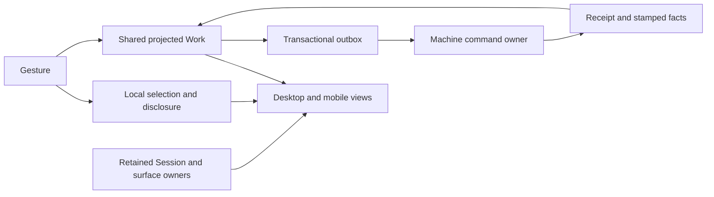

# LOO-906: immediate interactions across Desktop and mobile

Implementation continues 2026-11-15 from checkpoint `a2292b2ae7` on
origin/main `9cafc410ee`. Supersedes the Desktop-only delivery
boundary. No shipping or merge decision is recorded. Placement remains this Task;
no Wave is selected.

## Direction

Build one shared client state and command-reconciliation architecture: every
surface renders local intent immediately, then reconciles against causally newer
Machine facts without inventing execution readiness.

Jack Heart, comment `b38d7ddf-eb30-4331-b9e9-bbf9244ab700`:
> “Let’s make sure this is an aggressive systematic rewrite that sets us up to avoid these kinds of issues across the whole system, not just these specific interactions I’m talking about, and mobile and desktop are being considered”

Jack Heart, comment `e008238d-ab6b-4cf2-b307-581d122d6d81`:
> “That could include having a whole second store or a list of pending changes that are applied as a diff to the known store, something like that”

Jack Heart, comment `30bf26ae-1815-4e74-920e-8c6ed1986d56`:
> “We should do at least as well as all of those systems”

Jack Heart, comment `d555fa61-e250-4e7d-9da8-cdbe51600a3a`, answering
`scratch/concept-review.html` question 1:
> “1b for the question (or show noting)”

This selects immediate next-Task navigation after completion, with an empty state
allowed when none remains. It supersedes the keep-conversation-open draft.

Jack Heart, comment `5d9cb5de-a753-4758-b6a5-d0cb96accc64`:
> “another thing that is too slow is the time it takes for a task to look highlighted (and the session to render) after i click it, evne if its cached / recetn”

Jack Heart, comment `33675e39-b299-4a18-9049-3750eca5a8b8`:
> “or for a wave to expand when i click on it”

Earlier direction, retained:
> “launching a new task should get to new session instantaneously”

Jack Heart:
> “this is meant for deskto”
> “it takes like >10 seconds and there are a lot of intermediate states”
> “another thing i will add is that completing a task should make it disappear immediately”
> “can we talk about what are the fundamental causes of so many intermediate states and non-immediate reactivity?”
> “is it about slow sql? insufficient reactive UI archtiecture?”

The reported LOO-904 screenshot described Reading workflow, Restoring workspace,
Not started/Start, and Conversation change unconfirmed. The screenshot was not
available here. No native latency distribution or SQL attribution for these
interactions has been measured.

## What the current code establishes

Both clients use SwiftUI/Observation; their command, cache and navigation owners
still disagree about when an interaction happened. Desktop `WorkModel`/
`TaskRunDraft`, launch checkpoints and `abandoningTaskIDs`, plus mobile
`MobileTaskDraft`/view-owned `SessionLink`, remain replacement targets (see the
delete list). Revision-6 subscriptions now provide exact-query snapshot stamps;
server operation admission covers all typed writes, while live client outbox
migration still specializes creation. Native Session/Graph owners retain readiness.
Predecessor map: `bb936ac371`.

Completion already saves a domain request, checks execution/PR conditions, settles
state, syncs planning and schedules retirement. Creation already prepares its
primary Session and Graph. Those waits are not a measured SQL/latency diagnosis.

## Established designs and dependency choices

Research sources, the architecture and mutable-replica comparisons remain at
`8b42a874db6d925382c2e113c172c840496c6ea0` and `bb936ac371` (`scratch/instant-task-session.md`).
Apollo/TanStack supply operation-layer and rebase precedents; neither supplies
LF domain recovery. Apollo iOS would require GraphQL migration. Observation stays
as the native rendering model; SwiftData, Sharing and TCA do not establish causal
synchronization. A mutable replica would also require reproducing server-derived
Work membership and conflict policies. The selected engineering direction remains
confirmed cache plus ordered operation overlays, with one normalized owner.

The outbox now uses system SQLite3 directly on both native targets. This simpler
reversible dependency choice replaces the unadopted GRDB proposal; confirmed
cache/query transactions still belong in that same database. No new library is
installed. Membership coverage must be proved before client projection migration.

The comparison bar is behavioral: stable identity across surfaces, immediate shared
reads, overlapping-operation rebase, stale-response protection, operation-local
rollback, durable uncertain-outcome recovery and predictable navigation. The tests
below must demonstrate these properties; framework branding or a new placeholder
is not a substitute.

The cache/overlay owner must project every affected query, including Dashboard
membership and counts. If declarative membership cannot cover them, move the pure
projection into a shared portable core before client migration.



## Proposed contracts

Shared implementation belongs in `swift/Loopflow`, used by both app targets.
One `ClientWorkStore` per connected Machine/account in each app process; all
Desktop windows share it. Windows and mobile routes own selection and drafts.
Devices share semantics, not an in-memory instance or credentials. A shared
`InteractionModel` implementation holds per-window/route selection, disclosure
and generation; purely local actions never enter the server outbox.

- `OperationID`: client UUID, durable across reconnect/restart. Separate from
  transport request IDs and Task/Session identities. New destinations initially
  refer to an operation; server receipts bind real entity IDs without fake DTOs.
- `PendingOperation`: immutable typed command, Machine, original scope, local
  sequence, resource lanes, dependencies, projection effect and delivery state.
  Saving, queued, sent/uncertain, accepted, committed and rejected describe real
  different facts; they are not separate screens. Execution/attachment readiness
  belongs to existing Session/Graph owners.
- `ReadingStamp`: Machine, store epoch, query/scope and schema identity, complete
  coverage, domain revision vector. Frames carry the stamp from the same pinned
  snapshot as their contents. External observations retain their own freshness;
  they cannot certify a SQLite commit. Epoch changes force reconciliation.
- `OperationReceipt`: ID, payload fingerprint, authoritative disposition/result,
  affected resources and commit fence. The domain writer records that fence and
  committed result in the transaction that changes displayed facts; reading the
  global counter after a slow command returns is insufficient. Multi-stage commands
  publish stage-specific commits, not a guessed final fence. A receipt may report
  accepted but still settling. Rejection is definitive only when its effect did not commit; partial
  external effects are retained as uncertain/recoverable, never called rolled back.
- `ProjectedWork`: confirmed records/query membership plus ordered local effects
  and pending/error annotations. It is presentation data, not a modified wire DTO.
  Disk stores the confirmed cache and outbox atomically; Keychain/credentials stay
  outside it and retained payloads keep existing device-protection policies.

Core API shape:

```swift
@MainActor func begin(_ command: WorkCommand, from origin: InteractionOrigin) -> OperationID
func receive(_ reading: StampedWorkReading)
func receive(_ receipt: OperationReceipt)
func projection(for query: WorkQuery) -> ProjectedWork
@MainActor func select(_ destination: WorkDestination) // local state, no I/O
@MainActor func setExpanded(_ wave: WaveID, _ expanded: Bool) // local disclosure
func recover(_ id: OperationID) async
```

`begin` publishes locally before its first await; persistence completes before
send. Save failure removes only that effect and retains editable words. The
outbox, receipt handling and projection update use one serialized reducer and one
transactional disk owner. Draft debounce remains independent. On restart, load
saved layers before displaying cached queries, then look up each sent operation on
its original Machine. Only definitely unsent or domain-authorized continuations
send; an unavailable lookup never means absence. Offline queueing is explicit and
limited to typed durable commands; controls requiring a live owner remain paused.

Generalize the current creation receipt owner rather than adding another server
ledger. Preserve all saved creation payloads, IDs and outcomes in one finished
additive migration. The physical table name may remain `creation_receipts` during
released-binary coexistence; there is one logical receipt store and no dual write.
Every UI command uses a typed operation envelope and durable lookup. CLI output
and domain execution remain their existing owners. Transport admission is a new
operation-envelope acknowledgment; it does not weaken the existing Task creation
receipt's Graph-admitted milestone. New envelope/stamp fields require a negotiated
protocol revision, shared DTO fixtures and coordinated app/helper deployment.

The server records admission before dispatch and returns its operation identity
without waiting for planning, Git or provider readiness. Reuse the existing
bounded effect execution; preserve jobs across client disconnection. A server
restart resumes only domain-proven continuations. A recorded dispatch whose effect
cannot be established becomes uncertain; there is no generic replay of arbitrary
writes. Creation's Continue/Inspect rules and completion's durable request become
domain recovery handlers under this one receipt owner. Operation observation
gets a change revision/notification; recovery is not a five-second UI poll.

## Ordering, reconciliation and query coverage

Project layers in local sequence order. Commands touching the same entity serialize
dispatch; multi-entity commands acquire a deterministic set of resource lanes.
Different resources can proceed concurrently. A dependent command waits for real
IDs; independent operations do not wait for a whole-repository refresh.

For Complete A followed by Reopen B: both intent changes appear immediately; A's
success or rejection removes/rebases only A, leaving B. Uncertain A blocks B's
conflicting dispatch until recovery establishes ordering. Once sent, commands are
immutable; Undo is a new command, not deletion of a possibly executed request.
Other devices' changes enter as newer authoritative facts and are rebased below
remaining local intent. Server revisions/preconditions resolve concurrent edits;
field conflicts retain drafts and show the current value.

A response cannot retire projection layers merely because it arrived last. For
each affected query, retain the effect until that query's complete stamped reading
dominates the receipt's commit fence. Unrelated parts, cached frames, query changes,
missing entities in partial pages and a fresh native surface cannot acknowledge it.
After all affected cached queries converge, drop the layer; retain failed or
uncertain durable requests until resolved. Closed queries are invalidated and
must reload beyond their fence before their cached base can be shown unoverlaid.

Keep the durable operation's lifetime separate from where its effect still
applies. Once a query incorporates a committed operation, stop applying that
operation to that query, even while another query remains behind its fence.
Retaining the operation for recovery must not subtract a completed Task twice
from a fresh count. Track incorporation per affected query; retire the durable
operation only after its remaining coverage obligations are discharged.

Normalized records also need provenance across queries. Accept confirmed database
facts only when the incoming stamp covers the domains those facts depend on and
does not regress their stored revisions within the same Machine/epoch/schema.
Generate those dependencies with the membership vocabulary; never order facts by
arrival, checkpoint ID or query hash. Merge independently stamped fact groups;
when freshness cannot be ordered, retain the known value as stale and request a
covering reading rather than choosing a winner. External observations keep their
own freshness. Missing membership in a complete filtered query removes that
membership, not the normalized entity or its retained workspace. A partial or
unavailable result establishes neither removal nor incorporation.

Changing epoch invalidates comparison with the old confirmed cache and fences.
Bind incoming frames to the active connection/store generation so a delayed old
frame cannot switch the cache back. Keep submitted operations, their original
identity and pending presentation while recovering receipts on the original
Machine. An old fence cannot acknowledge the replacement base, and epoch reset
is never permission to resend uncertain work.
Historical-backup restoration must establish a new epoch before serving cached
clients; the reset mechanism remains implementation work.

Normalize Task/Session/Wave identity across lists, detail pages, boards, searches
and counts. Cut `WorkViewPlan` membership over to a server-produced declarative
selection/group/sort plan over display facts, evaluated by the shared client
projection owner. Generate its vocabulary from Rust and enforce cross-language
fixtures; do not write a second ad hoc Task status resolver in Swift. An unloaded
page keeps explicit unknown membership plus a pending result, rather than a
fabricated row or count. Do not remove
an overlay merely because another client has changed a different domain revision.
Every `ServedWrite` and UI configuration mutation must declare affected entities,
queries and projection policy in an exhaustive registry: editable-value change,
membership change, or immediate pending execution with no predicted execution fact.

### Effect acknowledgment follows the domain stage

Next implement direction from concept-review: the operation is the durable request;
its projected effects have separate acknowledgment obligations. Delivery, domain
commit, query incorporation and native readiness are independent facts, not phases
of one screen. Keep the existing receipt owner and stage results; do not add a
second lifecycle ledger to make them appear linear.

The exhaustive command registry must map each projected effect to its confirming
semantic stage and fact domains, affected query dependencies, and recovery policy.
A stage fence can discharge only the effects that stage establishes. For Complete,
`task.completion_requested` confirms pending intent, not completed membership. Only
`task.completed` plus a covering reading can replace the optimistic removal with
confirmed membership. A read that covers the request stage while settlement is held
must not restore the row or retire its removal. For Start, `task.filed` can bind
Task/Session identity without proving Graph admission, attachment or input readiness.
An operation can therefore have incorporated effects and unresolved effects at once.

For each effect/query obligation, apply the overlay until a complete covering read
incorporates the confirming stage; then use the newer confirmed facts for that
query. Keep unresolved effects and their recovery annotations. Query incorporation
and cache replacement persist atomically with the outbox so restart cannot apply a
count delta twice or reveal a pending row between loading base and layers. No-op
success must provide a domain-established current result/fence or a covering
confirmation read; neither a missing stage nor `finished` alone acknowledges it.

A definite refusal removes only effects proved not to have committed. If one stage
committed and a later stage fails, retain its confirmed facts, reconcile those
queries and recover the remaining effect in place. Absence of commits is not proof
of refusal: a filesystem/provider effect can happen before receipt recording.
External facts need their own confirmation contract, never a fabricated SQLite
fence. Keep unavailable and uncertain outcomes inspectable with the saved command;
recovery never reselects a destination or generically resends a dispatched command.

Counterexamples required before both-client cutover:

- Complete saves its request, then settlement is held. A fresh list covers only
  the request fence: the row remains projected out. Settlement refusal restores it
  from the latest base only when the domain establishes no completion effect.
- Settlement commits, then planning sync or command output fails. The Task stays
  completed, even after restart, while the remaining failure stays visible.
- One count covers settlement while another list is held; restart between their
  replies. Each query incorporates the removal once, independently of delivery.
- A Task is filed while Graph admission or native attachment fails. Keep its exact
  Task/Session and submitted words; Retry opening never creates another Task.
- A successful no-op or external mutation returns without a new SQLite stage.
  Resolve its stated confirmation obligation; never retire all effects merely
  because command output succeeded.

This refines the cache/overlay and stage-fence design with no
product choice. Implement domain recovery and effect/stage coverage before
cutting both clients over; keep the recorded launch counterexamples intact.

### Superseding an intent must resolve its effect

Next implement direction: a domain request can end without producing its intended
effect. Record that resolution in the existing receipt owner, separately from
command delivery and from successful commits. In particular, withdrawing a saved
completion request must not leave its optimistic removal and resource lane pending
forever. This follows the existing newer-facts/rebase contract; it introduces no
new product choice or cancellation control.

Concrete recovery: Complete A hides its row and selects B. While settlement is
held, Reopen from another client or the CLI withdraws A's exact saved request.
The withdrawing domain transaction records supersession for that request's
subscribers, with its replacement-fact fence. A covering read restores A from
the latest base; B stays selected. A late settler cannot complete the withdrawn
request. If completion committed before Reopen, retain that original commit and
result instead; the newer covering facts show Reopen. Neither path repeats Complete
or borrows a later completion's result.

Extend the effect/stage registry and Rust/Swift receipt contract with typed domain
resolutions for committed, definitely refused and superseded effects, alongside
pending/uncertain recovery. Keep them in the one receipt owner. A generic error,
missing request, current Task status or `delivery=finished` is insufficient to
infer a resolution. Every writer that withdraws or replaces a domain request must
record it in the same transaction, including CLI and periodic writers. Historical
rows without that record stay inspectable unless domain recovery can establish
the exact outcome. Extend the single draft migration and cross-language fixtures.

Persist each effect's resolution and per-query incorporation with the confirmed
cache. Supersession does not immediately expose a stale base: keep the pending
projection until a covering replacement reading (or an authoritative replacement
fact in the same transaction) can rebase it. Release conflicting dispatch only
when domain recovery establishes the relevant prior writer can no longer mutate
that resource; retained query coverage alone must not hold the execution lane.
Outstanding external stages keep their own recovery and ordering obligations.
Refusal or supersession never erases an earlier commit or declares provider,
planning or cleanup work rolled back. A recovered Task result with a retained
error must still expose the unresolved stage's recovery action on both clients.

Before projection cutover, hold settlement across withdrawal, restart and reordered
receipt/list/count replies. Race settlement against Reopen in both transaction
orders, and withdraw an old request before completing a newer one. Assert eventual
row/count convergence, unchanged later selection, no duplicate dispatch and no
permanent lane blockage once that domain obligation resolves. These extend the existing success and uncertainty cases. Server withdrawal and
restart cases now record supersession; client projection and navigation checks
remain open.

### Seeing a result does not incorporate its effects

Next implement direction: replace presentation-driven deletion with a presentation
acknowledgment in the same durable operation record. A mounted Task/Session or
Inspect result can acknowledge that its saved result was shown. It cannot confirm
query membership, release a resource lane, establish native input readiness or
resolve domain uncertainty. No new receipt ledger or user-facing phase is needed.

Keep three independent retention obligations: unresolved domain recovery,
unincorporated effect/query coverage, and an unpresented creation result. Retire
the saved command only when all applicable obligations are discharged. Persist
the presentation acknowledgment alongside the operation; query incorporation,
cache replacement and resulting retirement remain one transaction. A closed query
can discharge coverage through persisted invalidation and its required reload
fence, never by silently treating its old cache as current. Queries already
incorporated stop applying the effect even while the operation remains retained.

For Start, show the exact admitted conversation immediately. Once its result is
shown, remove the redundant recovery prompt, while retaining the command and
remaining effects internally until covering facts arrive. Closing that window or
restarting cannot lose the pending list/count obligations. Conversely, converged
queries do not discard an unseen recoverable creation result. Attachment failure
still offers Retry opening for the same Session; viewing an Inspect receipt does
not settle that failure, hide its recovery action or authorize another creation.
An epoch change invalidates
old fact comparisons without undoing the local fact that a result was shown;
that acknowledgment cannot certify the replacement database.

Required counterexamples: mount a finished creation while another window's list
and count are held, then restart; inspect only receipt text without a stamped Work
reading; converge all queries before any result mounts; show a partially committed
creation whose attachment failed; replace the epoch between presentation and
incorporation. Each retains exactly its outstanding obligations, with no duplicate
count delta, replay, recovery prompt or navigation change. Cover both clients.

This settles an implementation consequence of the existing lossless recovery and
per-query incorporation contracts. There is no open product choice. Replace the
interim `presented` deletion and creation-only presentation map as part of the
shared projection migration, after domain recovery and effect/stage coverage.

### Opening another query must preserve pending intent

Next implement direction: affected-query coverage is a dependency rule, not a
fixed list of the views open when `begin` runs. Opening another window, changing a
filter or returning to a cached query must evaluate the same ordered effects
before exposing its first cached frame. Derive applicability from the command's
resource/fact dependencies and the declarative query plan. Persist the plan's
identity/version with cached membership; a changed plan cannot reuse an old
incorporation acknowledgment. Unknown membership stays unknown as specified above.

Concrete interaction: Complete A hides it in Working, then open Dashboard while
its older cached count still includes A. Apply the same removal there. If that
count instead comes from a covering settlement reading, do not subtract again.
If Reopen superseded the request, retain the pending projection only until a
replacement reading covers that resolution. None of these reads changes selection.

Make operation retirement finite without requiring every possible future query
to be opened. In the cache/outbox transaction, either incorporate each affected
stored query or invalidate its base with its required confirmation fence. Opening
an invalidated query cannot expose that stale base as current. Queries created
later evaluate retained effects; after operation retirement they must use a base
that satisfies the persisted invalidation requirement or fetch a covering reading.
Keep such requirements with cache provenance, not an immortal saved command.
An epoch change still requires original-Machine recovery; invalidation is never
permission to replay uncertain work.

Before cutover, open a second window/query after Complete, close every affected
view, restart, then reopen from disk. Reorder a covering count and lagging list;
change filter/plan identity while replies are held. Assert one removal per query,
no stale row flash, no lost effect and eventual operation retirement without
opening every view. Cover Desktop and mobile through the same reducer.

This makes the existing per-query and closed-cache contracts concrete; it adds no
product choice. Ordering is under Current implementation cut.

## Local navigation, disclosure and retained content

Publish selection/highlight and disclosure in a bounded synchronous reducer before
starting effects. Cached lookup uses stable identity indexes, not a scan/re-sort of
all Work or warm preparation before the next frame. Read/decode/cache persistence,
planning acquisition and child loading run outside that gesture path. Profile
main-actor body/layout work separately; Observation alone cannot make a blocked
main actor paint sooner.

Bind a destination immediately to its cached projection and retained workspace.
The existing Desktop `GhosttySurfacePool`/workspace registry remains the native
owner. On mobile, move `SessionLink`/terminal occurrence lifetime out of transient
`SessionView` into a bounded retained-workspace owner; preserve its buffer/viewport
on quick navigation, with memory-pressure eviction. Background policy and input
control stay explicit. Cached display never certifies a location or enables input;
unknown or changed ownership pauses input while validation proceeds. Reuse a live
validated native occurrence rather than reopening it on each route push.

A→B→A increments navigation generation at every gesture. Async readers can update
their resource's confirmed cache but cannot select, focus, expand a collapsed group
or replace a newer occurrence. Completion's next selection uses this same local
owner. Wave expand shows cached children immediately; if cold, only the expanded
section shows loading/error. Collapse is immediate and a late child answer only
warms the cache. Where mobile uses a picker instead of a tree, retain that interaction
rather than introducing a new tree solely for parity; any disclosure uses the same
local semantics.

## Representative timelines

**Launch, both platforms:** tap Start → same UI turn closes editor and selects the
operation's conversation destination, showing submitted words → persist exact
request → submit/admit → bind actual Task and Session IDs → attach that Session
in place → native readiness enables input. Task/list/Graph frames reconcile in
any order without replacing the destination with Task details, Start or restoration.
Leaving changes only navigation; the operation remains in the outbox. On restart,
recover its original Machine/ID. Edit is available before send failure; uncertain
send offers lookup; attachment failure offers Retry opening, never recreate.

**Complete, both platforms:** tap Complete → remove from working/available/busy
memberships and update affected counts immediately; details show pending completion
→ persist/send → accepted/committed result → fresh stamped reads replace the layer.
Definitive refusal restores membership from the latest base while retaining later
operations. Lost reply keeps pending confirmation and recovers the same ID; refresh
failure after commit never restores a working row. Completing the selected Task
moves immediately to the next visible Task in the current list order, or an empty
state when none remains. Completing an unselected Task leaves selection alone.
Navigation changes once, in the initial interaction; neither acknowledgment nor
failure recovery selects again. Mobile gains the same completion action and
semantics, replacing the selected route rather than stacking obsolete destinations.

**Cached/recent Task:** click A → highlight A and bind its last-known workspace in
that interaction → show retained native content without a new preparation/attachment
when usable → refresh in background → update facts without blanking content. Record
click-to-highlight, click-to-cached-content and click-to-input-ready independently.
Rapid A→B→A and late replies never revive B or rebuild A's retained surface.

**Wave disclosure:** click → arrow/expanded state changes in that interaction →
cached children display, or one local loading area appears → children populate
without a second navigation action. Collapse during loading remains collapsed.

**Other mutations:** claim/unassign/move/rename/reopen/abandon, Session bind/new/move,
Wave editing, settings, layout/file save and delivery/Graph actions all enter the
same owner. Value edits project values; membership edits project all known lists;
execution commands project accepted intent and progress only. File writes retain
base-revision conflicts. Provider/Graph/PR success and Machine transfer completion
are never predicted. Terminal bytes, replies and control takeover remain with
existing bounded input owners: no offline keystroke queue or automatic resend.

## Delete — do not maintain

- Removed in this cut: newest-only delivery selection/acknowledgment in
  `task_state_delivery`/`observe_task_state`; exact attempted-delivery recovery
  replaces it. Current-decision acquisition and its adoption coverage remain.
- Already removed: Git discovery in `operation::admit`, `check_creation`, and
  `WorkNavigator.waveRow`'s delayed selection. Remove view-owned mobile
  `SessionLink` teardown on ordinary Task switching; keep explicit Close,
  background policy and memory-pressure eviction under the retained owner.
- Desktop `createdTaskIDs` predecessor and this pass's request-specific
  `pendingTaskReconciliations`/checkpoint exception, `StartingTask` submission state,
  `TaskRunDraft.phase`, `abandoningTaskIDs`, mutation-specific refresh barriers and
  rename/bind replacement bookkeeping. Replace their consumers in the same cut.
- Mobile `MobileTaskOutcome`, submitted/outcome/savedRequests portions of
  `MobileTaskDraft`, sheet-owned mutation lifetime and result-owned Open Task gate.
  Keep unsent drafts, repository selection and device protection.
- Removed: creation-only `CreationSubmissions` and `CreationRecovery`'s status
  poll. The shared SQLite outbox replaces the sender and saved-command owner.
  Remaining: per-view retirement map. Generalize/migrate their exact
  saved requests and receipt semantics into the operation store, without loss.
- WorkCache/TaskFeed duplicate authoritative caches and Desktop/mobile duplicate
  freshness reconciliation. Keep UI-only workspace/layout/draft persistence where
  it represents retained local content, not server truth.
- Tests exclusively asserting old intermediate screens, local exception sets or
  second-submit recovery. Preserve success, duplicate prevention, failure,
  departure, ownership, layout and first-turn coverage on the shared path.

Keep current branch source edits as a checkpoint, not the final architecture.
Previous Desktop design: `7030e08a:scratch/instant-task-session.md`.

## Forbidden outcomes

No per-screen exception sets, second mobile submission ledger, whole-snapshot
rollback, fake Task/Session DTOs or timer-based readiness. No SQL or network wait
before selection/disclosure, no retained surface replacement on a healthy revisit,
and no background completion that chooses navigation. A library or loading surface
alone does not complete the cut: query membership, overlap, uncertainty, migration
and both clients must use the same semantics.

## Delivery and acceptance

Indivisible cross-platform cut, with internal slices; no publish/merge authorization.
This scope exceeds the size-check signal because causal writes, both read paths
and their consumers must converge together.

1. **Architecture:** confirmed cache plus ordered overlays; validate query
   membership and persistence dependencies before cutting consumers over.
   Completion navigation is specified above.
2. Extend receipt/commit-stamp contracts and domain recovery; migrate saved data.
   Done: stamped subscription readings (revision 6), Git-free
   `operation.submit` admission, submitted/canonical identity, legacy envelope
   adoption, saved-command dispatch and both creation clients' outbox admission.
   Remaining: domain continuation and all-writer stage fences.
3. Build shared transactional client store and projection reducer; cut both
   transports over, including query membership. Delete predecessor owners.
4. Move selection, disclosure, launch, completion and every mutation family through
   their shared interaction owners on both clients;
   retain native execution and input owners. Update product/API docs together.
5. Measure actual latency and remove demonstrated backend waits independently of
   presentation; run the full acceptance matrix and native demo.

Slice status and order are under Current implementation cut; slice 4 has not
started, and slice 3 deletes the interim launch exception.

Headless acceptance uses deterministic held/reordered replies, not timing sleeps:
shared reducer tests cover overlapping success/failure, stale reads, partial pages,
query changes, epoch reset, reconnect and every save/send/crash boundary. Desktop
and iOS production-view tests prove immediate launch/removal before held network
responses. Selection/disclosure tests assert state before held reads; A→B→A,
expand→collapse and reordered loads preserve cached content and surface identity.
Two windows and two clients prove all projected surfaces agree. The
command registry has exhaustive policy coverage. Receipt fixtures include Rust,
Swift/macOS and iOS; upgrade tests preserve existing pending submissions.

Planned focused commands once those tests exist: `scripts/test_desktop.sh --filter
'ClientWorkStoreTests|WorkDestinationTests|NewTaskTests'`, `uv run python
scripts/test_ios.py -only-testing:LoopflowiOSTests/ClientWorkInteractionTests`, and
the new Rust operation-receipt/stamped-subscription module filters. Exact Rust
filters follow the named modules created by implementation. Gate owns wider suites
and documented commands; display diagnostics remain demo work.

## Latency and open review decisions

Trace gestures through event handling, observable state publication and the next
render commit; selection adds cached-content and input-ready endpoints, disclosure
adds arrow/children/data-ready endpoints. Separate retained hits, cold misses and
memory-pressure eviction. Trace one operation through gesture→local projection
→durable save→network admission
→domain commit→subscription apply→native readiness. Add separate backend spans for
SQLite lock wait/query, planning network, Git/worktree, Graph registration and
provider attach. Log IDs and durations, never authored text. Compare in-process
fixtures, Desktop local transport and mobile remote transport. Check changed SQL
with EXPLAIN on the 10,000-Task fixture; unrelated events must not reread every Task.

Proposed local-reaction target: P95 under 100 ms, at least 20 native launch and
completion, cached/recent selection and disclosure samples per applicable platform;
report highlight, cached content, input-ready and server-stage distributions
separately. Neither that target nor a SQL bottleneck has been measured here.

## Implement direction

Concept-review outcome (2026-11-15, checkpoint `a2292b2ae7` plus workspace edits):
no further model change or open product choice. Exact older-attempt recovery now uses the existing Task-state delivery
lock. Finish client reordering and remaining mutation-family fences before shared
membership/cache/projection and both-client cutover. Planning correlation does
not complete client reconciliation or authorize retiring operations on presentation. Loop-or-next may advance this review;
the implementation and native latency acceptance remain unfinished.

Next verify the live shared owner with a newer planning-status receipt, an older
saved-result reply and a lagging Work reading delivered in each order, including
restart. Preserve the original result, current recovery action and per-query
overlay independently; none of these replies may reselect the Task or replay the
command. Persisted receipt-order tests already cover older saved replies; they do
not establish live Work reconciliation or either client's presentation behavior.

### Recover the result; observe the remaining work

Next implement direction from concept-review (2026-11-15): a recovered result is
an immutable account of the original mutation, not the current state of every
owner it touched. In particular, the saved `TaskEdit.sync` describes planning
delivery at that commit. It cannot replace newer planning status after reconnect,
certify external delivery, or keep showing an old failure after that owner resolves
it. Preserve the saved result and diagnostic; derive current recovery actions from
the owner of each outstanding effect.

Concrete interaction: edit A, commit locally, lose the reply before planning
delivery finishes, then edit A again elsewhere. Restart returns the first edit's
exact result without overwriting the second edit. A covering Work reading shows
the current value. Planning status comes from the existing planning changes and
delivery receipts. If the first change is still unresolved, its recovery action
targets that change; it never reruns `TaskUpdate` with the old words. If it was
delivered or superseded, retain the historical diagnostic without presenting it
as a current failure. An unavailable status read establishes neither outcome.

For every remaining mutation family, the effect/stage registry must name the
domain recovery owner, its stable attempt/change identity, the reading that
confirms resolution, and any domain-authorized continuation. Reuse existing
planning, completion, creation, execution and filesystem owners. Where no
recoverable identity or confirmation exists, retain Inspect and implement that
contract before offering a retry; do not infer success from a current value that
could belong to another attempt. A transport error string is diagnostic data,
not a recovery policy. Neither `delivery=finished` nor viewing the saved result
discharges an unresolved external effect.

Keep this correlation in the existing receipt/stage contract and shared client
projection; do not copy domain queues into another operation lifecycle. Current
status readings carry their own provenance. SQLite coverage confirms only the
local facts it covers. Release a resource lane when its prior domain writer can
no longer mutate that resource; an unrelated planning wait must not hold every
later edit, while a still-live external writer cannot be bypassed by lookup.
Presentation acknowledgment and cache retirement retain their existing rules.

Server side, `planning_recovery_tracks_the_exact_change_across_newer_edits_and_restart`
(`store/sqlite/task_content.rs`) holds delivery across a newer edit and restart,
resolves the old change only, and keeps missing evidence unavailable. Completion
also covers output loss after successful external delivery. Open items are in
the remaining list under Current implementation cut.

Preserve the launch counterexamples in the shared tests: pre-admission cached
Task data, a fresh unrelated planning frame, unavailable or missing Task rows,
current no-Graph results, Graph removal after reconciliation, reconnect, departure
and return, and native readiness before a current Task result. Attachment failure
must remain visible beside receipt recovery, and Retry opening must reuse the
admitted Session without another create.

Desktop still has the per-action `pendingTaskReconciliations` checkpoint path.
Its launch counterexamples above must survive deletion in the shared projection
cut. Implementation map: `639411f1b27fbdb1532ac206ceb775a0dc76fde9`.

Proposed usage text for the affected Desktop/mobile docs:
> Start opens your submitted request immediately. Leave and return while it
> prepares; Retry opening uses the same conversation. Complete removes the Task
> from the list and opens the next Task, or an empty view. A definite refusal
> restores its row with an explanation without changing your later selection.
> An interrupted or partly committed completion stays pending while its outcome
> is recovered; a refresh failure does not undo it.
> If a newer action replaces a pending completion, the list follows that newer
> state without changing your current selection.
> Opening a finished result clears its Show result prompt. List and count updates
> continue in the background; leaving the result does not cancel them. Unresolved
> failures keep their recovery actions.
> Opening another list or window shows the same pending changes; an older cached
> list never brings a completed Task back while confirmation is pending.
> Selecting a recent Task shows its retained content while refreshing. Expanding
> a Wave opens its children immediately; a cold section loads in place.

Keep this text marked proposed until each client uses the shared owner. Existing
creation-recovery instructions remain valid; no skill workflow change is needed.

Additional held-response counterexamples for the shared owner: a list at planning
revision 12 arrives before a detail response at revision 11 for the same Task;
the title must not regress. A refreshed count already includes Complete while
another affected list is held; apply the removal only to the lagging list. A Task
leaves a filtered list but remains open elsewhere; retain its entity/workspace.
After an epoch change, an old frame and a lost-write recovery reply arrive; neither
may restore the old base or trigger a second submission. These refine the existing
cache/overlay design and require no new product choice.

## Current implementation cut

Protocol revision 6 provides stamped subscriptions, Git-free admission and one
receipt owner. Both creation transports use the shared SQLite outbox. Exact saved
commands, independent submitted/canonical identities, legacy candidate adoption,
receipt revisions and epoch-checked admission remain intact. Details and previous
checks are at `aeb4ed3b2b0e7256748fa69bd76f77acff966b98:scratch/instant-task-session.md`.
The launch checkpoint, presentation-driven retirement and phone sheet/outcome
presentation remain interim; no shared projection cutover is claimed.

Completion/reopen and Task field/Wave edits recover their writer's original
result without replaying intent. Field/membership validation records definite
refusal; later errors stay uncertain. Saved `TaskEdit.sync` is historical. Remote
Machine moves remain outside the Wave-move recovery rule. Other mutation families
and both clients' completion presentation remain unfinished.

Stage resolutions stay in `commits`: committed, definitely refused or superseded.
Completion withdrawal resolves the exact saved request in the withdrawing writer's
transaction, with replacement coverage rather than a guessed Task. First resolution
wins even after delivery finishes. Recovery never repeats a superseded request.
The indexed 10k status-withdrawal lookup replaced a `repository_plans` scan;
prior detail/checks: `fc50618e31:scratch/instant-task-session.md`.

Task edit/move stages correlate exact Task-field or Project-order delivery IDs.
Completion settlement now correlates its `task_state_deliveries` ID to every
receipt for the exact request; Reopen correlates its own state delivery, including
no-op coverage without inventing a change. `operation.get.planning` reads current
status with its own snapshot fence. Conflicts record provider disagreement, not
delivery; only the current decision adopts it. Older attempts remain uncertain
until their own recovery, despite newer local decisions. Missing
rows remain unavailable. Saved results/diagnostics never change with that status.
Receipt revisions and subscription invalidation include planning revisions. Both
native targets share the DTO and persisted receipt ordering; live action/projection
migration is unfinished. No new queue, generic retry or migration was introduced.

State delivery now recovers the oldest unresolved attempted write under the
existing Task lock. Exact acknowledgment/history resolves only that delivery;
ordinary acquisition cannot adopt it over newer local intent. Proven noncommit
leaves the older decision superseded; unknown history retains uncertainty even
under Retry. A resolved observation rebases the unsent successor's provider
baseline before its own delivery, without changing its local value. Reservation
also excludes any other unresolved attempted writer. Repository maintenance finds
old attempts even if the newest decision is already settled. Held acknowledgment,
lost success, noncommit, changed/unknown history and restart have focused coverage.
This is state-delivery ordering, not the unfinished client resource-lane registry.
Definite refusal outside Task content/membership validation, other planning families,
remote/detached operations and file/config confirmation remain open.

Remaining, in order: client reordering of saved results against Work and
delivery-status readings; lost-output coverage for families beyond completion;
remaining mutation-family recovery and fences (remote/detached,
external file/config confirmation and other planning-delivery families included); exhaustive effect/stage registry and a
declarative membership plan over #1947's `selection_states`; transactional confirmed cache and ordered effect/query
projection; both clients' interaction/retained-occurrence migration and deletion
of checkpoint/presentation exceptions; epoch reset on historical restoration;
held/reordered/crash and native acceptance. Dispatched errors remain uncertain;
SQLite fences cannot certify filesystem/provider effects. Transport `complete`
is query coverage, not membership or native readiness.

### Admission identity and recovery contract

Admission means the submitted envelope is saved, not that repository identity,
legacy compatibility or execution has been established. No repository discovery,
Git, planning, creation lock or provider call precedes the acknowledgment. Local
schema/ID checks and the receipt transaction remain necessary. Domain validation
and its wait are visible through receipt observation in the same destination;
there is no new screen or second submission.

Keep two meanings separate in the single receipt owner:

- **Submitted content:** a versioned deterministic encoding of the typed command,
  preserving authored values and path spelling. It excludes transport IDs and
  incidental JSON key order. Persist both content and its digest; a digest alone
  cannot recover the command. New operations bind this content at admission.
  Same ID/content returns the existing receipt without changing dispatch state;
  changed content is a conflict. Retrying uses the saved envelope, not rebuilt
  fields from a current form or a newly resolved directory.
- **Creation identity:** the existing canonical domain fingerprint, computed by
  the worker using the released normalization rules. Preserve it independently;
  never put a raw-envelope digest into the legacy fingerprint field. New creation
  rows need an explicitly unresolved domain identity until the worker establishes
  it. Direct CLI creation and served envelopes must use the same atomic domain
  claim, so a CLI attempt racing normalization cannot create a second Task.

Released creation rows have canonical identity but no submitted envelope. Preserve
all their IDs, results, launch data, milestones and recovery dispositions. For
first envelope adoption, durably reserve one candidate in that same row before
acknowledgment; this is pending validation, not a replacement command or permission
to execute. Existing creation lookup remains usable while validation is held.
The worker resolves its directory, compares the legacy fingerprint and atomically
binds the **first verified** envelope. A symlink/subdirectory spelling that resolves
to the old canonical payload can adopt it. A mismatch reports a candidate content
conflict and releases only that reservation; it must not reject, overwrite or
strand the previously successful creation. Unavailable normalization retains the
candidate for recovery, without classifying it as a mismatch. Concurrent identical
candidates share validation; a different candidate conflicts while reserved.
Candidate finalization/release must compare its saved identity so a held worker
cannot overwrite a newer reservation. After successful adoption, submitted content
is immutable; subsequent envelope retries use that saved spelling. Legacy CLI
recovery continues to compare canonical identity, including equivalent paths.

Keep candidate validation and command dispatch distinct. Validation can repeat
after restart because it has no domain effect. A new operation dispatches only
after validation and an atomic claim. An adopted released row always consults its
existing domain recovery disposition: Complete returns its saved result, Continue
uses only the domain-proven continuation, Inspect remains inspectable. It never
becomes generically queued. A crash after claim remains uncertain until domain
recovery proves what happened. No invented commit fence certifies historical
results; obtain current covering facts without replaying the creation.

Extend the one draft migration in place. Represent submitted and canonical identity
explicitly, including their absence; do not infer identity mode from a hash or
reuse `queued` to mean adoption of a completed creation. Expose admission versus
validation outcome in Rust/Swift fixtures and protocol docs before client cutover.
Keep the existing Graph-admitted creation milestone distinct from envelope receipt.

Server fixtures cover held Git before discovery, released-row upgrade and path
adoption, wrong-then-correct candidates, restart/CLI races and duplicate
submission (list at `19612daf41:scratch/instant-task-session.md`). Live clients
use that admission; the shared receipt cursor and epoch race have focused checks.
Still open: reordered validation replies must update only the active epoch with a
newer receipt revision, never enabling input or retiring overlays, and full
cross-platform presentation acceptance.

## Upstream acceptance retained

Origin/main `9cafc410ee` supplies `selection_states` (#1947), terminal paste
continuity (#1944), name freshness/failure presentation (#1943), and retained
surface visibility (#1942). Shared projection and retained-occurrence migration
must retain their coverage. The detailed predecessor map is at
`639411f1b27fbdb1532ac206ceb775a0dc76fde9:scratch/instant-task-session.md`.

## Benchmark implementation and observations (2026-11-14)

Exact feedback and host preferences are in `desktop-reactivity-feedback.md`.
The existing performance harness README now maps ADEMark A1–A12/B1–B4/C1–C6 and
LF workflow journeys to endpoints, fixtures, platforms, coverage and remaining
work. Sources read: https://ademark.dev/ and https://github.com/zqkra/ademark,
source HEAD `119a5f7b99247cffbe7f96bb2c36c03496cf3018`, retrieved 2026-11-14.
The site's C2–C6 reliability methods are written but not run; no borrowed result
is a Loopflow measurement. Web-reader access failed; a direct HTTP fetch succeeded.

`desktop_performance.py preflight` retains host CPU/load and rejects contamination
without stopping other work. Quiet-host native probes inspect display/capture/input
access without prompting. These probes do not yet establish thermal/swap or
whole-trial load. Shared `PerfClock.interaction` marks distinguish Desktop
selection publication/completion return and phone tap/workspace mount from pixels.
Rust CLI volume adds aggregate SQLite profile time without SQL text/values;
mutex/planning/provider attribution remains incomplete. The existing headless
projection measurement now includes 10,000 Tasks/Sessions, preserves each sample
with an atomic checkpoint outside the interval and refuses to overwrite an old
result. The rebuilt diagnostic ran; the quiet-host baseline remains missing. Native display/input benchmarks remain unmeasured.

Benchmark observations and raw files: `8b42a874db`; earlier checks: `bb936ac371`
(both `scratch/instant-task-session.md`). Both hosts failed load preflight on 2026-11-14; the mini also runs macOS 15.5
against Desktop's macOS 26 target (`ssh mini-heart sw_vers -productVersion`
reconfirmed 15.5 on 2026-11-15). The rebuilt debug 10k constructor warm P95
was 235.92 ms on the rejected host; it is diagnostic, not a regression baseline
or native/SQL attribution. No gesture, native paint/input or full backend-stage
baseline exists. The 10k receipt diagnostic (nextest run
`7f2b652c-19e3-4026-8961-d4e3f4d84d37`) had lookup/admission P95 0.033 ms;
all 20 receipt SQL statements used keyed indexes without table scans.
`measureWriteToVisible` still refers to removed `pm_items.body` and needs migration.
The earlier admission LEAK has no established cause. Preflight rejected native measurement at
2026-11-15T10:40:27Z (CPU 371.0%, one-minute load 39.52), raw
`/tmp/loo906-state-planning-preflight-session_b2a6/preflight.json`.

Gate owns wider suites and packaging; implementation owns a valid benchmark
baseline; demo owns native usability judgment.

Earlier focused checks and raw results: `fc50618e31:scratch/instant-task-session.md`.

Previous checks: `a2292b2ae7:scratch/instant-task-session.md`.
Current cut (2026-11-15; inherited `LF_*` cleared):
- `cargo nextest run -p loopflow --lib --build-jobs 4`, named state-attempt/held-ack/restart/uncertainty filters: 8 passed; 10k query plans indexed. Runs `476e77fd` and `79c825f0`.
- `cargo clippy --all-targets --jobs 4 -- -D warnings`, fmt, architecture, test inventory and diff checks: passed.
- `cargo test -p loopflow --test integration documented_commands:: --jobs 4`: 4 passed. Gate owns wider suites.
