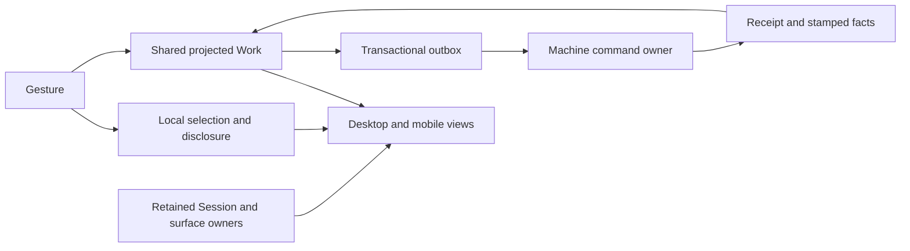

# LOO-906: immediate interactions across Desktop and mobile

Draft for architecture review, 2026-11-14. Supersedes the Desktop-only delivery
boundary. No shipping or merge decision is recorded. Placement remains this Task;
no Wave is selected.

## Direction

Build one shared client state and command-reconciliation architecture: every
surface renders local intent immediately, then reconciles against causally newer
Machine facts without inventing execution readiness.

Jack Heart, comment `b38d7ddf-eb30-4331-b9e9-bbf9244ab700`:
> “Let’s make sure this is an aggressive systematic rewrite that sets us up to avoid these kinds of issues across the whole system, not just these specific interactions I’m talking about, and mobile and desktop are being considered”

Jack Heart, comment `e008238d-ab6b-4cf2-b307-581d122d6d81`:
> “That could include having a whole second store or a list of pending changes that are applied as a diff to the known store, something like that”

Jack Heart, comment `30bf26ae-1815-4e74-920e-8c6ed1986d56`:
> “We should do at least as well as all of those systems”

Jack Heart, comment `d555fa61-e250-4e7d-9da8-cdbe51600a3a`, answering
`scratch/concept-review.html` question 1:
> “1b for the question (or show noting)”

This selects immediate next-Task navigation after completion, with an empty state
allowed when none remains. It supersedes the keep-conversation-open draft.

Jack Heart, comment `5d9cb5de-a753-4758-b6a5-d0cb96accc64`:
> “another thing that is too slow is the time it takes for a task to look highlighted (and the session to render) after i click it, evne if its cached / recetn”

Jack Heart, comment `33675e39-b299-4a18-9049-3750eca5a8b8`:
> “or for a wave to expand when i click on it”

Earlier direction, retained:
> “launching a new task should get to new session instantaneously”

Jack Heart:
> “this is meant for deskto”
> “it takes like >10 seconds and there are a lot of intermediate states”
> “another thing i will add is that completing a task should make it disappear immediately”
> “can we talk about what are the fundamental causes of so many intermediate states and non-immediate reactivity?”
> “is it about slow sql? insufficient reactive UI archtiecture?”

The reported LOO-904 screenshot described Reading workflow, Restoring workspace,
Not started/Start, and Conversation change unconfirmed. The screenshot was not
available here. No SQL or native latency distribution has been measured.

## What the current code establishes

Reactive rendering and synchronization are separate problems. Both clients already
use SwiftUI/Observation. Their command, cache and navigation owners disagree about
when an interaction has happened:

| Area | Current owners and sequencing | Replacement obligation |
|---|---|---|
| Desktop mutations | `WorkModel.performTaskAction`, `TaskRunDraft`, `confirmWorkUpdate`; Complete waits through command and observation | Immediate shared projection; acceptance survives refresh failure |
| Desktop removal | `abandoningTaskIDs` filters rows and separately advances selection | Same operation projection as Complete; navigation remains its own choice |
| Desktop creation | `StartingTask`, creation journal/recovery/presentation, exact Session attachment; branch reconciliation map | Shared operation destination and reconciliation, retain exact Session owner |
| Mobile creation | `MobileTaskDraft.submission/outcome/savedRequests` plus a separate `CreationSubmissions` journal; sheet owns/cancels async work, then opens a Task | One durable submitted-operation owner; draft stores editable text only |
| Read freshness | Desktop part sequence/floors and checkpoint waiters; mobile `RemoteTaskObservation` refresh/coalescing; saved Work and list files | One stamped read/reconciliation engine, platform-specific transport only |
| Task selection | Desktop `select` sets selection synchronously but continues through `openSelectedWorkspace`/warm conversation reconciliation; mobile pushes `NavigationLink` content and creates/closes a view-owned `SessionLink` | Small immediate navigation reducer; cached content/native occurrence retention independent of refresh |
| Wave navigation/disclosure | `WorkNavigator.waveRow` stages `pressedScope`, sleeps 120 ms, then selects without a newer-selection token | Delete delayed selection; disclosure/route changes happen locally before loading children |
| Shared commands | Typed `ServedWrite`/Rust `Write`; creations alone have durable request receipts | Stable operation IDs and outcomes for every UI command |
| Backend reads | SQLite domain revisions and pinned read snapshots already exist; subscription wire exposes `answers`, unavailable and body | Expose causal stamps, including complete query scope; do not compare unrelated checkpoints |

`task_complete` already saves a completion request, checks PR/execution conditions,
settles state, syncs planning and schedules retirement. Creation already performs
planning, primary Session preparation and Graph admission. These paths contain
potential waits; their durations do not establish which is slow. Server effects
continue after the connection drops, but ordinary request IDs are transport-local
and are not durable command identities.

## Established designs and dependency choices

Research checked on 2026-11-14:

- [Apollo optimistic mutations](https://www.apollographql.com/docs/react/performance/optimistic-ui)
  keep optimistic data separate from confirmed cache data and notify affected
  queries. Adopt operation layers and shared invalidation; rollback removes one
  operation, rather than restoring an entire old snapshot.
- [TanStack optimistic updates](https://tanstack.com/query/latest/docs/framework/react/guides/optimistic-updates)
  show both pending-variable projections and cache updates, cancel stale refetches,
  and invalidate after settling. Its [mutation guidance](https://tanstack.com/query/latest/docs/framework/react/guides/mutations)
  addresses persistent/offline mutations. Adopt stable identity, explicit retry
  policy and concurrency tests. Network uncertainty needs our domain receipts.
- [Apollo iOS](https://www.apollographql.com/docs/ios/caching/introduction)
  normalizes entities across query results and offers memory/SQLite caches.
  Direct adoption would require GraphQL schema/code generation and transport
  migration. That cost does not supply LF operation recovery or native ownership.
- [Apple Observation](https://developer.apple.com/documentation/observation.md)
  tracks observable model changes; [SwiftData](https://developer.apple.com/documentation/swiftdata/modelcontext)
  manages persistent models. Neither alone defines reconciliation with this Rust
  server. Replacing Observation would leave the synchronization problem intact.
- [Expo local-first guidance](https://docs.expo.dev/guides/local-first/)
  distinguishes local storage from synchronization and describes several sync
  systems. Those JavaScript/client-centric ecosystems are architectural references;
  replacing the native clients or Machine execution authority is a separate cost.
- [GRDB](https://github.com/groue/GRDB.swift) supplies SQLite transactions and
  database observation. [Sharing](https://github.com/pointfreeco/swift-sharing)
  shares observable persisted values; [TCA](https://github.com/pointfreeco/swift-composable-architecture)
  supplies reducers, effects and test stores. None removes the need for LF command
  semantics. A full TCA conversion adds navigation/effect migration; Sharing alone
  leaves our causal protocol. Proposed library choice: GRDB for transactional
  client persistence, existing Observation for UI, and a small shared typed
  reconciliation reducer. Verify supported toolchains and dependency build cost
  before adopting; no new dependency has been installed in this pass.

The comparison bar is behavioral: stable identity across surfaces, immediate shared
reads, overlapping-operation rebase, stale-response protection, operation-local
rollback, durable uncertain-outcome recovery and predictable navigation. The tests
below must demonstrate these properties; framework branding or a new placeholder
is not a substitute.

### Two storage architectures

| Candidate | Benefits | Costs and failure modes |
|---|---|---|
| Mutable client replica: local entities/queries become primary app state; bidirectional sync reconciles writes | All queries run locally; broad offline editing; strong normalization | Must reproduce derived Work status, membership and permissions or move their evaluator into a portable shared core; conflict policy for every field, replicated schema and execution-derived data; snapshot rollback can clobber overlapping writes |
| Confirmed cache plus ordered operation overlays, exposed through one client store | Keeps server derivation and domain execution; operation-local rollback/rebase; smaller recovery/migration cut | Requires complete query dependencies/membership rules and causal stamps; raw per-screen JSON patches would recreate the current fragmentation |

Next implement direction: the second, with a real shared client store containing
both cached facts and a transactional outbox. This is an architecture replacement,
not a window-local list of exceptions. It must normalize entity identity and
project every affected query, including Dashboard membership and counts. If the
membership cut cannot be made complete, the design must move the pure projection
core into shared portable code; silently leaving those surfaces stale is invalid.



## Proposed contracts

Shared implementation belongs in `swift/Loopflow`, used by both app targets.
One `ClientWorkStore` per connected Machine/account in each app process; all
Desktop windows share it. Windows and mobile routes own selection and drafts.
Devices share semantics, not an in-memory instance or credentials. A shared
`InteractionModel` implementation holds per-window/route selection, disclosure
and generation; purely local actions never enter the server outbox.

- `OperationID`: client UUID, durable across reconnect/restart. Separate from
  transport request IDs and Task/Session identities. New destinations initially
  refer to an operation; server receipts bind real entity IDs without fake DTOs.
- `PendingOperation`: immutable typed command, Machine, original scope, local
  sequence, resource lanes, dependencies, projection effect and delivery state.
  Saving, queued, sent/uncertain, accepted, committed and rejected describe real
  different facts; they are not separate screens. Execution/attachment readiness
  belongs to existing Session/Graph owners.
- `ReadingStamp`: Machine, store epoch, query/scope and schema identity, complete
  coverage, domain revision vector. Frames carry the stamp from the same pinned
  snapshot as their contents. External observations retain their own freshness;
  they cannot certify a SQLite commit. Epoch changes force reconciliation.
- `OperationReceipt`: ID, payload fingerprint, authoritative disposition/result,
  affected resources and commit fence. The domain writer records that fence and
  committed result in the transaction that changes displayed facts; reading the
  global counter after a slow command returns is insufficient. Multi-stage commands
  publish stage-specific commits, not a guessed final fence. A receipt may report
  accepted but still settling. Rejection is definitive only when its effect did not commit; partial
  external effects are retained as uncertain/recoverable, never called rolled back.
- `ProjectedWork`: confirmed records/query membership plus ordered local effects
  and pending/error annotations. It is presentation data, not a modified wire DTO.
  Disk stores the confirmed cache and outbox atomically; Keychain/credentials stay
  outside it and retained payloads keep existing device-protection policies.

Core API shape:

```swift
@MainActor func begin(_ command: WorkCommand, from origin: InteractionOrigin) -> OperationID
func receive(_ reading: StampedWorkReading)
func receive(_ receipt: OperationReceipt)
func projection(for query: WorkQuery) -> ProjectedWork
@MainActor func select(_ destination: WorkDestination) // local state, no I/O
@MainActor func setExpanded(_ wave: WaveID, _ expanded: Bool) // local disclosure
func recover(_ id: OperationID) async
```

`begin` publishes locally before its first await; persistence completes before
send. Save failure removes only that effect and retains editable words. The
outbox, receipt handling and projection update use one serialized reducer and one
transactional disk owner. Draft debounce remains independent. On restart, load
saved layers before displaying cached queries, then look up each sent operation on
its original Machine. Only definitely unsent or domain-authorized continuations
send; an unavailable lookup never means absence. Offline queueing is explicit and
limited to typed durable commands; controls requiring a live owner remain paused.

Generalize the current creation receipt owner rather than adding another server
ledger. Preserve all saved creation payloads, IDs and outcomes in one finished
additive migration. The physical table name may remain `creation_receipts` during
released-binary coexistence; there is one logical receipt store and no dual write.
Every UI command uses a typed operation envelope and durable lookup. CLI output
and domain execution remain their existing owners. Transport admission is a new
operation-envelope acknowledgment; it does not weaken the existing Task creation
receipt's Graph-admitted milestone. New envelope/stamp fields require a negotiated
protocol revision, shared DTO fixtures and coordinated app/helper deployment.

The server records admission before dispatch and returns its operation identity
without waiting for planning, Git or provider readiness. Reuse the existing
bounded effect execution; preserve jobs across client disconnection. A server
restart resumes only domain-proven continuations. A recorded dispatch whose effect
cannot be established becomes uncertain; there is no generic replay of arbitrary
writes. Creation's Continue/Inspect rules and completion's durable request become
domain recovery handlers under this one receipt owner. Operation observation
gets a change revision/notification; recovery is not a five-second UI poll.

## Ordering, reconciliation and query coverage

Project layers in local sequence order. Commands touching the same entity serialize
dispatch; multi-entity commands acquire a deterministic set of resource lanes.
Different resources can proceed concurrently. A dependent command waits for real
IDs; independent operations do not wait for a whole-repository refresh.

For Complete A followed by Reopen B: both intent changes appear immediately; A's
success or rejection removes/rebases only A, leaving B. Uncertain A blocks B's
conflicting dispatch until recovery establishes ordering. Once sent, commands are
immutable; Undo is a new command, not deletion of a possibly executed request.
Other devices' changes enter as newer authoritative facts and are rebased below
remaining local intent. Server revisions/preconditions resolve concurrent edits;
field conflicts retain drafts and show the current value.

A response cannot retire projection layers merely because it arrived last. For
each affected query, retain the effect until that query's complete stamped reading
dominates the receipt's commit fence. Unrelated parts, cached frames, query changes,
missing entities in partial pages and a fresh native surface cannot acknowledge it.
After all affected cached queries converge, drop the layer; retain failed or
uncertain durable requests until resolved. Closed queries are invalidated and
must reload beyond their fence before their cached base can be shown unoverlaid.

Normalize Task/Session/Wave identity across lists, detail pages, boards, searches
and counts. Cut `WorkViewPlan` membership over to a server-produced declarative
selection/group/sort plan over display facts, evaluated by the shared client
projection owner. Generate its vocabulary from Rust and enforce cross-language
fixtures; do not write a second ad hoc Task status resolver in Swift. An unloaded
page keeps explicit unknown membership plus a pending result, rather than a
fabricated row or count. Do not remove
an overlay merely because another client has changed a different domain revision.
Every `ServedWrite` and UI configuration mutation must declare affected entities,
queries and projection policy in an exhaustive registry: editable-value change,
membership change, or immediate pending execution with no predicted execution fact.

## Local navigation, disclosure and retained content

Publish selection/highlight and disclosure in a bounded synchronous reducer before
starting effects. Cached lookup uses stable identity indexes, not a scan/re-sort of
all Work or warm preparation before the next frame. Read/decode/cache persistence,
planning acquisition and child loading run outside that gesture path. Profile
main-actor body/layout work separately; Observation alone cannot make a blocked
main actor paint sooner.

Bind a destination immediately to its cached projection and retained workspace.
The existing Desktop `GhosttySurfacePool`/workspace registry remains the native
owner. On mobile, move `SessionLink`/terminal occurrence lifetime out of transient
`SessionView` into a bounded retained-workspace owner; preserve its buffer/viewport
on quick navigation, with memory-pressure eviction. Background policy and input
control stay explicit. Cached display never certifies a location or enables input;
unknown or changed ownership pauses input while validation proceeds. Reuse a live
validated native occurrence rather than reopening it on each route push.

A→B→A increments navigation generation at every gesture. Async readers can update
their resource's confirmed cache but cannot select, focus, expand a collapsed group
or replace a newer occurrence. Completion's next selection uses this same local
owner. Wave expand shows cached children immediately; if cold, only the expanded
section shows loading/error. Collapse is immediate and a late child answer only
warms the cache. Where mobile uses a picker instead of a tree, retain that interaction
rather than introducing a new tree solely for parity; any disclosure uses the same
local semantics.

## Representative timelines

**Launch, both platforms:** tap Start → same UI turn closes editor and selects the
operation's conversation destination, showing submitted words → persist exact
request → submit/admit → bind actual Task and Session IDs → attach that Session
in place → native readiness enables input. Task/list/Graph frames reconcile in
any order without replacing the destination with Task details, Start or restoration.
Leaving changes only navigation; the operation remains in the outbox. On restart,
recover its original Machine/ID. Edit is available before send failure; uncertain
send offers lookup; attachment failure offers Retry opening, never recreate.

**Complete, both platforms:** tap Complete → remove from working/available/busy
memberships and update affected counts immediately; details show pending completion
→ persist/send → accepted/committed result → fresh stamped reads replace the layer.
Definitive refusal restores membership from the latest base while retaining later
operations. Lost reply keeps pending confirmation and recovers the same ID; refresh
failure after commit never restores a working row. Completing the selected Task
moves immediately to the next visible Task in the current list order, or an empty
state when none remains. Completing an unselected Task leaves selection alone.
Navigation changes once, in the initial interaction; neither acknowledgment nor
failure recovery selects again. Mobile gains the same completion action and
semantics, replacing the selected route rather than stacking obsolete destinations.

**Cached/recent Task:** click A → highlight A and bind its last-known workspace in
that interaction → show retained native content without a new preparation/attachment
when usable → refresh in background → update facts without blanking content. Record
click-to-highlight, click-to-cached-content and click-to-input-ready independently.
Rapid A→B→A and late replies never revive B or rebuild A's retained surface.

**Wave disclosure:** click → arrow/expanded state changes in that interaction →
cached children display, or one local loading area appears → children populate
without a second navigation action. Collapse during loading remains collapsed.

**Other mutations:** claim/unassign/move/rename/reopen/abandon, Session bind/new/move,
Wave editing, settings, layout/file save and delivery/Graph actions all enter the
same owner. Value edits project values; membership edits project all known lists;
execution commands project accepted intent and progress only. File writes retain
base-revision conflicts. Provider/Graph/PR success and Machine transfer completion
are never predicted. Terminal bytes, replies and control takeover remain with
existing bounded input owners: no offline keystroke queue or automatic resend.

## Delete — do not maintain

- `WorkNavigator.waveRow`'s `pressedScope`/120 ms delayed selection and its exclusive
  timing tests; cut callers over to immediate local navigation. Remove view-owned
  mobile `SessionLink` teardown on ordinary Task switching; keep explicit Close,
  background policy and memory-pressure eviction under the retained owner.
- Desktop `createdTaskIDs` predecessor and this pass's request-specific
  `pendingTaskReconciliations`/checkpoint exception, `StartingTask` submission state,
  `TaskRunDraft.phase`, `abandoningTaskIDs`, mutation-specific refresh barriers and
  rename/bind replacement bookkeeping. Replace their consumers in the same cut.
- Mobile `MobileTaskOutcome`, submitted/outcome/savedRequests portions of
  `MobileTaskDraft`, sheet-owned mutation lifetime and result-owned Open Task gate.
  Keep unsent drafts, repository selection and device protection.
- `CreationSubmissions` as a creation-only parallel owner, `CreationRecovery`'s
  separate status poll and per-view retirement map. Generalize/migrate their exact
  saved requests and receipt semantics into the operation store, without loss.
- WorkCache/TaskFeed duplicate authoritative caches and Desktop/mobile duplicate
  freshness reconciliation. Keep UI-only workspace/layout/draft persistence where
  it represents retained local content, not server truth.
- Tests exclusively asserting old intermediate screens, local exception sets or
  second-submit recovery. Preserve success, duplicate prevention, failure,
  departure, ownership, layout and first-turn coverage on the shared path.

Reusable current branch work: immediate surface interaction, exact Session
attachment, original-request display, request UUIDs, recovery failure cases and
performance endpoints. Keep source edits; they are a checkpoint, not the final
architecture. Previous Desktop design and historical checks are recoverable at
`7030e08a:scratch/instant-task-session.md`.

## Forbidden outcomes

No per-screen exception sets, second mobile submission ledger, whole-snapshot
rollback, fake Task/Session DTOs or timer-based readiness. No SQL or network wait
before selection/disclosure, no retained surface replacement on a healthy revisit,
and no background completion that chooses navigation. A library or loading surface
alone does not complete the cut: query membership, overlap, uncertainty, migration
and both clients must use the same semantics.

## Delivery and acceptance

Indivisible cross-platform cut, with internal slices; no publish/merge authorization.
This scope exceeds the size-check signal because causal writes, both read paths
and their consumers must converge together.

1. **This slice: architecture review.** Carry the cache/overlay design into
   implementation; validate query membership and persistence dependencies before
   cutting consumers over. Completion navigation is specified above.
2. Extend receipt/commit-stamp contracts and domain recovery; migrate saved data.
3. Build shared transactional client store and projection reducer; cut both
   transports over, including query membership. Delete predecessor owners.
4. Move selection, disclosure, launch, completion and every mutation family through
   their shared interaction owners on both clients;
   retain native execution and input owners. Update product/API docs together.
5. Measure actual latency and remove demonstrated backend waits independently of
   presentation; run the full acceptance matrix and native demo.

Headless acceptance uses deterministic held/reordered replies, not timing sleeps:
shared reducer tests cover overlapping success/failure, stale reads, partial pages,
query changes, epoch reset, reconnect and every save/send/crash boundary. Desktop
and iOS production-view tests prove immediate launch/removal before held network
responses. Selection/disclosure tests assert state before held reads; A→B→A,
expand→collapse and reordered loads preserve cached content and surface identity.
Two windows and two clients prove all projected surfaces agree. The
command registry has exhaustive policy coverage. Receipt fixtures include Rust,
Swift/macOS and iOS; upgrade tests preserve existing pending submissions.

Planned focused commands once those tests exist: `scripts/test_desktop.sh --filter
'ClientWorkStoreTests|WorkDestinationTests|NewTaskTests'`, `uv run python
scripts/test_ios.py -only-testing:LoopflowiOSTests/ClientWorkInteractionTests`, and
the new Rust operation-receipt/stamped-subscription module filters. Exact Rust
filters follow the named modules created by implementation. Gate owns wider suites
and documented commands; display diagnostics remain demo work.

## Latency and open review decisions

Trace gestures through event handling, observable state publication and the next
render commit; selection adds cached-content and input-ready endpoints, disclosure
adds arrow/children/data-ready endpoints. Separate retained hits, cold misses and
memory-pressure eviction. Trace one operation through gesture→local projection
→durable save→network admission
→domain commit→subscription apply→native readiness. Add separate backend spans for
SQLite lock wait/query, planning network, Git/worktree, Graph registration and
provider attach. Log IDs and durations, never authored text. Compare in-process
fixtures, Desktop local transport and mobile remote transport. Check changed SQL
with EXPLAIN on the 10,000-Task fixture; unrelated events must not reread every Task.

Proposed local-reaction target: P95 under 100 ms, at least 20 native launch and
completion, cached/recent selection and disclosure samples per applicable platform;
report highlight, cached content, input-ready and server-stage distributions
separately. Neither that target nor a SQL bottleneck has been measured here.

## Implement direction

Use confirmed cache plus ordered operation overlays as the next implementation
path. This is a headless engineering choice, not a recorded product preference:
it meets the stated immediate-interaction requirements while keeping execution
and derived status with the Machine. Full offline authoring of arbitrary domain
state has not been requested. A mutable replica remains the evaluated alternative
above; it must not silently add different conflict or execution semantics.

Query membership and GRDB/toolchain cost are implementation investigations, not
questions requiring a person. Prove one membership vocabulary across Rust and
both clients before migration. If the declarative plan cannot express it, use the
shared pure projection core described above. Check GRDB on both app toolchains
before adopting it; the transactional cache/outbox contract is required regardless
of library. No new product choice is needed to start this work.

Preserve the launch counterexamples in the shared tests: pre-admission cached
Task data, a fresh unrelated planning frame, unavailable or missing Task rows,
current no-Graph results, Graph removal after reconciliation, reconnect, departure
and return, and native readiness before a current Task result. Attachment failure
must remain visible beside receipt recovery, and Retry opening must reuse the
admitted Session without another create.

Desktop launch checkpoint as it stands: `createdTaskIDs` is gone.
`WorkNavigation.pendingTaskReconciliations` keys each admitted Task to its request
ID and the floor of a `.checkpoint(replay: ["task"])` sent after admission
(`WorkModel.submitTask`); reopening observation re-floors it. Only a matching
`.task` row at or beyond that floor clears it (`WorkModel.apply`); one-shot
transports clear it from `task show` (`reconcileCreatedTask`). After clearing,
the Task behaves ordinarily, including Graph loss. Focused tests cover
these counterexamples, as well as attachment failure with Inspect and Retry opening
reusing the Session. `docs/server.md` and `swift/README.md` describe this behavior.
This map is still a per-action exception. The shared store's operation fences
replace it; do not extend it to other actions.

Proposed usage text for the affected Desktop/mobile docs:
> Start opens your submitted request immediately. Leave and return while it
> prepares; Retry opening uses the same conversation. Complete removes the Task
> from the list and opens the next Task, or an empty view. A failed completion
> restores its row with an explanation without changing your later selection.
> Selecting a recent Task shows its retained content while refreshing. Expanding
> a Wave opens its children immediately; a cold section loads in place.

Keep this text marked proposed until each client uses the shared owner. Existing
creation-recovery instructions remain valid; no skill workflow change is needed.
Show the same journeys with held network replies next, including overlap and
restart recovery; demo still owns native latency samples.

Headless concept-review outcome: design changed; iterate to implement the shared
client store and cross-platform cut. Completion follows the quoted 1b choice.
The prior launch-only feedback is retained as regression requirements, rather
than the final scope. No production code changed in this review.

Checks (Desktop launch checkpoint, 2026-11-14): `scripts/test_desktop.sh --jobs 4
--no-parallel --filter` over `WorkDestinationTests.newTask`,
`WorkDestinationTests.lateCreationReply`, `WorkDestinationTests.failedAutomatic`
and `WorkModelStreamTests.launchReconciliation`: all passed (23 cases). Before
this run the checkpoint did not compile: `SessionsContentView.body` exceeded the
type checker (header split into `mainPaneHeader`), and tests encoded the
Decodable-only `RoadmapTask` (now `WorkTestFixture.taskRowJSON`). The
cross-platform rewrite has not started; gate/CI own its suites, demo owns native
timing.
