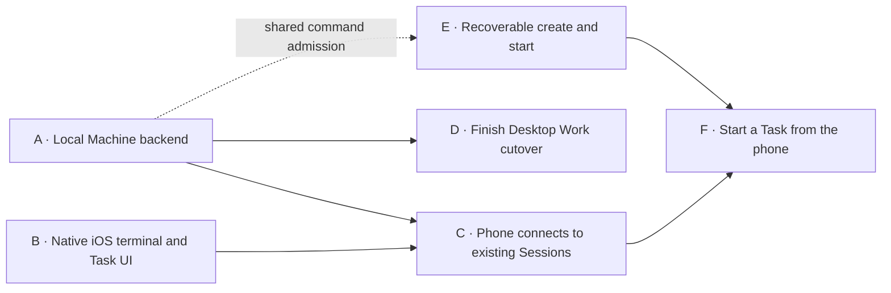

# Deliver Desktop and iOS against one Machine backend

Jack Heart requested a task plan separate from the design notes, with backend and frontend work able to start simultaneously. Jack invoked launch-plan to execute the first two lanes: reuse LOO-593 for A (Machine backend) and LOO-718 for B (native iOS client). The current conversation and worktree retain the native client and integration context. C–F remain named follow-ups; no dependency-only Tasks are filed now.

## Read the plan separately from the design

This document owns task outcomes, acceptance and dependencies. [Backend reference](mobile-backend.md) preserves the reviewed architecture; the working backend design is in [LOO-593](/Users/jack/src/loopflow.loo-593-decide-the-desktop/scratch/mobile-backend.md). [Native iOS design](mobile-ios.md) scopes the current frontend implementation. [Interactive review](mobile-backend-review.html) explains the system and questions. [Task-to-Session prototype](prototype-tasks.html) and [selected creation flow](mobile-new-task-flows.md) own the interaction direction. Detailed historical and installation evidence stays linked from the backend design.

The briefs below can be filed without pasting the architecture into their descriptions. Before launching another checkout, copy its required design/prototype files and relative dependencies into its scratch directory; a path into this checkout does not supply context. Preserve accepted constraints and acceptance criteria in the durable Task description before scratch cleanup. Do not start another Graph in this conversation to reach Jack.

## Parallel start and integration

**Start A and B together.** A owns the shared application contract; B supplies a real native consumer immediately. B can begin app structure, Desktop styling, renderer evaluation and native input without waiting for a running service. Agree the minimal contract early, then use shared recordings and fixtures for client development. Fixtures prove client behavior, not connectivity or host lifetime.

**C joins those lanes.** It delivers the first real phone-to-existing-Session experience. D can proceed alongside C; full Desktop migration need not block phone integration. E can start independently in the shared CLI after create/start semantics are selected and coordinate its admission fields with A. F consumes that operation. Remote setup exploration can begin during A/B, but C's completion requires their working paths.

The first joint demonstration is existing open Tasks → existing editable Session → disconnect/reconnect to the same provider. The first supported release requires A–D; new-Task creation requires E–F as well. No release retains a permanent alternate Work FFI route.

## The small contract that enables parallel work

A and B jointly settle these application semantics in the backend design and executable Rust/Swift fixtures. This is the first part of A, not a separate infrastructure-only Task. Avoid a new universal SDK or independent frontend domain model.

- Connection bootstrap: Machine identity, protocol capabilities and service-instance identity; explicit incompatible/unavailable results.
- Task readings: reuse existing Task/Session DTOs; initial complete reading, subsequent replacements, unavailable state and cancellation. Specify which existing Session a Task row opens, including no-live-Session behavior.
- Session attachment: existing identity, initial terminal state, ordered subsequent output, bounded-history gaps, ended state, and separate input/geometry authority. Distinguish observation from takeover; do not settle the takeover gesture through an accidental renderer default.
- Input: bytes or supported terminal actions, acknowledged control ownership and resize semantics. Reconnect never blindly replays uncertain input.
- Commands: request identity and resulting domain identities; acceptance, completion and unknown delivery are distinct. Keep correlation separate from execution ancestry.

Both lanes use the same fixture shapes and error cases. The backend implementation owns serialization truth; the Swift consumer must parse required/optional fields without silent defaults. Recorded terminal fixtures must represent the chosen snapshot/output contract, not an unrelated text transcript. A real-service integration test replaces fixture-only confidence in C.

## A · LOO-593 · Keep Desktop work running through a Machine backend

Desktop needs a backend that remains reachable when its windows close. Deliver an automatically obtained local service that serves a working Task-list subscription, an existing command and an existing Session attachment through a private socket. Delegate commands to `lf` and reuse the native shared readers. Keep Session and Graph execution independent of the service connection lifetime.

Acceptance:

- A representative Desktop Task flow uses the service end to end; selected migrated operations have no silent FFI fallback. CLI remains directly usable and produces equivalent state and attribution.
- Under the installed supervisor, Desktop quit and helper replacement preserve the same live Session owner/provider and Graph. Reconnect refreshes Work and terminal state without replaying input.
- Concurrent startup yields one service under the existing installation authority. Disabled registration, incompatible versions and unavailable reads are visible and recoverable.
- Concurrent requests retain separate attribution; command outcomes and provider usage remain explainable after disconnect/restart. Cancellation and slow subscribers release bounded resources.

Design: [service, lifetime and telemetry](mobile-backend.md). Settle signed Mac packaging before its installation implementation. Prove the chosen standalone Mac/Linux deployment promises separately; a successful development binary is not installed-service evidence. A is the local vertical proof; D explicitly owns the remaining Work cutover.

## B · LOO-718 · Use a native iOS Task list and editable terminal

Build the native Swift client for the selected two-screen experience: open Tasks, then the selected existing Session. Reuse Desktop typography and colors. Deliver the real terminal renderer and native keyboard/input behavior against the shared application contract while A builds the service.

Acceptance:

- Build and exercise an iOS target with Task selection, terminal rendering, input editing/submission and clear loading, disconnected and ended states. No Wave navigation, shell panes or extra inspector screens.
- Evaluate the preferred Ghostty-based path on iOS against actual renderer/input constraints; select and document a viable library rather than assuming macOS bindings work on iOS.
- Demonstrate keyboard resizing, multiline paste, selection, IME, hardware keyboard input and accessibility on simulator/device as appropriate. Verify generated input against a deterministic terminal harness; replay alone does not prove editing works.
- Development fixtures exercise the production client codec and shared DTOs, including replacement readings, gaps and control loss. Fixture mode is explicit and never masquerades as a connected Machine.
- Keep the reduced key bar. Contextual approvals/Stop require trustworthy state; do not infer actionable permissions from arbitrary terminal text.

Design: [MVP interaction](mobile-task-brief.md), [prototype](prototype-tasks.html), [native constraints](research-native-mobile.md). B can land a buildable, demonstrable native client before networking is complete; it does not claim the mobile MVP is delivered. LOO-718 is the selected home for this client and its integration, preserving this conversation and worktree.

## C · Connect the phone to existing work over host Tailscale

Connect B's client to A's Machine service. Detect host Tailscale and automate supported setup/discovery so a signed-in host is straightforward to pair. Enable remote admission separately from local service setup. Deliver the real existing-Task experience on a phone.

Acceptance:

- Pair with the intended Machine, list its open Tasks, open an existing Session and edit/submit input to that same provider. No phone CLI, embedded Tailscale, custom relay or required public hub.
- Implement the selected carrier and explicit device admission/revocation; do not inherit a local proxy's trusted identity as the remote caller. Preserve unrelated host networking configuration.
- Show signed-out, unreachable, revoked and incompatible states with useful recovery. Never fall through to execution on the wrong Machine.
- Prove control/geometry handoff with Desktop, background/network-loss recovery, retained-output gaps and service restart. Do not create a replacement Session or resend uncertain keys on reconnect.
- Verify Work attribution and provider usage across those events. Run against actual selected Mac/Linux hosting paths; retain explicit limits for sleep/logout/reboot.

Depends on A and B. Design: [trust and protocol](mobile-backend.md). Select carrier, pairing flow, first hosting tier and takeover gesture before their dependent implementation. The HTML review recommendations are not recorded choices.

## D · Make the socket the complete Desktop Work path

Finish moving Desktop Work operations to the Machine backend so maintaining mobile does not leave two Desktop execution routes. Preserve app-owned window automation and terminal rendering.

Acceptance:

- Inventory all Work FFI consumers, migrate them, and remove unused Work exports, wrappers and exclusive build/test wiring in the same change.
- Preserve reads, writes and watches, including initial/change/error/cancel behavior, Task results, defaults and attribution. Do not add service-specific orchestration.
- Desktop works through the installed service with honest startup/version failures. Ghostty rendering FFI and Desktop-only automation remain functional.

Depends on A; can run alongside C. Design: [cutover/removal boundary](mobile-backend.md). Complete before declaring the socket architecture supported; no indefinite fallback milestone.

## E · Recover a Task creation after an interrupted reply

Make the shared create/start operation recoverable so a lost response cannot silently file another Task. CLI and service callers use the same admission, domain writes and recovery.

Acceptance:

- Repeating the same request identity and payload recovers the original outcome; a changed payload cannot silently reuse that identity.
- Exercise interruption around external creation, local persistence and workflow launch. Reconcile provider evidence or report an explicit unknown outcome; a response cache alone is insufficient.
- Creation followed by launch failure returns the existing Task and permits recovering its launch. Defaults and execution destination match the declared operation; no implicit headless/Auto-Ship approval.
- Preserve original attribution and avoid duplicate usage/work accounting. Concurrency does not admit the same request twice.

Design: [create/start and reconnection](mobile-backend.md). Can start at the shared command boundary once launch semantics are selected; does not require the phone UI or completed networking. Coordinate request/receipt fields with A. It owns this operation's persistence/migration, not a service-only receipt store.

## F · Start a Task from the phone

Add the selected describe-first sheet: type or dictate an editable request, review/change the visible repository and Machine, then Create & start and enter its Session.

Acceptance:

- Preserve drafts through destination changes and back navigation; explicit submission starts work. Dictation availability does not block typing, and speech never silently sends.
- Use E's shared operation and show acceptance, creation, launch failure and unknown outcome accurately. Reconnect recovers the original Task instead of inviting a duplicate submission.
- Enter the returned Session with the established terminal/input behavior and preserve the chosen destination.

Depends on C and E; frontend sheet construction can begin during B. Design: [selected creation flow](mobile-new-task-flows.md). Native dictation is a candidate; third-party voice services, TTS and background voice agents are not implied by this Task.

## Coordinate existing work before filing or launching

Open PRs inspected November 3, 2026. Recheck at launch; this inventory is evidence, not a reservation of files.

| Existing work | Relationship and boundary |
|---|---|
| [PR #1809 · LOO-720](https://github.com/loopflowstudio/loopflow/pull/1809) | Terminal activity after reconnect; A/B/C consume its trustworthy status instead of adding another detector. |
| [PR #1807 · LOO-582](https://github.com/loopflowstudio/loopflow/pull/1807) | Session promotion/identity and terminal wire changes; preserve identities and rebase the shared attachment contract on its outcome. |
| [PR #1791 · LOO-673](https://github.com/loopflowstudio/loopflow/pull/1791) | Desktop Task-list behavior, FFI and query tests; A/D preserve the intended list semantics during transport replacement. |
| [PR #1656 · LOO-312](https://github.com/loopflowstudio/loopflow/pull/1656) | App activation and installation promotion; A extends its installation authority. Helper survival is still unproven there; packaging remains a design choice. |
| [PR #1805 · LOO-714](https://github.com/loopflowstudio/loopflow/pull/1805) | Agent/Graph defaults, reads and execution; E preserves its settings/default resolution rather than freezing old behavior. |
| [PR #1808 · Wave-change revert](https://github.com/loopflowstudio/loopflow/pull/1808) | Overlapping read/write DTO and RegistryQuery changes; Task attribution unresolved in this inspection. Reconcile the landed API before A/D change it. |

Existing design references also assign shell lifetime to LOO-717, Rex workspace opening to LOO-498, Desktop server roles to LOO-593, agent retention to LOO-709, terminal snapshots to LOO-710 and Session transport to LOO-712. Inspect their current status before touching those responsibilities; this plan does not create another retention owner. The launch-plan handoff reuses LOO-593 and LOO-718. Both take the existing feature Graph from implement to its interactive demo; Task status and comments record actual launch outcomes.

The future webhook hub, push notifications, file/diff panes and broad shell/workspace support remain later work. Preserve their architectural boundaries without implementing their features here.
